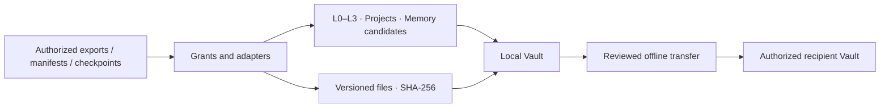

# AI Memory Hub — KI-Erinnerungen unter eigener Kontrolle
**Languages:** [English](README.md) · [简体中文](README.zh-CN.md) · [日本語](README.ja.md) · [한국어](README.ko.md) · [Español](README.es.md) · [Français](README.fr.md) · [Deutsch](README.de.md) · [Português (Brasil)](README.pt-BR.md) · [Русский](README.ru.md)
> **Dein Kontext. Deine Dateien. Deine Entscheidung.** Eine lokale, plattformneutrale Grundlage für langfristige KI-Erinnerungen, nachvollziehbare Projektarbeit und autorisierte Übergaben zwischen KI-Agenten.
**Version 2.2.0 · Python 3.11+ · MIT-Lizenz · Kommandozeile (CLI)**
Ein Chatverlauf ist noch kein verlässliches Langzeitgedächtnis. Entscheidungen verschwinden in langen Gesprächen, Anhänge verlieren ihren Zusammenhang und bei einem Wechsel des KI-Assistenten muss alles erneut erklärt werden. **AI Memory Hub** speichert ausdrücklich freigegebene Informationen, Herkunftsnachweise, Projektstände und **echte Dateiinhalte** in einem lokalen Vault – unabhängig von einzelnen KI-Anbietern.
## Welche Probleme löst das Projekt?
- **Kontinuität:** Ziele, Einschränkungen, Beschlüsse, überprüfte Ergebnisse, offene Fragen und nächste Schritte bleiben erhalten.
- **Nachvollziehbarkeit:** Quellen, Revisionen, Belege und SHA-256-Prüfsummen gehören zum Datensatz.
- **Verlässliche Dateien:** Hochgeladene Dateien und KI-Ergebnisse werden mitsamt ihren Versionen gespeichert – nicht bloß als möglicherweise ungültige Links.
- **Wechsel zwischen Agenten:** Geprüfter Kontext und ausdrücklich ausgewählte Dateiversionen lassen sich weitergeben.
- **Nutzerkontrolle:** Quellen und Schutzstufen werden separat freigegeben; wörtliche L3-Nachrichten benötigen zusätzliche Zustimmung.
## Was V2.2 tatsächlich kann
| Bereich | Implementierte Funktion |
| --- | --- |
| Langzeit-Erinnerungen | Kandidaten für Fakten, Vorlieben und Entscheidungen mit Prüfung; Chattext wird nicht automatisch als wahr übernommen |
| Vier Kontextebenen | L0 Index, L1 Zusammenfassung, L2 detaillierter Checkpoint, optional L3 mit sichtbaren Originalnachrichten und Quellennachweis |
| Projektkontinuität | Versionierte Stände, Entscheidungen, Nachweise und Aufgaben für Übergaben |
| Dateiverwaltung | Echte freigegebene Bytes, SHA-256-Deduplizierung, unveränderliche Revisionen und geprüfte Wiederherstellung |
| Datenimport | Lokale JSON-Dateien, explizite Manifeste aus Coding-Agenten, manuell bezogene ChatGPT-JSON- oder unterstützte ZIP-Exporte |
| Agentenübergabe | Offline-Pakete, Zustimmung beider Seiten, konkrete `ID@REV`-Dateiversionen, Byte-Prüfung im empfangenden Vault |
| Synchronisierung | Fünf unabhängige Schalter für wöchentlich, vollständig, ereignisbasiert, täglich und Übergabe |
| Wiederherstellung | Idempotente Wiederholungen, Versionshistorie, Sicherung, Restore und getesteter Rollback |
**Wichtig:** Die Funktionen wurden mit synthetischen Daten unter Windows und Ubuntu getestet. Die Software überwacht **nicht automatisch alle KI-Chats**, richtet keine Zeitplanung ein und bietet standardmäßig keine Cloud-Echtzeitsynchronisation.
## Architektur

Ein **Vault** ist ein vom Besitzer kontrolliertes lokales Verzeichnis **außerhalb von Git**. Es verwendet einen SQLite-Index und inhaltsadressierte Datei-Blobs. Jede Instanz besitzt genau eine Schutzklasse; Betriebssystemrechte sichern den Zugriff. Für unterschiedliche Empfänger sind getrennte Konten oder Speichergrenzen erforderlich.
L0 benennt eine Konversation, L1 fasst sie zusammen, L2 enthält Ziele, Entscheidungen, Prüfungen und nächste Aufgaben. L3 bewahrt nach **gesonderter Freigabe** echte sichtbare Nachrichten samt Originalquelle und Revision auf. Spätere L2-Änderungen überschreiben oder erfinden keine historischen L3-Texte.
## Typische Szenarien
**Projekt mit einem anderen KI-Agenten fortführen:** Anforderungen, verworfene Ansätze, Tests und offene Arbeit als L2 sichern und ein geprüftes Übergabepaket versenden. Anhänge sind auf ausgewählte Versionen beschränkt.
**KI-Ergebnisse archivieren:** Eingabedateien als `user_upload` und erstellte Ergebnisse als `ai_generated` markieren. Selbst nach Verlust der Quelldatei bleibt die bereits gespeicherte Version überprüfbar.
**ChatGPT-Verläufe importieren:** Den eigenen Export auf offiziellem Weg herunterladen, den lokalen JSON/ZIP-Pfad freigeben und importieren. Für L3-Rohtext und Dateianhänge sind eigene Berechtigungen nötig.
## Schnellstart mit synthetischen Beispielen
Voraussetzung ist **Python 3.11 oder neuer**. Im geklonten Repository kann `python -m pip install .` ausgeführt werden. Unter Windows PowerShell, unter Linux/macOS ein Terminal verwenden. Der Vault muss **außerhalb des Repository-Verzeichnisses** liegen.
```sh
python -m ai_memory_hub --root ../hub-demo init --preset ordinary
python -m ai_memory_hub --root ../hub-demo source grant demo normalized --path examples --consent
python -m ai_memory_hub --root ../hub-demo local run --source demo
python -m ai_memory_hub --root ../hub-demo local status
python -m ai_memory_hub --root ../hub-demo session show calibration-session --layer L2
python -m ai_memory_hub --root ../hub-demo asset check calibration-notes
python -m ai_memory_hub --root ../hub-demo asset copy calibration-notes --consent
```
Das Manifest `examples/memory-hub.json` enthält vier synthetische Einträge einschließlich einer Datei. Erneute Importe kennzeichnen unveränderte Daten, statt Duplikate zu erzeugen. `asset copy` erzeugt eine überprüfte Kopie innerhalb des Vaults.
### Freigegebene Quellen importieren
Zuerst den Vault initialisieren. Ein Verzeichnis mit `memory-hub.json` per `source grant ID normalized --path PATH --consent` freigeben; anschließend `local run --source ID` und `local status` ausführen. Für ChatGPT den Adapter `chatgpt_export` mit einer bereits heruntergeladenen unterstützten `.json`- oder `.zip`-Datei wählen. `--allow-raw` nur bei ausdrücklicher L3-Zustimmung setzen. Eine globale Chatüberwachung existiert nicht. Siehe [Adapter](docs/adapters.md) und [Deployment](docs/deployment.md).
### Projekt zwischen unabhängigen Vaults übertragen
`handoff` ist standardmäßig deaktiviert. Auf beiden Seiten aktivieren und die freigegebenen Dateirevisionen gezielt auswählen.
```sh
python -m ai_memory_hub --root ../hub-demo config set handoff on
python -m ai_memory_hub --root ../hub-demo transfer pack --project greenhouse-demo --asset calibration-notes@1 --consent
python -m ai_memory_hub --root ../recipient init --preset ordinary
python -m ai_memory_hub --root ../recipient config set handoff on
python -m ai_memory_hub --root ../recipient transfer receive --input APPROVED_COPY.zip --consent
python -m ai_memory_hub --root ../recipient transfer inspect PACKAGE_ID --consent
python -m ai_memory_hub --root ../recipient transfer file PACKAGE_ID calibration-notes@1 --consent
```
`APPROVED_COPY.zip` bezeichnet das zuvor geprüfte Paket, das über einen separat genehmigten sicheren Kanal kopiert wird. `PACKAGE_ID` stammt aus der Empfangsantwort. **Das ZIP ist unverschlüsselt.** SHA-256 prüft die Integrität, **nicht die Identität des Absenders**. L3 und nicht ausgewählte Dateien werden nicht übertragen.
## Fünf unabhängige Schalter
| Schalter | Standard | Bedeutung |
| --- | --- | --- |
| `weekly` | Ein | Wöchentlicher Einstiegspunkt, installiert aber keinen Scheduler |
| `full` | Ein | Manueller Gesamt- oder Quellenimport |
| `event` | Aus | Expliziter autorisierter Ereignisaufruf |
| `daily` | Aus | Optionaler täglicher Nachlauf |
| `handoff` | Aus | Explizite Übergabe |
Mit `config set FEATURE on|off` ändern. `local run --source ID` verwendet normalerweise `full`. Lokale wöchentliche Archivierung und cloudseitige Erinnerungsverwaltung sind unterschiedliche Ausführungsumgebungen. Ein eingeschalteter Schalter beweist keine tatsächlich aktive Zeitplanung.
## Datenschutz, Grenzen und Kompatibilität
Der Vault wird nicht von der Anwendung verschlüsselt. Betriebssystemrechte, Festplattenverschlüsselung und Backups müssen gesondert eingerichtet werden. Das Entziehen einer Quellenfreigabe stoppt zukünftiges Lesen, löscht aber keine gespeicherten Revisionen. Transfer-ZIPs sind unverschlüsselt und dürfen nur über einen freigegebenen Kanal an berechtigte Empfänger gehen. Ein externer Link ist kein bereits gespeicherter Dateiinhalt.
Die Anwendung ist V2.2.0 und unterstützt weiterhin das Datensatzschema `2.1`; das Offline-Transferformat trägt die Version 2.2. Vor Updates eine Sicherung erstellen und das Upgrade an einer wiederhergestellten Kopie prüfen.
## Dokumentation und Mitwirkung
[Einrichtung, Backup und Transfer](docs/deployment.md) · [Benutzerhandbuch](docs/guide.md) · [Adapter](docs/adapters.md) · [Protokoll](docs/protocol.md) · [Sicherheit](SECURITY.md) · [MIT-Lizenz](LICENSE)
Für Beiträge ausschließlich synthetische Daten verwenden, keine privaten Exporte oder Anhänge veröffentlichen. Tests: `python -m pip install jsonschema`, `python -m unittest discover -s tests -v`, `python scripts/smoke_release.py` und `python scripts/smoke_v22.py`.
**Veröffentlichungsstand:** Der V2.2-Kern ist implementiert und synthetisch getestet. Die öffentliche Freigabe des GitHub-Repositories und ein offizielles Release 2.2.0 sind eigenständige Veröffentlichungsschritte.
