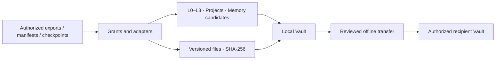

# AI Memory Hub — La mémoire IA qui vous appartient
**Languages:** [English](README.md) · [简体中文](README.zh-CN.md) · [日本語](README.ja.md) · [한국어](README.ko.md) · [Español](README.es.md) · [Français](README.fr.md) · [Deutsch](README.de.md) · [Português (Brasil)](README.pt-BR.md) · [Русский](README.ru.md)
> **Votre contexte, vos fichiers, votre contrôle.** Une infrastructure locale et indépendante des plateformes pour la mémoire à long terme, la continuité des projets et la transmission autorisée entre agents IA.
**Version 2.2.0 · Python 3.11+ · Licence MIT · Interface en ligne de commande (CLI)**
Un historique de conversation ne constitue pas à lui seul une mémoire fiable. Les décisions se perdent dans les échanges, les pièces jointes se détachent de leur contexte et changer d’assistant impose de tout réexpliquer. **AI Memory Hub** conserve les informations **explicitement autorisées**, leur provenance, l’état des projets et les octets réels des fichiers sélectionnés dans un Vault local, indépendant des fournisseurs d’IA.
## Pourquoi l'utiliser ?
- **Reprendre sans repartir de zéro :** objectifs, contraintes, décisions, vérifications, questions ouvertes et prochaines actions.
- **Tracer les sources :** provenance, révisions, éléments de preuve et empreintes SHA-256 des fichiers.
- **Conserver les vrais fichiers :** versions des documents fournis par l’utilisateur et des livrables produits par l’IA, au-delà d’un simple lien.
- **Changer d’agent :** transmettre uniquement le contexte relu et les versions de fichiers approuvées.
- **Respecter le consentement :** choisir les sources et les niveaux de sensibilité ; les messages bruts L3 nécessitent une autorisation supplémentaire.
## Fonctions incluses dans V2.2
| Fonction | Comportement |
| --- | --- |
| Mémoire durable | Candidats de faits, préférences et décisions, soumis à validation ; le texte d’un chat ne devient pas automatiquement une vérité acceptée |
| Quatre couches de conversation | L0 index, L1 résumé, L2 point de suivi détaillé, L3 facultatif contenant des messages visibles et leur source |
| Continuité des projets | Historique des objectifs, décisions, preuves, jalons et tâches restantes |
| Fichiers versionnés | Conservation des octets approuvés, déduplication SHA-256, versions immuables et récupération vérifiée |
| Importation | JSON local, manifeste explicite d’agent de programmation, export ChatGPT JSON ou ZIP pris en charge et téléchargé par l’utilisateur |
| Transmission entre agents | Archive hors ligne, accord de l’émetteur et du destinataire, versions précises `ID@REV`, vérification dans le Vault de destination |
| Synchronisation | Cinq interrupteurs indépendants : hebdomadaire, complète, événementielle, quotidienne et transmission |
| Résilience | Reprises idempotentes, historique, sauvegarde/restauration et tests de retour en arrière |
**Limite importante :** ces fonctions ont été validées avec des données synthétiques sous Windows et Ubuntu. Elles ne permettent **pas** de surveiller automatiquement toutes les conversations IA, d’installer un planificateur ou d’activer une synchronisation cloud en temps réel.
## Architecture

Un **Vault** est un répertoire local contrôlé par son propriétaire, placé hors du dépôt Git. Il utilise un index SQLite et des fichiers stockés selon leur empreinte de contenu. Chaque instance dispose d’un niveau de sensibilité ; les permissions du système d’exploitation protègent l’accès. Des identités ou des espaces de stockage distincts sont nécessaires pour des publics différents.
L0 identifie la conversation, L1 la résume, L2 garde objectifs, décisions, vérifications et prochaines étapes. L3 conserve les messages visibles réels **avec autorisation supplémentaire**, en préservant leur origine et leur révision. Une modification L2 n’altère jamais artificiellement l’historique L3.
## Exemples d’utilisation
**Passer à un autre agent IA :** conserver les exigences, solutions rejetées, résultats de tests et actions restantes, puis envoyer un dossier de transmission vérifié avec éventuellement des versions de fichiers choisies.
**Archiver les livrables :** enregistrer les fichiers reçus comme `user_upload` et les résultats créés comme `ai_generated`. Retrouver la version archivée même si la source change ou disparaît.
**Importer son historique ChatGPT :** télécharger l’export via le parcours officiel, autoriser le JSON/ZIP local, puis importer. Les messages littéraux exigent une autorisation distincte ; les pièces jointes aussi.
## Démarrage rapide sur des données fictives
Vous avez besoin de **Python 3.11 ou supérieur**. Depuis le dépôt cloné, vous pouvez installer le paquet avec `python -m pip install .`. Utilisez PowerShell sous Windows ou un terminal sous Linux/macOS. Le Vault doit rester **en dehors du dépôt**.
```sh
python -m ai_memory_hub --root ../hub-demo init --preset ordinary
python -m ai_memory_hub --root ../hub-demo source grant demo normalized --path examples --consent
python -m ai_memory_hub --root ../hub-demo local run --source demo
python -m ai_memory_hub --root ../hub-demo local status
python -m ai_memory_hub --root ../hub-demo session show calibration-session --layer L2
python -m ai_memory_hub --root ../hub-demo asset check calibration-notes
python -m ai_memory_hub --root ../hub-demo asset copy calibration-notes --consent
```
Le manifeste `examples/memory-hub.json` sélectionne quatre entrées synthétiques, dont un fichier. Une deuxième exécution signale les éléments inchangés sans duplication. `asset copy` crée une copie locale dont le contenu est vérifié.
### Importer une source réellement autorisée
Initialisez un Vault, puis utilisez `source grant ID normalized --path PATH --consent` pour un dossier qui contient `memory-hub.json`. Exécutez ensuite `local run --source ID` et consultez `local status`. Pour ChatGPT, choisissez `chatgpt_export` et votre fichier `.json` ou `.zip` compatible déjà téléchargé. Ajoutez `--allow-raw` uniquement si l’enregistrement du contenu L3 a été approuvé. Aucun espion global des discussions n’est fourni. Consultez les [adaptateurs](docs/adapters.md) et le [guide de déploiement](docs/deployment.md).
### Transférer un projet vers un Vault indépendant
La fonction `handoff` est désactivée par défaut. Activez-la des deux côtés et choisissez chaque version de fichier qui sera transmise.
```sh
python -m ai_memory_hub --root ../hub-demo config set handoff on
python -m ai_memory_hub --root ../hub-demo transfer pack --project greenhouse-demo --asset calibration-notes@1 --consent
python -m ai_memory_hub --root ../recipient init --preset ordinary
python -m ai_memory_hub --root ../recipient config set handoff on
python -m ai_memory_hub --root ../recipient transfer receive --input APPROVED_COPY.zip --consent
python -m ai_memory_hub --root ../recipient transfer inspect PACKAGE_ID --consent
python -m ai_memory_hub --root ../recipient transfer file PACKAGE_ID calibration-notes@1 --consent
```
`APPROVED_COPY.zip` est une copie du paquet relu, envoyée par un canal sûr et autorisé. `PACKAGE_ID` est fourni lors de la réception. **Le ZIP n’est pas chiffré** ; SHA-256 vérifie l’intégrité, **pas l’identité de l’expéditeur**. Les messages L3 et les fichiers non sélectionnés ne sont pas inclus.
## Cinq interrupteurs indépendants
| Option | Par défaut | Effet |
| --- | --- | --- |
| `weekly` | Activée | Point d’entrée hebdomadaire ; aucun planificateur n’est installé |
| `full` | Activée | Import complet ou ciblé à la demande |
| `event` | Désactivée | Événement explicitement autorisé |
| `daily` | Désactivée | Complément quotidien facultatif |
| `handoff` | Désactivée | Transmission explicite entre agents |
Modifiez-les avec `config set FEATURE on|off`. `local run --source ID` utilise `full` par défaut. L’archivage hebdomadaire local et la gestion de mémoire dans le cloud sont des processus distincts. Une option activée ne prouve pas qu’une tâche planifiée a effectivement tourné.
## Confidentialité, limites et compatibilité
Le Vault n’est pas chiffré par l’application : configurez droits OS, chiffrement du disque et sauvegardes. Retirer une autorisation empêche les lectures futures, sans effacer automatiquement les révisions déjà conservées. Les archives ZIP de transfert ne sont pas chiffrées et nécessitent un destinataire et un canal approuvés. Une URL externe reste une référence tant que les octets ne sont pas stockés.
La version logicielle est 2.2.0, avec compatibilité du schéma des enregistrements `2.1` et une enveloppe de transfert 2.2. Sauvegardez le Vault et testez toute mise à jour sur une copie restaurée.
## Documentation et contribution
[Déploiement et récupération](docs/deployment.md) · [Guide complet](docs/guide.md) · [Adaptateurs](docs/adapters.md) · [Protocole](docs/protocol.md) · [Sécurité](SECURITY.md) · [Licence MIT](LICENSE)
Pour contribuer, utilisez des données fictives et ne publiez jamais d’exports personnels. Vérifications : `python -m pip install jsonschema`, `python -m unittest discover -s tests -v`, `python scripts/smoke_release.py` et `python scripts/smoke_v22.py`.
**Publication :** le noyau V2.2 a été implémenté et validé avec des données synthétiques. La mise en public du dépôt et la création d’une Release officielle 2.2.0 restent deux opérations distinctes.
