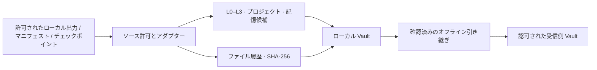

# AI Memory Hub — 自分で管理できる AI メモリ基盤
**Languages:** [English](README.md) · [简体中文](README.zh-CN.md) · [日本語](README.ja.md) · [한국어](README.ko.md) · [Español](README.es.md) · [Français](README.fr.md) · [Deutsch](README.de.md) · [Português (Brasil)](README.pt-BR.md) · [Русский](README.ru.md)
> **会話の文脈も、ファイルも、管理権限もあなたのもの。** AI サービスに依存しない、ローカル優先の長期メモリ・プロジェクト継続・AI エージェント間引き継ぎのための基盤です。
**バージョン 2.2.0 · Python 3.11 以上 · MIT ライセンス · CLI**
長い AI チャットには、重要な判断や試行錯誤が埋もれます。添付ファイルと生成物は文脈から切り離され、別の AI に作業を渡すと同じ説明を繰り返すことになります。**AI Memory Hub** は、明示的に許可した会話の文脈、証拠、プロジェクト状態、実ファイルのバイト列を、特定の AI 事業者から独立したローカル Vault に記録します。
## 解決したい課題
- **作業を再開しやすくする：** 目的、制約、決定、検証結果、未解決事項、次の手順を保存します。
- **出典を追跡する：** 保存内容には出典、履歴、証拠、ファイルの SHA-256 を関連付けます。
- **リンクだけでなく実ファイルを保存する：** ユーザーの添付物と AI の成果物をバージョン管理します。
- **エージェントを切り替えられる：** 承認した情報と特定バージョンのファイルだけを引き継ぎます。
- **取得範囲を選べる：** ソースと機密レベルを明示し、原文（L3）は別途承認します。
## V2.2 で利用できる機能
| 機能 | 内容 |
| --- | --- |
| 長期メモリ候補 | 事実、好み、決定の候補とレビュー。チャット本文を自動的に確定済み事実へ昇格させません |
| 会話の 4 層 | L0 索引、L1 要約、L2 詳細チェックポイント、任意の L3 出典付き可視メッセージ |
| プロジェクトの継続性 | 状態、判断、検証、未完了作業の履歴と引き継ぎ |
| ファイル保管 | 承認されたアップロード・AI 生成ファイルの実バイト、SHA-256 重複排除、履歴、検証付き取り出し |
| 入力アダプター | ローカル JSON、明示的マニフェスト、コーディング Agent の作業領域、取得済み ChatGPT JSON/対応 ZIP |
| AI 間の引き継ぎ | オフライン ZIP、双方の同意、指定 `ID@REV`、受信 Vault での実バイト確認 |
| 同期ポリシー | 週次・手動全量・イベント・日次・引き継ぎの 5 つの独立スイッチ |
| 障害復旧 | 重複しない再実行、出典と履歴の保存、バックアップ、復元、ロールバック検証 |
**実装済みと自動運用は別です。** Windows と Ubuntu の合成データテストを通過していますが、すべての AI のチャットを自動監視したり、クラウド同期や定期実行を勝手に設定する製品ではありません。
## アーキテクチャ

**Vault** は Git リポジトリ外に作る利用者管理のローカルディレクトリで、SQLite の索引と内容ハッシュによるファイル保存を利用します。1 つの Vault は 1 つの機密区分を扱い、OS のアクセス制御で保護します。
L0 は会話の識別、L1 は概要、L2 は目標・決定・検証・次の行動、L3 は別途同意を得た実際の可視メッセージです。L2 を更新しても過去の L3 原文や出典は書き換えません。
## 活用例
**別の AI でプロジェクトを継続：** 課題、却下した案、検証結果、残作業を L2 に残し、確認した引き継ぎパッケージで受け渡します。ファイルは選択した版だけ転送できます。
**生成した成果物の保管：** ユーザーの元ファイルを `user_upload`、AI の生成物を `ai_generated` として登録し、後から同じバージョンを検証・復元します。
**ChatGPT の履歴を読み込む：** 公式手順で自身のエクスポートを取得し、そのローカル JSON/ZIP の読み取りを明示的に許可します。可視メッセージ本文には追加承認が必要で、添付ファイルは別途登録します。
## 5 分で試す（合成データ）
Python 3.11 以上が必要です。リポジトリをチェックアウトし、必要なら `python -m pip install .` を実行してください。Windows は PowerShell、Linux/macOS はターミナルを使用します。Vault は必ずリポジトリの**外**に作成してください。
```sh
python -m ai_memory_hub --root ../hub-demo init --preset ordinary
python -m ai_memory_hub --root ../hub-demo source grant demo normalized --path examples --consent
python -m ai_memory_hub --root ../hub-demo local run --source demo
python -m ai_memory_hub --root ../hub-demo local status
python -m ai_memory_hub --root ../hub-demo session show calibration-session --layer L2
python -m ai_memory_hub --root ../hub-demo asset check calibration-notes
python -m ai_memory_hub --root ../hub-demo asset copy calibration-notes --consent
```
`examples/memory-hub.json` にはファイルを含む 4 件の合成データがあります。再実行しても同じデータは重複登録されません。`asset copy` は検証済みファイルのコピーを Vault 内に作ります。
### 許可した実データの取り込み
Vault を初期化してから、`memory-hub.json` を持つ明示的なディレクトリを `source grant ID normalized --path PATH --consent` で登録し、`local run --source ID` を実行します。`local status` で読み取り結果と失敗・成功状態を確認します。
ChatGPT には `chatgpt_export` と取得済み `.json` / 対応 `.zip` を指定します。L3 を保存する場合のみ追加の `--allow-raw` を許可します。自動的なプラットフォーム監視機能はありません。詳細は[入力アダプター](docs/adapters.md)と[導入ガイド](docs/deployment.md)を参照してください。
### 別 Vault へのプロジェクト引き継ぎ
`handoff` は初期状態では無効です。両方の Vault で有効化し、転送するファイル版を個別に選びます。
```sh
python -m ai_memory_hub --root ../hub-demo config set handoff on
python -m ai_memory_hub --root ../hub-demo transfer pack --project greenhouse-demo --asset calibration-notes@1 --consent
python -m ai_memory_hub --root ../recipient init --preset ordinary
python -m ai_memory_hub --root ../recipient config set handoff on
python -m ai_memory_hub --root ../recipient transfer receive --input APPROVED_COPY.zip --consent
python -m ai_memory_hub --root ../recipient transfer inspect PACKAGE_ID --consent
python -m ai_memory_hub --root ../recipient transfer file PACKAGE_ID calibration-notes@1 --consent
```
`APPROVED_COPY.zip` は送信側が作成した、確認済みパッケージを安全な経路でコピーしたものです。`PACKAGE_ID` は受信時に返される識別子です。**ZIP は暗号化されません。** SHA-256 は完全性を検証しますが、送信者の本人確認にはなりません。L3 と未指定ファイルは送信されません。
## 5 つの独立スイッチ
| 設定 | 通常モードの初期値 | 動作 |
| --- | --- | --- |
| `weekly` | ON | 週次処理の入口。スケジューラー自体はインストールしません |
| `full` | ON | 手動の全量・選択ソース取り込み |
| `event` | OFF | 明示的なイベント呼び出し |
| `daily` | OFF | 任意の日次補完 |
| `handoff` | OFF | 明示的な引き継ぎ |
`config set FEATURE on|off` で変更します。`local run --source ID` は初期状態で `full` を使用します。クラウド側のメモリ管理タスクとローカルのアーカイブ実行は別です。スイッチが ON でも本番の定期実行が確認されたことにはなりません。
## プライバシー、制限、更新
Vault 自体にはアプリ内暗号化がなく、OS 権限・ディスク暗号化・バックアップ管理を利用者が設定します。ソースの許可を取り消すと今後の読み取りを止めますが、保存済み履歴は自動削除されません。オフライン ZIP は暗号化されないため、安全な転送手段と受信者の承認が必要です。URL 参照と、バイト列を実際に保存したファイルは別物です。
ソフトウェアの版は 2.2.0、既存レコードのスキーマは互換性のため `2.1` のままです。引き継ぎには別途 2.2 形式を使用します。アップグレード前にバックアップし、復元したコピーで試してください。
## ドキュメントと貢献
[導入・バックアップ・転送](docs/deployment.md) · [利用ガイド](docs/guide.md) · [アダプター](docs/adapters.md) · [データ仕様](docs/protocol.md) · [セキュリティ](SECURITY.md) · [MIT ライセンス](LICENSE)
開発や不具合報告には合成データを使い、個人のエクスポートや添付ファイルをコミットしないでください。テストは `python -m unittest discover -s tests -v`、`python scripts/smoke_release.py`、`python scripts/smoke_v22.py` で実行できます（必要に応じて `python -m pip install jsonschema`）。
**公開状況：** V2.2 のコアは実装・合成テスト済みですが、GitHub リポジトリの一般公開と正式な 2.2.0 Release は別の手続きです。
