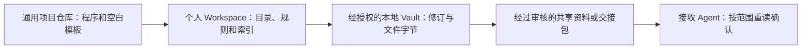

# AI Memory Hub

**语言 / Languages：** [简体中文](README.md) · [English](docs/i18n/README.en.md) · [日本語](docs/i18n/README.ja.md) · [한국어](docs/i18n/README.ko.md) · [Español](docs/i18n/README.es.md) · [Français](docs/i18n/README.fr.md) · [Deutsch](docs/i18n/README.de.md) · [Português (Brasil)](docs/i18n/README.pt-BR.md) · [Русский](docs/i18n/README.ru.md)

---
**把 AI 的长期记忆变成用户自己掌控、可以迁移和持续维护的资料体系。**
AI Memory Hub 提供完整的**个人记忆工作区模板 + 本地 Vault 归档引擎**，用于组织长期事实、会话检查点、项目、文件、人生档案，以及不同 Agent 之间经授权的交接和版本确认。
**V2.3.0** · Python 3.11+ · MIT · 本地优先 · 当前项目仓库仍为 **Private**，未正式公开发布。
**新用户从这里开始：** [让你的 Agent 协助初始化（中文）](docs/agent-onboarding.zh-CN.md) · [English onboarding](docs/agent-onboarding.md) · [手动安装及命令](docs/workspace.md)
## 一、这是什么？适合谁？
你可以把它理解为一套**长期私人资料的组织方法、治理规则和实际可运行的存储程序**，而不是把所有聊天复制到一个大文件里。
- **个人用户**：希望更换 AI 后仍能找回自己的偏好、项目进展、决策和文件版本。
- **使用多个 Agent 的人**：希望让不同工具在获准范围内读取相同背景、接续任务并确认自己读到哪一版。
- **开发者与长期项目维护者**：需要长期检查点、历史修订、来源与证据、文件真实字节归档。
- **希望建立人生档案的人**：可以从 12 个类别、52 个二级领域、134 个字段逐渐补充，不必一次填写完整。
**它不是什么？** 它不是能自动读取所有 AI 账号的服务、不是云端同步平台，也不是将原始聊天或健康记录默认上传至 GitHub 的程序。功能可用性取决于 Agent 的实际工具权限、数据来源和用户授权。
## 二、首次使用：让你的 AI 帮你搭建
这应当是普通用户最主要的入口。你可以把当前仓库交给有**仓库读取、必要的本地执行能力**的 Agent，让它按 [Agent 首次部署协议](docs/agent-onboarding.zh-CN.md) 完成已获准的步骤，并把不能完成的事项集中反馈。
### 用户只需表达目标
```text
请阅读这个 AI Memory Hub 仓库的 README.md、AGENTS.md
和 docs/agent-onboarding.zh-CN.md。
我想建立属于自己的私人记忆中枢。
先盘点你实际拥有的工具和可访问数据，再提出最少的
必要授权；不要假定能读取所有历史聊天或文件。
可自主完成安全的安装、空白初始化和合成测试。
建立个人 GitHub 私有仓库、读取真实来源、写入远端、
启用自动调度前，应获得我明确的权限及范围确认。
按目录整理有来源的候选记忆、会话、项目和资产，
不能把未核实的推断当成正式事实。
结束时报告已完成事项、证据、资料缺口、待我补充的
内容，以及五种同步开关和真实调度状态。
```
### Agent 应当遵循的顺序
| 阶段 | 允许自主完成的部分 | 需要用户提供或批准的部分 |
| --- | --- | --- |
| **① 识别环境** | 阅读入口和规范，盘点 GitHub/文件/命令/数据导出能力 | 无法访问的账号、平台及数据范围 |
| **② 初始化** | 安装程序，创建独立 Workspace 和 Vault，检查 19 个模块与空档案 | 合法本地路径；涉及实际系统的执行权限 |
| **③ 整理来源** | 对已经获准、实际可读的数据生成 L0–L2、项目检查点、候选和文件清单 | 具体来源授权；L3 原文、敏感文件需另行许可 |
| **④ 审核与发布** | 去重、冲突建议、生成待审核资料及 Git 提交计划 | 正式记忆激活、远端写入、共享范围和私有仓库创建批准 |
| **⑤ 交付与维护** | 检查数据覆盖、来源回执、同步状态，列出资料缺口与操作说明 | 是否部署定时任务、备份策略及将来变更权限 |
**当前版本的实际限制**：这是一套可执行的引擎加操作协议，尚**没有内置一键创建 GitHub 仓库、遍历任意 AI 账号历史、自动形成并推送完整个人仓库的通用编排器**。有足够权限和工具的 Agent 可以协助完成若干步骤，但“阅读 README”本身不会赋予它 GitHub 写权限或历史聊天访问权。
[Agent 首次部署与交付清单](docs/agent-onboarding.zh-CN.md) · [真实数据来源支持范围](docs/adapters.md) · [当前能力对照](docs/workspace-parity.md)
## 三、关键能力：为什么这样设计？
### 会话采用 L0–L3，而不是只存一份全文
| 层级 | 内容与目的 | 什么时候用 |
| --- | --- | --- |
| **L0 · 索引** | 会话标题、ID、关联项目和版本定位 | 找到曾经讨论过该问题的会话 |
| **L1 · 摘要** | 在索引上增加实际提供的概括 | 快速确认是否相关 |
| **L2 · 结构化检查点** | 目标、要求、约束、决策、否决方案与理由、验证、下一步、文件引用 | 长期项目换 Agent 后直接接续 |
| **L3 · 可选原文** | 实际归档的可见消息、来源和原始修订证据 | 需要核实原话时额外授权读取 |
四层是**按需深入的视图**，不是自动生成的四份摘要。不存在的内容不会被编造；L3 需要额外同意，只允许在 `private` 或 `restricted` Vault 中保存和读取。新 L2 检查点不会改写已经归档的历史 L3。
[会话协议](docs/protocol.md) · [实际查询方式](docs/guide.md) · [会话索引](sessions/README.md)
### 长期记忆要经过候选、审批、单独激活
只把经验证的信息加入正式事实视图：候选提取 → 核对来源和时间 → 比较同键重复或冲突 → 明确审核 → **另行激活**。更新时保留前后版本和替代关系；没有证据的推断留在候选，不能因为 Agent 自称“确认过”就写成事实。
[记忆治理流程](workflows/memory-lifecycle.md) · [候选入口](candidates/README.md)
### 文件存真实字节，不把链接当成文件
获准的用户上传和 AI 生成文件可进入本地内容寻址 Vault，使用 **SHA-256** 核对原始字节、记录文件版本并关联会话与项目；外部链接只作为引用与观察状态。交接时单独选择**具体文件版本**，而不是把整个 Vault 发出去。
[文件操作](docs/guide.md) · [资产版本](assets/README.md) · [离线交接](docs/deployment.md)
### 共享版本必须由每个 Agent 自行确认
`detected_sha` 表示发现了哪个快照；`synced_sha` 表示该 Agent 已完成获准变更范围的读取确认。不同 Agent 的状态独立；读取失败返回 `unknown`。同步回执不能证明 Agent 真正理解了内容，也不等于第三方 AI 服务的内置记忆已更新。
[版本检测与重读](integrations/memory-bootstrap.md)
### 其他重要设计
- **人生档案**：12 类、52 个领域、134 个带来源/有效期/敏感度的字段，初始化均为 `unknown`，按实际经历和证据逐步补全。
- **幂等重试**：导入按来源与条目记录回执，未变化返回 `unchanged`；缺失和失败单独报告，不把一次部分成功说成全量完成。
- **项目连续性**：目标、历史取舍、检查点、验证证据和下一步与资产版本关联。
- **分离存储**：可复用模板、个人 Workspace 和本地 Vault 各有不同角色；共享 Git 仓库不等于敏感原始资料数据库。
[人生档案与字段](life-archive/README.md) · [项目模板](projects/TEMPLATE.md) · [同步说明](workflows/hybrid-sync.md)
## 四、资料分别放在哪里？

| 位置 | 主要用途 | 默认能否上传 GitHub？ |
| --- | --- | --- |
| **通用代码仓库** | `AGENTS.md`、`core/`、`memory/`、`projects/`、`sessions/`、`life-archive/`、`integrations/`、`workflows/`、程序和模板 | 公开产品文件经过发行审计 |
| **用户 Workspace** | 个性化分类、身份/规则、人生档案、待审核项目与索引 | **默认全部忽略**；只允许另行审查后选取的资料 |
| **用户 Vault** | SQLite 修订、授权来源、真实文件字节、原文与回执 | **不能默认上传**；使用本地权限与备份机制 |
| **用户自己的私有仓库（可选）** | 经用户批准的非敏感结构化记忆、项目摘要、工作流和引用索引 | 需要独立授权创建、审查与提交；Private 不等于端到端加密 |
默认工作区的 `.gitignore` 使用拒绝式规则。**不能为了“自动完成”直接运行 `git add -f .` 将所有个人资料推送远端。** 需要 Git 同步时，应建立专门的**经过审核的投影**，对 L3 原文、敏感字段和附件采用单独授权的存储路径。
[19 模块完整覆盖](docs/workspace-parity.md) · [安全边界](core/boundaries.md) · [Agent 归档与提交规则](docs/agent-onboarding.zh-CN.md)
## 五、安装与快速体验
### 环境与初始化
准备 Python 3.11+，在已经获准获取的源代码根目录执行。初始化会在仓库外建立个人工作区与独立 Vault，默认**零数据源授权、零后台定时任务**。
```sh
python -m pip install .
ai-memory-hub workspace init --path ../my-hub
ai-memory-hub workspace check --path ../my-hub
```
### 合成示例：从导入到按层读取
首次使用请选一个新的测试目录；`--demo` 只准备合成数据，**真正读取仍需明确授权**。
```sh
ai-memory-hub workspace init --path ../hub-demo --demo
ai-memory-hub workspace check --path ../hub-demo
ai-memory-hub --root ../hub-demo-vault source grant sample normalized \
  --path ../hub-demo/demo-inbox --consent
ai-memory-hub --root ../hub-demo-vault local run --source sample
ai-memory-hub --root ../hub-demo-vault session show calibration-session --layer L0
ai-memory-hub --root ../hub-demo-vault session show calibration-session --layer L1
ai-memory-hub --root ../hub-demo-vault session show calibration-session --layer L2
ai-memory-hub --root ../hub-demo-vault memory review
ai-memory-hub --root ../hub-demo-vault asset check calibration-notes
ai-memory-hub --root ../hub-demo-vault local status
```
L2 中可看到**已记录**的取舍、验证和待办，系统不会自动生成不存在的 L3 原文。真实来源如 ChatGPT 导出或 Codex 工作区只能通过实际受支持的格式、获得访问权后导入；原始聊天 L3 需额外授权。
### 审批、跨 Agent 读取与文件交接

以下多行示例使用 POSIX Shell 的 `\` 续行符；在 Windows PowerShell 中请将每条命令合并为一行，或使用 PowerShell 的反引号续行。
```sh
ai-memory-hub --root VAULT candidate suggest CANDIDATE_ID --consent
ai-memory-hub --root VAULT candidate advance CANDIDATE_ID validated \
  --base 0 --record-revision 1 --actor reviewer \
  --reason "Source checked" --consent
ai-memory-hub --root VAULT candidate history CANDIDATE_ID --consent
ai-memory-hub --root RECEIVER_VAULT version check --channel shared \
  --agent agent-b --snapshot APPROVED_JSON --consent
ai-memory-hub --root RECEIVER_VAULT version reload --channel shared \
  --agent agent-b --scope rules --consent
ai-memory-hub --root RECEIVER_VAULT version confirm --channel shared \
  --agent agent-b --sha DETECTED_SHA \
  --receipt READ_RECEIPT --consent
ai-memory-hub --root OWNER_VAULT transfer pack --project greenhouse-demo \
  --asset calibration-notes@1 --consent
ai-memory-hub --root RECEIVER_VAULT transfer receive --input APPROVED_COPY.zip --consent
ai-memory-hub --root RECEIVER_VAULT transfer inspect PACKAGE_ID --consent
ai-memory-hub --root RECEIVER_VAULT transfer file PACKAGE_ID calibration-notes@1 --consent
```
这部分为**命令形态示意**：大写 ID、Vault 路径、读取回执、审批修订号均需要替换成真实返回值；传输前要先开启并获准使用 `handoff`，接收端 Vault 要独立初始化。记忆审批需按完整状态机经过审查、批准和单独激活，不能仅执行上面三行就视为完成。
[一步步安装](docs/workspace.md) · [候选完整审批](workflows/memory-lifecycle.md) · [跨 Agent 共享版本](integrations/memory-bootstrap.md) · [离线交接与恢复](docs/deployment.md)
## 六、同步、权限与运行维护
### 五种开关不是五个自动任务
| 开关 | 普通模式初始值 | 实际含义 |
| --- | --- | --- |
| `weekly` | 开 | 每周归档入口；**不会自动建立计划任务** |
| `full` | 开 | 用户主动执行的全量/指定来源读取 |
| `event` | 关 | 已获准的事件触发入口 |
| `daily` | 关 | 额外的每日补漏运行入口 |
| `handoff` | 关 | 已授权的项目和文件版本交接 |
**配置开启 ≠ 实际执行成功 ≠ 已读取所有来源 ≠ 已同步到 GitHub。** 调度安装、凭据作用域、来源读取、运行结果和备份恢复都需要分别验证。可用 `config show`、`local status` 查看已有的记录；没有运行证据时应报告 `not_verified`。
### 数据和安全边界
- 只对**实际可访问且用户明确授权**的来源进行导入；不要让一位 Agent 冒充拥有所有历史会话、平台记忆或文件。
- L3 原文、健康/财务等高敏信息、私有附件、仓库写入以及长期自动化，均需要单独说明范围和许可。
- 撤销来源授权只停止后续读取，不自动清除此前已经归档的历史修订；Git 提交历史中的内容也不会因删除现行文件而消失。
- Vault 和传输 ZIP **本身不提供应用层加密**，需要依靠操作系统权限、磁盘加密与用户认可的安全传输方式。
- 不同 Agent 各自确认共享记忆版本；实际 Git 仓库同步与快照重读是不同机制。
[安全说明](SECURITY.md) · [权限约束](core/boundaries.md) · [导入和重试](docs/guide.md) · [本地备份恢复](docs/deployment.md)
## 七、当前已实现什么？还缺什么？
| 能力 | 当前真实状态 |
| --- | --- |
| 完整 19 模块工作区和独立 Vault 初始化 | **已实现，已进行合成测试** |
| 12/52/134 人生档案分类和缺口检查 | **已实现**；初始数据全部 `unknown` |
| 会话 L0–L3、项目检查点、真实文件版本 | **已实现引擎**，具体内容须从实际获准来源提供 |
| 候选去重、审查、独立激活和修订追溯 | **已实现** |
| 授权快照的逐 Agent 版本读取与确认 | **已实现**；并非第三方平台自动共享内部记忆 |
| **让任意 Agent 一键新建用户私有 GitHub 仓库** | **尚无内置通用编排器**；有授权 GitHub 工具的 Agent 可以协助操作 |
| **自动获取所有 AI 平台记忆、会话及附件** | **不具备通用访问能力**；依赖平台提供的导出和授权连接 |
| **自动形成按目录分类的可审阅 Git 投影与提交** | **尚未作为完整端到端功能实现**；工作区默认拒绝跟踪 |
| **首次完整性报告、待补资料和同步部署向导** | 可以通过本仓库 [Agent 操作协议](docs/agent-onboarding.zh-CN.md)指导完成，但尚无平台无关的一键执行器 |
| 自动周期归档、远端 Git 同步与生产备份 | **默认不安装、不执行**；需用户另行配置和验收 |
| 健康原始数据自动读取 | **未实现为通用功能**；仅支持去标识化健康汇总校验 |
| 公开 Release | **未执行**，通用仓库仍是 Private |
**当前阶段**：通用存储引擎、组织模板和审查机制已完成；“交给任意 AI 就自动部署、分类导入、创建仓库并持续更新”的**一站式 Agent 产品体验尚待补齐**。请勿把“有引导文档”误当作“自动化已经验收通过”。
[能力对照与测试证据](docs/workspace-parity.md) · [Agent 首次使用协议](docs/agent-onboarding.zh-CN.md) · [GitHub Actions](.github/workflows/test.yml)
## 八、长期目标
**用户只需把通用项目交给自己信任的 AI，经过必要的授权，就能拥有一套长期可维护、独立于单一平台的私人记忆中枢。**
我们追求的是：自动化能做的让 Agent 完成，身份与权限由用户掌控，未经核实的信息保留为候选，敏感原文留在适当的私有存储中，长期同步有可验证的结果。
这不是“无条件保存一切”，而是**把真正值得长期保留的信息，变成有证据、有版本、有范围、有退出机制的个人数字资产**。
