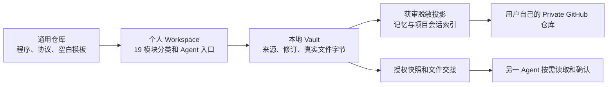

# AI Memory Hub

**语言 / Languages：** [简体中文](README.md) · [English](docs/i18n/README.en.md) · [日本語](docs/i18n/README.ja.md) · [한국어](docs/i18n/README.ko.md) · [Español](docs/i18n/README.es.md) · [Français](docs/i18n/README.fr.md) · [Deutsch](docs/i18n/README.de.md) · [Português (Brasil)](docs/i18n/README.pt-BR.md) · [Русский](docs/i18n/README.ru.md)

---

**一个由用户自主掌控、面向长期积累和多 Agent 协作的个人 AI 记忆中枢。**

将分散在 AI 对话、人生经历、项目和文件中的长期信息，逐步整理为**可检索、可理解、可更新、可追溯、可授权迁移**的个人资料体系。它关注的不仅是让 AI“记住”信息，更是**应该长期保存什么、如何在未来使用、怎样保证来源可靠以及如何掌握控制权**。

**定位：** 个人长期记忆库 · 人生档案 · 项目与决策知识库 · 会话和文件归档 · 跨 Agent 协作上下文

**原则：** 用户拥有数据 · 模型中立 · 按需读取 · 来源可验证 · 更新可审核 · 敏感数据最小授权

**版本：** V2.4.0 · Python 3.11+ · MIT License · 本地优先

**首次使用：** 可直接将本仓库和第五章中的指令交给具备相应工具权限的 AI / Agent；不必先手动学习命令行安装。

## 一、主要功能

### 1. 为不同 AI 提供可复用的长期背景

授权的 AI 工具可以通过统一入口读取同一套资料，获取用户的稳定偏好、重要约束、协作规则和当前任务相关的项目背景。新 Agent 不必完全依赖某个服务内部的聊天记忆，也不需要默认阅读全部私人档案。

[Agent 统一入口](AGENTS.md) · [任务导航](core/INDEX.md)

### 2. 持续构建个人的人生档案

以 **12 个一级类别、52 个二级领域、134 个注册字段**整理个人经历、学习、工作、生活、目标及重大事件。每项记录可保留来源、时间、敏感等级和证据状态。

这是一套可以逐年补充和修订的档案体系，而非一次性填写的用户简介。没有可靠资料的字段保持 `unknown`，不会为了填满档案而编造内容。

[人生档案结构](life-archive/README.md) · [字段注册表](life-archive/field-registry.json)

### 3. 保存长期偏好、规则与协作习惯

把可重复使用的沟通偏好、工作规范、交付标准、禁止事项和 AI 协作方式组织为独立资料，同时区分**事实、偏好、规则、决策、推断和待核实信息**。

一次性的对话要求不会被自动视为永久规则；某个平台特有的功能也不会被误当成所有 Agent 都具备的能力。

[核心规则与索引](core/) · [长期记忆](memory/)

### 4. 分层管理会话与历史上下文（L0–L3）

会话不仅保存摘要，还可以保留继续任务所需的结构化检查点和可核查的原始来源。

| 层级 | 保存内容 | 主要作用 |
| --- | --- | --- |
| **L0 · 索引** | 会话标识、标题、关联项目与版本 | 找到相关历史对话 |
| **L1 · 摘要** | 实际提供的讨论概括 | 判断会话是否与当前任务相关 |
| **L2 · 检查点** | 目标、约束、决定、被否决方案及原因、验证结果、待办与文件引用 | 中断后接续项目、跨 Agent 交接 |
| **L3 · 原文** | 另行授权保存的真实可见消息、来源与修订记录 | 需要时核对原话和证据 |

**设计细节：** 优先读取较浅层级，需要核对时再逐步深入。L0–L3 不是自动生成的四份摘要；未保存的内容不会被虚构。L3 须单独授权并保留在受保护的本地 Vault，后续修改 L2 不会覆盖历史原文。

[会话协议](docs/protocol.md) · [会话目录](sessions/)

### 5. 保持长期项目的上下文连续性

按项目沉淀目标、需求、架构约束、关键决策、历史方案、已验证成果、未解决问题和下一步任务，并关联对应会话及文件版本。

再次启动项目时，可以先回答**已经完成什么、为何采用当前方案、哪些结论验证过、还缺什么**，而不只是重新读取上万字聊天记录。

[项目档案](projects/) · [项目模板](projects/TEMPLATE.md)

### 6. 归档文件原件并追踪版本

用户授权的上传文件和 AI 生成成果可以保存真实字节、SHA-256 校验值、来源及版本，并关联原始项目或会话。文件多次更新后仍可核对指定历史版本。

系统区分**外部链接、文件引用和真正已归档的文件原件**：只有链接时不会假称文件已保存，更不会自动读取未经授权的附件。

[文件资产](assets/) · [文件操作与恢复](docs/guide.md)

### 7. 审核长期记忆的新增、更正和冲突

新发现的信息先形成候选，再执行来源验证、去重、冲突分析和审核；即使候选获得批准，也需**单独授权激活**才进入正式事实视图。

更正、撤销、替代和历史修订均可追溯。AI 的推断或不完整证据不会自动升级为已确认事实。

[记忆治理](workflows/memory-lifecycle.md) · [候选记录](candidates/)

### 8. 检测跨 Agent 的记忆版本变化

不同 Agent 可以使用相同的共享版本资料，但各自保留读取进度。`detected_sha` 表示发现了新版本，`synced_sha` 表示已经按变化范围重新读取并确认。

**发现更新不等于完成同步。** 来源不可达、读取不完整或未经确认时，系统如实报告状态，不会声称已更新模型自身的原生记忆。

[跨 Agent 版本协议](integrations/memory-bootstrap.md)

### 9. 协助创建和维护用户自己的私人仓库

V2.4 提供可执行的首次部署编排：评估当前工具与数据访问能力、初始化完整工作区和本地 Vault、归档已授权资料、生成待审核的共享内容，以及汇报资料缺口。

经用户分别批准后，还可建立 **Private GitHub 仓库**，生成可导航的 **19 模块结构**，并把审阅通过的脱敏记忆、项目和会话索引放入对应目录。原始对话、未授权文件、Vault 数据库和凭据不会被默认提交。

**自动化有明确条件：** Agent 必须实际拥有相应工具和访问权限；真实 GitHub 建库发布尚未在获授权的真实测试账号完成端到端验收。

[首次部署流程](docs/agent-onboarding.zh-CN.md) · [功能覆盖](docs/workspace-parity.md)

## 二、保存的信息领域

信息分类是资料的**组织范围**，并不意味着安装后已拥有所有相应数据。

### 人生档案：12 类长期信息

| 类别 | 主要收录方向 |
| --- | --- |
| **01 · 基础身份** | 个人基本背景、语言、地域与身份资料边界 |
| **02 · 童年与成长** | 生活阶段、成长经历、重要变化与影响 |
| **03 · 教育与学习** | 教育经历、学习过程、技能与学习目标 |
| **04 · 职业与事业** | 工作履历、岗位、项目实践、职业发展 |
| **05 · 性格与价值观** | 沟通倾向、行为习惯、价值判断与决策原则 |
| **06 · 人际与社会关系** | 家庭、亲友、工作关系及个人边界 |
| **07 · 健康与生活** | 生活方式、健康经历、检查资料及数据来源 |
| **08 · 财务与现实条件** | 收支、生活成本、财务规划及现实约束 |
| **09 · 目标与未来规划** | 阶段目标、长期愿景、兴趣和旅行计划 |
| **10 · AI 协作与决策** | AI 使用偏好、工作流、技术取舍与长期规则 |
| **11 · 人生重大事件** | 里程碑、重要转折、成就及事件时间线 |
| **12 · 资料收集与维护** | 来源、覆盖缺口、敏感度、修订和访问管理 |

除此之外，系统还整理**长期规则与决策、项目和技术知识、工具及 Skills、会话检查点、文件版本与协作流程**。这些内容按类别进入相应模块，而不是全部混合在一份用户画像中。

健康相关的通用扩展目前仅支持**明确授权的去标识化汇总校验**；私人版特有的健康原始记录同步并未随通用版发布。

[人生档案入口](life-archive/) · [知识与项目](knowledge/) · [工具及接入](integrations/)

## 三、典型使用场景

| 使用情境 | 系统提供的支持 |
| --- | --- |
| **第一次使用新的 AI / Agent** | 按授权范围读取统一入口、稳定偏好和必要背景 |
| **恢复中断数月的项目** | 利用 L2 检查点、决策与下一步计划恢复上下文 |
| **将任务交给另一个 AI** | 传递经授权的项目摘要、规则及指定文件版本 |
| **寻找某次讨论的依据** | 从 L0 索引逐层定位到 L2 结论或获准的 L3 原文 |
| **修正错误或过时的记忆** | 创建候选，核对历史来源，审批后替代旧记录 |
| **回顾个人成长和生活变化** | 根据 12 类人生档案及时间线查阅已确认资料 |
| **迁移到自己的私人仓库** | 发布获准的脱敏索引与模块结构，原件继续本地保存 |
| **判断多个 Agent 是否读取了更新** | 分别检查版本检测、重读范围和确认状态 |

上述场景依赖实际存在的资料及访问权限；系统不能仅凭用户授权声明就从所有 AI 平台自动提取隐藏历史。

## 四、数据结构与设计原则

系统使用**统一入口 → 分类导航 → 结构化资料 → 原始来源或历史版本**的组织方式，同时把私人原件和可共享信息隔离。



| 组织层次 | 核心目录与职责 |
| --- | --- |
| **通用入口与规则** | `AGENTS.md`、`core/`、`config/`：任务导航、偏好、权限和策略 |
| **个人及项目资产** | `life-archive/`、`memory/`、`projects/`、`knowledge/`、`sessions/`、`assets/` |
| **协作与接入** | `collaboration/`、`integrations/`、`workflows/`：多 Agent 交接、工具能力与流程 |
| **审核与质量保障** | `candidates/`、`schemas/`、`scripts/`、`tests/`、`.github/`：候选、格式及测试 |
| **示例及交付资料** | `examples/`、`docs/`、`vendor/`：示例、使用说明及受控依赖 |

这里的 19 模块是**完整的分类与导航骨架**，不是 19 个自动取得真实个人数据的平台连接。首次发布的私人 Git 仓库保留可共享的分类资料；敏感原始数据及文件字节仍留在独立本地 Vault。

**维护原则：** 无来源的内容保持待核实；已批准的事实保留历史；Agent 只读取当前任务需要的范围；仓库版本变更后需要按范围重新确认。

[模块结构对照](docs/workspace-parity.md) · [任务导航](core/INDEX.md)

## 五、开始使用

### 将通用仓库交给自己的 AI / Agent

普通用户**不需要从安装 Python、配置数据库或学习 Git 命令开始**。只需把以下指令复制给具备仓库访问和文件执行能力的 Agent，由它读取项目说明、评估环境并推进能够实际执行的部分。

```text
项目仓库：
https://github.com/ranchen-love/ai-memory-hub-v2-1-review
请先读取 README.md、AGENTS.md 和
docs/agent-onboarding.zh-CN.md，核对实际功能和权限。
我的目标是建立一套由我掌控的私人 AI 记忆中枢。
请基于这个通用项目，自主完成以下工作：
1. 盘点你实际拥有的执行工具、GitHub 权限，
   以及可以合法访问的会话、记忆和文件来源。
2. 在安全的新目录中建立完整的 19 模块个人
   Workspace 和独立 Vault，完成初始化检查。
3. 整理已获授权、实际可读取的历史信息；
   分类保存长期偏好、规则、人生档案、
   L0–L3 会话、项目检查点和文件版本。
4. 核对来源，识别重复、冲突和不确定信息；
   未证实的内容保留为候选，不直接激活。
5. 为我准备独立的 Private GitHub 仓库；
   只将逐条审阅和脱敏批准的资料按目录发布，
   原始消息、私人附件和 Vault 保持本地隔离。
6. 检查同步策略、来源覆盖、各 Agent 版本状态；
   经我授权后配置可用的后续更新和调度方式。
普通低风险操作请自主推进，不要反复逐项询问。
创建仓库、读取敏感来源、激活正式记忆、
远端提交及持续自动化，须集中说明并取得授权。
不允许把未获得的权限或未执行的步骤说成完成。
最后提供实际成果、仓库地址、数据覆盖、
缺失信息、待我补充的事项、同步状态和验收报告。
如遇工具或权限不足，请保留已有成果并说明阻断项。
```

**使用前提：** 当前通用仓库仍是 **Private**。尚未获得仓库访问权限的 Agent 或其他用户，无法仅凭上述 URL 阅读源码；正式对外开放前应先提供合法访问方式。

实际使用时，用户只需核对 Agent 汇总提出的关键授权与脱敏内容，并查看最终报告。**不需要自己照着 README 逐条执行命令**。若使用的 Agent 没有本地命令执行或 GitHub 写入能力，应改用具备相关工具的执行环境，或让 Agent 说明尚未完成的步骤。

[Agent 端到端操作指南](docs/agent-onboarding.zh-CN.md) · [安装与故障排查](docs/workspace.md)

## 六、隐私、安全与控制权

- **用户决定**哪些资料进入长期记忆、哪些需要核实、哪些可共享，以及什么时间和范围可以执行远端操作。
- **默认隔离**个人 Workspace、本地 Vault 和 Git 发布投影。Private GitHub 仓库不等于端到端加密；原始聊天、敏感档案、文件原件、访问凭据不会默认写入 Git 历史。
- **逐项审批**私人资料的脱敏投影，并绑定来源修订、审阅摘要及目标仓库身份。通过规则检查不代表可以省略用户对普通文字中私人细节的审核。
- **按需归档与同步**。`weekly` 和 `full` 是默认启用的策略入口；`daily`、`event`、`handoff` 默认关闭。启用策略并不意味着系统已安装定时器、完成读取或提交远端。
- **保留可追溯证据**。撤销来源读取权限不会自动删除此前的历史修订或 Git 提交；Vault 及离线传输文件本身不提供应用层加密。

[安全说明](SECURITY.md) · [授权边界](core/boundaries.md) · [同步与备份](docs/deployment.md)

## 七、当前建设状态与适用范围

**已实现并经过合成测试：** V2.4.0 的首次部署 `onboarding plan/apply/report`、独立 Workspace/Vault、19 模块、12/52/134 档案结构、会话 L0–L3、长期记忆候选审批、文件版本、逐 Agent 版本确认，以及经过逐条审核的私人 Git 分类投影。Windows、Ubuntu 与发行安全检查已通过。

**仍需真实环境验证：** 不同 Agent 的实际执行与数据权限、真实 GitHub 账号的 Private 仓库创建/发布、不同平台可导出的历史范围、用户对脱敏内容的审核，以及持续调度和备份的实际运行。

**不属于已实现的通用能力：** 自动读取所有 AI 服务的隐藏记忆和全部聊天附件、无需授权的持续采集、私人版健康原始数据全量同步。

通用仓库当前尚未公开，也未创建正式 Release。项目功能可供具备权限的 Agent 使用，但不能将模拟远端测试表述为实际账号的生产验收。

## 八、文档导航与长期方向

对首次使用者，建议直接使用第五章指令；需要深入排查或开发时，再按需查看：

| 文档 | 用途 |
| --- | --- |
| [Agent 统一入口](AGENTS.md) | 说明 Agent 从哪里开始读取、如何遵守授权边界 |
| [Agent 初始化指南](docs/agent-onboarding.zh-CN.md) | 详细命令、资料来源、脱敏审批与私有仓库发布 |
| [手动安装与恢复](docs/workspace.md) | 本地环境、演示、版本兼容与恢复 |
| [会话分层协议](docs/protocol.md) | L0–L3、项目检查点及证据来源 |
| [记忆生命周期](workflows/memory-lifecycle.md) | 候选、冲突、审批、激活与追溯 |
| [共享版本协议](integrations/memory-bootstrap.md) | 逐 Agent 检测、按范围重读与确认 |
| [功能与模块覆盖](docs/workspace-parity.md) | 19 模块结构、已实现功能及范围说明 |

长期目标是让用户用自己的 AI **在得到必要授权后建立、维护和迁移独立的记忆体系**，让可重复使用的背景、规则、经验、决策和项目成果能够持续沉淀，而不是随着一次会话结束而失去上下文。
