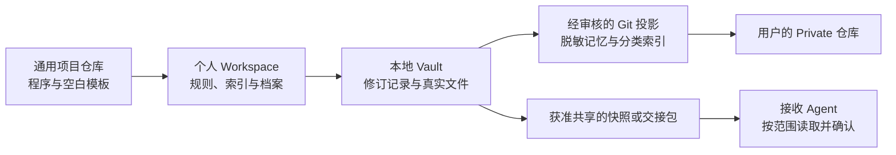

# AI Memory Hub

**语言 / Languages：** [简体中文](README.md) · [English](docs/i18n/README.en.md) · [日本語](docs/i18n/README.ja.md) · [한국어](docs/i18n/README.ko.md) · [Español](docs/i18n/README.es.md) · [Français](docs/i18n/README.fr.md) · [Deutsch](docs/i18n/README.de.md) · [Português (Brasil)](docs/i18n/README.pt-BR.md) · [Русский](docs/i18n/README.ru.md)

---

AI Memory Hub 是一套**用户自主掌控、面向多 Agent 协作的长期记忆管理系统**。项目提供标准化个人工作区、可追溯的本地资料归档、记忆审核机制，以及经授权的跨 Agent 共享与私人仓库发布能力。

**当前版本：** V2.4.0 · Python 3.11+ · MIT License · 本地优先

**发布状态：** 项目仓库目前仍为 Private，尚未建立正式公开 Release。

**新用户入口：** [复制 Agent 初始化指令](#41-可直接复制的初始化指令)，由 Agent 完成可执行的配置与资料整理。

[Agent 初始化指南](docs/agent-onboarding.zh-CN.md) · [安装与演示](docs/workspace.md) · [Agent 接入规范](AGENTS.md)

## 一、项目概述

本项目旨在将分散于 AI 对话、项目记录和文件中的长期有效信息，整理为**具有明确来源、版本、适用范围与授权边界的个人数字资产**。资料由用户持有，可以在满足访问条件时供不同 AI 工具使用，不依赖单一模型的内置会话记忆。

系统适用于需要长期项目连续性、多 Agent 上下文交接、文件版本追溯或个人知识与人生档案整理的用户。

核心原则是**有证据地归档、按需提供、审核后生效、受控地共享**。仓库包含程序和去个人化模板，不包含作者的私人记忆，也不会在安装后自动读取各 AI 平台的全部历史记录。

## 二、系统架构与数据组织

系统将可复用程序、个人工作区、原始资料存储和共享仓库分开管理。



| 组成部分 | 职责 | 数据边界 |
| --- | --- | --- |
| **通用项目仓库** | 提供程序、19 个模块的结构模板、Schema、测试与说明 | 不存放真实个人资料 |
| **个人工作区（Workspace）** | 组织 Agent 入口、长期规则、人生档案、项目与会话索引 | 初始化后独立于产品仓库，默认禁止 Git 跟踪 |
| **本地资料库（Vault）** | 持久化来源、修订、真实文件字节、可选原始消息与执行回执 | 独立本地存储，依赖操作系统权限保护 |
| **个人 Private GitHub 仓库** | 保存用户逐条审核后允许共享的记忆、项目、会话索引及模块结构 | 可选；与 Vault 分离，敏感原件不默认上传 |

用户仓库首次获准发布时可生成**19 个可导航模块**，其中已审记忆、项目和会话索引分别进入相应目录。私人工作区的全部内容不等同于可发布内容；Private Git 仓库也不等同于加密保险库。

[完整模块对照](docs/workspace-parity.md) · [权限与安全原则](core/boundaries.md)

## 三、核心能力与设计机制

### 3.1 会话分层归档（L0–L3）

系统按任务所需的资料深度组织会话，避免每次接续工作都需要重新读取完整历史。

| 层级 | 资料结构 | 使用目的 |
| --- | --- | --- |
| **L0 · 会话索引** | 标题、标识、关联项目、版本定位 | 检索和定位相关会话 |
| **L1 · 会话摘要** | L0 信息及已提供的内容摘要 | 判断与当前任务的相关性 |
| **L2 · 结构化检查点** | 目标、约束、决策、被否决方案与原因、验证结果、待办事项及文件引用 | 恢复长期项目上下文 |
| **L3 · 原始消息（可选）** | 实际获准归档的可见消息、来源及历史修订 | 核对原始表达和证据 |

L0–L3 是**逐层增强的资料视图**，不是四份自动生成的摘要。不存在的原始资料不会被补造；L3 仅在额外授权下于 `private` 或 `restricted` Vault 中保存和读取。后续更新 L2 不会改写已归档的历史 L3。

### 3.2 长期记忆治理

持续有效的事实、偏好和规则先进入候选流程，经来源验证、重复与冲突检查、审核和**独立激活**后，才进入正式记忆视图。修订、撤销与替代关系保留历史记录；未经证实的推断不自动转换为事实。状态转换由 `candidate advance` 执行，并要求精确的修订与授权。

### 3.3 人生档案与项目连续性

人生档案按 **12 个一级类别、52 个二级领域、134 项注册字段**组织，支持来源、时间、有效期和敏感等级校验。所有字段初始为 `unknown`，需要由真实资料逐步补充。

项目模块记录目标、范围、关键决策、验证证据、文件版本及后续任务，供授权 Agent 从检查点继续工作。

### 3.4 文件资产及版本追溯

获准的用户上传件和 AI 生成件可按真实字节归档，以 SHA-256 校验，关联来源、会话、项目及指定版本。外部 URL 仅作为引用；未保存的文件不能宣称已完成本地归档。

### 3.5 多 Agent 版本确认

共享记忆采用逐 Agent 版本基线：`detected_sha` 代表检测到的版本，`synced_sha` 代表已完成指定范围读取并确认的版本。未确认或来源不可用时不得宣称同步完成；接收端按范围读取后，使用 `version confirm` 明确确认。读取回执不代表模型理解了内容，也不等于第三方平台的内置记忆已更新。

[会话协议](docs/protocol.md) · [候选审核机制](workflows/memory-lifecycle.md) · [共享版本协议](integrations/memory-bootstrap.md)

## 四、Agent 辅助初始化

新用户无需先掌握 Python、Git 或记忆库内部的数据格式。**将项目仓库交给具备相应工具的 AI/Agent，发送一次初始化指令，即可从环境检查开始，尽可能自主完成个人记忆中枢的建立。**

**推荐流程：提供仓库 → 复制指令 → Agent 检查环境并初始化 → 经授权整理资料 → 审核后建立私人仓库 → 交付成果、缺口报告与同步方案。**

### 4.1 可直接复制的初始化指令

```text
请帮我建立一套属于自己的私人 AI 记忆中枢。
通用项目仓库：
https://github.com/ranchen-love/ai-memory-hub-v2-1-review
请先阅读 README.md、AGENTS.md 和
docs/agent-onboarding.zh-CN.md，遵循项目既有规范。
先核实你实际拥有的文件、历史会话和 GitHub 工具权限。
在可执行范围内自主完成：
1. 安装并初始化完整 Workspace 和独立 Vault。
2. 整理我已授权且你确实能访问的长期记忆、
   会话、项目、文件与人生档案，并保留来源。
3. 进行分类、去重、冲突检查与缺失信息梳理；
   未证实的信息保留为候选，不编造成正式事实。
4. 在我批准账号、仓库名和发布范围后，
   创建我的 GitHub Private 仓库及完整模块结构。
5. 将经我审核的脱敏资料归入对应目录，
   核验提交结果；原文、附件和 Vault 不默认上传。
6. 说明后续同步、备份与跨 Agent 使用方式；
   只有我明确授权后才能启用持续调度。
安全且可验证的步骤请连续完成，不必反复征询。
需要真实数据读取、远端写入、敏感资料处理等权限时，
集中说明用途、范围和影响，再请求我确认。
最后提交已完成事项、真实证据、未完成原因、
需要我补充的资料与确认事项，以及同步运行状态。
```

### 4.2 交付内容与必要授权

Agent 应优先完成环境识别、空白工作区创建、合成检查及获准资料的整理。涉及**个人 GitHub 仓库创建、敏感数据读取、正式记忆激活、脱敏内容发布、持续调度**等行为，需要用户对具体对象和范围分别批准。

完成后应提供**本地工作区与 Vault、可选的 Private 仓库、已分类资料、来源与版本记录、待补信息清单，以及同步与备份说明**。没有执行或无法验证的步骤必须如实列明，不得报告为成功。

**当前项目仓库仍为 Private**，陌生用户须先获得读取权限；未来仓库正式公开后，才能直接通过上述链接访问。Agent 也必须具备相应的执行和数据访问能力。

[Agent 首次部署完整指南](docs/agent-onboarding.zh-CN.md) · [接入规范](AGENTS.md) · [支持的数据来源](docs/adapters.md)

## 五、主要应用场景

| 使用场景 | 系统提供的支持 |
| --- | --- |
| **迁移至新的 AI 工具** | 按授权范围读取长期偏好、规则和重要历史信息，减少重复介绍 |
| **恢复中断的项目** | 通过 L2 检查点、决策依据、文件版本和待办事项接续任务 |
| **多人或多 Agent 协作** | 以经审核的共享资料和版本确认机制减少上下文差异 |
| **长期整理个人资料** | 以 12/52/134 人生档案体系逐步完善有来源的记录与时间线 |
| **保存工作成果与附件** | 归档经过授权的真实文件字节、历史版本及相关项目 |
| **更正或更新长期记忆** | 审查候选、识别冲突、保留替代记录，必要时同步到私人仓库 |

系统的价值并非要求 AI 记住全部历史，而是让**重要信息能够持续积累、按需调用，并在工具变化时保留连续性**。

## 六、隐私与同步机制

**个人资料由用户掌控。** 本地 Vault 保存资料修订和获准文件；可选的私人 GitHub 仓库只接收用户审核过的脱敏索引与结构化内容。原始聊天、未经批准的附件、凭据和本地数据库不会被默认推送到 Git 历史。仓库标记为 Private 并不意味着资料已经加密。

**同步分为不同环节**：发现来源变化、归档与校验、审阅可共享内容、更新私人仓库、由接收 Agent 重读确认。它们有不同的权限和完成回执，不能把某一步的成功等同于全部同步完成。

系统支持 `weekly`、`full`、`event`、`daily`、`handoff` 五种策略入口；开关启用不等于安装了后台定时任务。Agent 应在交付时告知用户：哪些来源已接入、上次实际执行结果、是否配置了周期运行、失败时如何处理，以及需要用户继续授权的事项。

[权限与安全](SECURITY.md) · [同步流程](workflows/hybrid-sync.md) · [备份与恢复](docs/deployment.md)

## 七、实现状态与使用条件

V2.4 已实现 **Agent 首次部署流程、19 模块个人工作区、12/52/134 人生档案、L0–L3 会话归档、记忆审核、文件版本、跨 Agent 版本确认，以及经审核的私人仓库分类投影**。相关程序在 Windows、Ubuntu 和合成数据场景下通过测试。

实际部署效果取决于 Agent 的本地执行能力、GitHub 账号权限、用户授权及各 AI 平台可提供的数据。**真实 GitHub 账号建库和发布流程尚未完成独立实测**；无法自动访问所有 AI 平台隐藏的历史会话，也不默认启用生产调度或健康原始数据同步。

[功能覆盖与验收范围](docs/workspace-parity.md)

## 八、文档与维护

本 README 负责说明**项目定位、能力设计与使用入口**，具体安装参数和技术协议交由独立文档维护。

[首次部署与私人仓库发布](docs/agent-onboarding.zh-CN.md) · [本地部署手册](docs/workspace.md) · [会话协议](docs/protocol.md) · [记忆治理](workflows/memory-lifecycle.md) · [跨 Agent 版本确认](integrations/memory-bootstrap.md) · [项目维护约定](docs/readme-sync.md)
