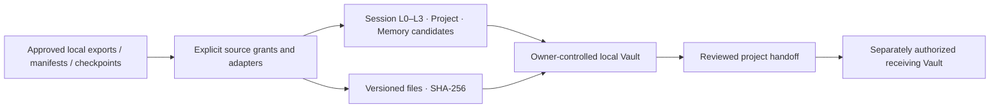

# AI Memory Hub
**Languages:** [English](README.md) · [简体中文](README.zh-CN.md) · [日本語](README.ja.md) · [한국어](README.ko.md) · [Español](README.es.md) · [Français](README.fr.md) · [Deutsch](README.de.md) · [Português (Brasil)](README.pt-BR.md) · [Русский](README.ru.md)
> **Your context. Your files. Your control.** A local-first, platform-neutral foundation for lasting AI memory, verifiable project continuity, and selective handoffs between AI agents.
**Current version: 2.2.0 · Python 3.11+ · MIT License · Command-line interface (CLI)**
AI conversations are useful—but a conversation history alone is not a dependable long-term project workspace. Decisions become buried, attachments lose their context, and switching assistants can mean explaining everything again. **AI Memory Hub** gives you an independent, versioned place to preserve *authorized* context, its evidence, and the actual files associated with it, without tying your archive to one AI provider.
It is built for people using several AI tools, developers running coding agents, and anyone who wants a portable record of why a project reached its current state. The core runs locally and does **not** require a hosted AI service.
## Why it exists
- **Continuity instead of repetition:** Resume an interrupted project from its goals, constraints, decisions, tests, open questions, and next actions.
- **Evidence instead of vague recollection:** Keep source identifiers, revisions, provenance, and file hashes alongside stored information.
- **Files instead of broken references:** Store approved uploaded and AI-generated file bytes with version history; distinguish a saved file from an external link.
- **Choice instead of platform lock-in:** Transfer selected project context to another AI or owner-controlled Vault under explicit consent.
- **Control instead of indiscriminate capture:** Select sources and sensitivity levels. Raw conversations (L3) need additional authorization.
## What you can do today
| Capability | What V2.2 provides |
| --- | --- |
| Long-term memory candidates | Record and review candidate facts, preferences and decisions; prevent raw text from becoming accepted memory automatically |
| Conversation layers | L0 index, L1 summary, L2 detailed checkpoint, optional L3 source-backed visible messages |
| Project continuity | Version project status, milestones, decisions, evidence and pending work; produce handoff context |
| File archive | Store actual bytes from approved user uploads or AI outputs, SHA-256 deduplication, immutable revisions and verified retrieval |
| Source import | Local JSON/manifest, explicit coding-agent workspace manifest, manually obtained ChatGPT JSON or supported export ZIP |
| Cross-agent handoff | Portable offline package; optional exact asset revisions approved by sender and recipient, verified in the receiving Vault |
| Sync controls | Independent weekly, on-demand full, event, daily and handoff switches; detailed coverage and failure status |
| Recovery | Retry idempotently, preserve history, verify backup integrity and test rollback against a restored copy |
**Important:** These are implemented capabilities, validated with synthetic data on Windows and Ubuntu. The software does **not** automatically read every AI conversation, install a scheduler, capture every attachment, or provide hosted real-time synchronization.
## How it works

A **Vault** is a local, owner-controlled directory outside the Git repository. The instance uses a SQLite index and content-addressed file blobs. Each Vault has one sensitivity class and access is enforced using operating-system permissions; separate identities or storage boundaries are needed for different audiences.
L0 answers *which conversation?* L1 answers *what was it about?* L2 captures *what was decided, verified and left to do?* L3 preserves *eligible visible source messages*, but **only with separate consent**, and preserves original source/revision evidence. A later L2 update does not silently overwrite or fabricate historical L3 text.
## Real-world workflows
**Continue work with a different AI.** Preserve a checkpoint of requirements, rejected approaches and verified results. Send an inspected context package; if needed, select specific file versions for transfer. The recipient checks what is actually available.
**Archive AI-generated deliverables.** Register an output file as `ai_generated` and the original uploaded input as `user_upload`. The Vault retains bytes and hashes, so an old version remains identifiable after a source file changes or disappears.
**Import an eligible ChatGPT export.** Download your own export through the provider's official process, explicitly grant the local JSON/ZIP path, and run an import. Raw eligible text requires an additional opt-in; attachments require separate file grants. Unsupported formats need manual normalization.
**Review long-running decisions.** Compare previous session revisions, evidence, outstanding questions and the project timeline without treating an AI-generated guess as a verified fact.
## Quick start: a safe synthetic demo
Requirements: **Python 3.11+** and a trusted local filesystem. From the checked-out repository, optionally install the package with `python -m pip install .`. On Windows, run these in PowerShell; on Linux/macOS, use a terminal. Choose a fresh Vault directory **outside the source checkout**.
```sh
python -m ai_memory_hub --root ../hub-demo init --preset ordinary
python -m ai_memory_hub --root ../hub-demo source grant demo normalized --path examples --consent
python -m ai_memory_hub --root ../hub-demo local run --source demo
python -m ai_memory_hub --root ../hub-demo local status
python -m ai_memory_hub --root ../hub-demo session show calibration-session --layer L2
python -m ai_memory_hub --root ../hub-demo asset check calibration-notes
python -m ai_memory_hub --root ../hub-demo asset copy calibration-notes --consent
```
The bundled `examples/memory-hub.json` selects four synthetic entries, including a file. On a repeated run, unchanged records are reported instead of duplicated. The copy command creates a verified local copy within the Vault. To experiment again from a clean state, select a **new** demo Vault; do not erase a real Vault.
### Import your own approved sources
Grant only a directory containing an explicit `memory-hub.json` manifest, or a specific supported export file. Then run:
```sh
python -m ai_memory_hub --root ../my-vault source grant work normalized --path /path/to/approved-inbox --consent
python -m ai_memory_hub --root ../my-vault local run --source work
python -m ai_memory_hub --root ../my-vault local status
```
Initialize `../my-vault` first. Replace example paths with real paths **only after selecting their scope and sensitivity**. For ChatGPT exports, use the `chatgpt_export` adapter and a downloaded supported `.json` or `.zip` file; use a separate `--allow-raw` grant only when expressly authorized. No connector or background watcher is installed automatically. See [source adapters](docs/adapters.md) and [local deployment](docs/deployment.md).
### Transfer a project to an independent Vault
The `handoff` switch is off by default. Enable it separately at both ends. A package contains context and references by default; a named `ID@REV` adds exactly one approved file revision.
```sh
python -m ai_memory_hub --root ../hub-demo config set handoff on
python -m ai_memory_hub --root ../hub-demo transfer pack --project greenhouse-demo --asset calibration-notes@1 --consent
python -m ai_memory_hub --root ../recipient init --preset ordinary
python -m ai_memory_hub --root ../recipient config set handoff on
python -m ai_memory_hub --root ../recipient transfer receive --input APPROVED_COPY.zip --consent
python -m ai_memory_hub --root ../recipient transfer inspect PACKAGE_ID --consent
python -m ai_memory_hub --root ../recipient transfer file PACKAGE_ID calibration-notes@1 --consent
```
`APPROVED_COPY.zip` is the **reviewed ZIP produced by pack**, transferred through a separately approved trusted channel. `PACKAGE_ID` is the identifier returned by receive. The package is **not encrypted**, and SHA-256 checks integrity, **not sender identity**. L3 messages and unapproved file bytes are not included. See [deployment and transfer instructions](docs/deployment.md).
## Five independent sync controls
| Switch | Default (`ordinary`) | Meaning |
| --- | --- | --- |
| `weekly` | On | Weekly archive/governance entry point; **does not install a scheduler** |
| `full` | On | Manually invoked full/selected-source import |
| `event` | Off | Explicitly invoked, authorized event |
| `daily` | Off | Optional catch-up invocation |
| `handoff` | Off | Explicit project handoff/transfer |
Change a switch with `config set FEATURE on|off`. `local run --source ID` uses `full` by default; `--mode weekly` runs local archiving, **not** the separate cloud governance executor. The status report distinguishes enabled switches, readable grants, source coverage, completed runs and scheduling status. An enabled switch alone is **not proof** that a task has run.
## Privacy and limits
- **Owner-controlled storage:** Keep Vaults and backups outside Git; use local access control and disk encryption. The program does not encrypt the Vault itself.
- **Explicit consent:** Grants select a source. L3 visible raw messages and outgoing file versions require further approval. Revoking a grant stops future reads; it does not erase existing revisions.
- **Offline transfer:** Review both sides, exact file versions and the transfer channel. Transfer ZIPs are unencrypted; retain and delete them under your own data policy.
- **No magical provider access:** Official exports and explicit manifests are supported. No universal AI chat watcher, no automatic acquisition of provider credentials, and no default production schedule.
- **Honest source status:** An external URL is only a reference unless file bytes are actually stored. An unavailable source never becomes a successful full-coverage claim.
- **Compatibility:** Package release 2.2.0 uses protocol/schema version 2.1 for existing records and adds a 2.2 offline transfer envelope. Keep backups and test upgrades on a restored copy.
## Documentation and development
- [Local deployment, recovery and transfer](docs/deployment.md)
- [Full user guide](docs/guide.md)
- [Source adapters and provider limitations](docs/adapters.md)
- [Data model and protocol](docs/protocol.md) · [Record JSON Schema](schemas/protocol.schema.json) · [Transfer Schema](schemas/transfer.schema.json)
- [Security boundaries](SECURITY.md) · [MIT license](LICENSE)
For contributors: create a branch, use synthetic fixtures, avoid publishing private exports, and run the Windows/Linux test suites:
```sh
python -m pip install jsonschema
python -m unittest discover -s tests -v
python scripts/smoke_release.py
python scripts/smoke_v22.py
```
**Release status:** The core is implemented and has passed synthetic end-to-end validation. Public repository visibility and a formal 2.2.0 GitHub Release are **separate publishing steps**, not prerequisites to using the code from an authorized checkout. Issues and pull requests are welcome where repository permissions allow.
