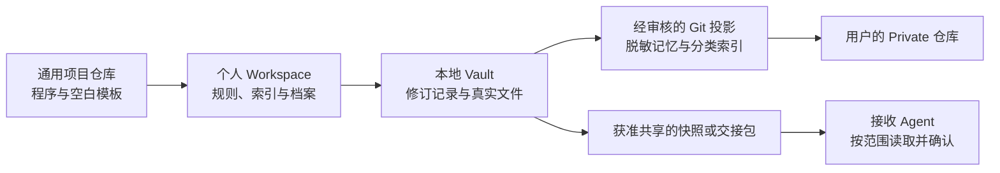

# AI Memory Hub

**语言 / Languages：** [简体中文](README.md) · [English](docs/i18n/README.en.md) · [日本語](docs/i18n/README.ja.md) · [한국어](docs/i18n/README.ko.md) · [Español](docs/i18n/README.es.md) · [Français](docs/i18n/README.fr.md) · [Deutsch](docs/i18n/README.de.md) · [Português (Brasil)](docs/i18n/README.pt-BR.md) · [Русский](docs/i18n/README.ru.md)

---
AI Memory Hub 是一套**用户自主掌控、面向多 Agent 协作的长期记忆管理系统**。项目提供标准化个人工作区、可追溯的本地资料归档、记忆审核机制，以及经授权的跨 Agent 共享与私人仓库发布能力。
**当前版本：** V2.4.0 · Python 3.11+ · MIT License · 本地优先
**发布状态：** 项目仓库目前仍为 Private，尚未建立正式公开 Release。
[Agent 初始化指南](docs/agent-onboarding.zh-CN.md) · [安装与演示](docs/workspace.md) · [Agent 接入规范](AGENTS.md)
## 一、项目概述
本项目旨在将分散于 AI 对话、项目记录和文件中的长期有效信息，整理为**具有明确来源、版本、适用范围与授权边界的个人数字资产**。资料由用户持有，可以在满足访问条件时供不同 AI 工具使用，不依赖单一模型的内置会话记忆。
系统适用于需要长期项目连续性、多 Agent 上下文交接、文件版本追溯或个人知识与人生档案整理的用户。
核心原则是**有证据地归档、按需提供、审核后生效、受控地共享**。仓库包含程序和去个人化模板，不包含作者的私人记忆，也不会在安装后自动读取各 AI 平台的全部历史记录。
## 二、系统架构与数据组织
系统将可复用程序、个人工作区、原始资料存储和共享仓库分开管理。

| 组成部分 | 职责 | 数据边界 |
| --- | --- | --- |
| **通用项目仓库** | 提供程序、19 个模块的结构模板、Schema、测试与说明 | 不存放真实个人资料 |
| **个人工作区（Workspace）** | 组织 Agent 入口、长期规则、人生档案、项目与会话索引 | 初始化后独立于产品仓库，默认禁止 Git 跟踪 |
| **本地资料库（Vault）** | 持久化来源、修订、真实文件字节、可选原始消息与执行回执 | 独立本地存储，依赖操作系统权限保护 |
| **个人 Private GitHub 仓库** | 保存用户逐条审核后允许共享的记忆、项目、会话索引及模块结构 | 可选；与 Vault 分离，敏感原件不默认上传 |
用户仓库首次获准发布时可生成**19 个可导航模块**，其中已审记忆、项目和会话索引分别进入相应目录。私人工作区的全部内容不等同于可发布内容；Private Git 仓库也不等同于加密保险库。
[完整模块对照](docs/workspace-parity.md) · [权限与安全原则](core/boundaries.md)
## 三、核心能力与设计机制
### 3.1 会话分层归档（L0–L3）
系统按任务所需的资料深度组织会话，避免每次接续工作都需要重新读取完整历史。
| 层级 | 资料结构 | 使用目的 |
| --- | --- | --- |
| **L0 · 会话索引** | 标题、标识、关联项目、版本定位 | 检索和定位相关会话 |
| **L1 · 会话摘要** | L0 信息及已提供的内容摘要 | 判断与当前任务的相关性 |
| **L2 · 结构化检查点** | 目标、约束、决策、被否决方案与原因、验证结果、待办事项及文件引用 | 恢复长期项目上下文 |
| **L3 · 原始消息（可选）** | 实际获准归档的可见消息、来源及历史修订 | 核对原始表达和证据 |
L0–L3 是**逐层增强的资料视图**，不是四份自动生成的摘要。不存在的原始资料不会被补造；L3 仅在额外授权下于 `private` 或 `restricted` Vault 中保存和读取。后续更新 L2 不会改写已归档的历史 L3。
### 3.2 长期记忆治理
持续有效的事实、偏好和规则先进入候选流程，经来源验证、重复与冲突检查、审核和**独立激活**后，才进入正式记忆视图。修订、撤销与替代关系保留历史记录；未经证实的推断不自动转换为事实。状态转换由 `candidate advance` 执行，并要求精确的修订与授权。
### 3.3 人生档案与项目连续性
人生档案按 **12 个一级类别、52 个二级领域、134 项注册字段**组织，支持来源、时间、有效期和敏感等级校验。所有字段初始为 `unknown`，需要由真实资料逐步补充。
项目模块记录目标、范围、关键决策、验证证据、文件版本及后续任务，供授权 Agent 从检查点继续工作。
### 3.4 文件资产及版本追溯
获准的用户上传件和 AI 生成件可按真实字节归档，以 SHA-256 校验，关联来源、会话、项目及指定版本。外部 URL 仅作为引用；未保存的文件不能宣称已完成本地归档。
### 3.5 多 Agent 版本确认
共享记忆采用逐 Agent 版本基线：`detected_sha` 代表检测到的版本，`synced_sha` 代表已完成指定范围读取并确认的版本。未确认或来源不可用时不得宣称同步完成；接收端按范围读取后，使用 `version confirm` 明确确认。读取回执不代表模型理解了内容，也不等于第三方平台的内置记忆已更新。
[会话协议](docs/protocol.md) · [候选审核机制](workflows/memory-lifecycle.md) · [共享版本协议](integrations/memory-bootstrap.md)
## 四、Agent 首次初始化与资料交付
V2.4 提供 `onboarding plan / apply / report`，支持 Agent 在**实际工具权限及用户授权范围内**规划环境、初始化 Workspace/Vault、处理已获准资料并输出执行与缺口报告。
| 阶段 | Agent 执行内容 | 用户参与及验收 |
| --- | --- | --- |
| **环境与来源评估** | 检查可用工具、路径、适配器及已选来源；生成计划摘要 | 确认来源、存储位置和操作范围 |
| **工作区初始化** | 建立独立 Workspace/Vault，验证模板与数据协议 | 批准本地执行及计划摘要 |
| **资料整理** | 归档实际可读取的会话、项目和文件，提出记忆候选，标记缺失证据 | 审核敏感来源和长期记忆 |
| **共享与发布（可选）** | 生成脱敏审阅内容、19 模块 Git 投影，并可创建或更新 Private 仓库 | 分别批准脱敏文本、仓库目标及具体发布摘要 |
| **结果交付** | 输出 JSON 与可读报告，列明成功、部分成功、阻断、未验证及待补资料 | 确认后续授权、备份与同步安排 |
用户可让具有适当执行工具的 Agent 阅读本仓库的 `AGENTS.md` 与 [首次部署协议](docs/agent-onboarding.zh-CN.md)。**仅阅读仓库不会自动取得 GitHub 写权限、其他平台的聊天导出权限或系统定时任务权限。**
完整流程会核对来源时间范围、会话层级、候选审批、资产版本、人生档案空缺、真实远端回执和下一步用户待办。
## 五、安装与使用示例
### 5.1 环境准备与工作区初始化
在获得访问权限的源码根目录中使用 Python 3.11 或更高版本。所有示例均应在新建的、受信任的目录中执行。
```sh
python -m pip install .
ai-memory-hub workspace init --path ../my-hub
ai-memory-hub workspace check --path ../my-hub
```
初始化会生成独立的工作区与同级 Vault，默认**不授予任何数据来源读取权限，也不安装后台调度器**。
### 5.2 Agent 首次部署
复制 [首次部署请求模板](examples/onboarding-request.json)，配置本人选定的目录和来源。`plan` 仅作只读评估；获得计划摘要的明确批准后，才能执行 `apply`。
```sh
ai-memory-hub onboarding plan --request hub-request.json
ai-memory-hub onboarding apply --request hub-request.json \
  --approve-plan APPROVED_PLAN_DIGEST --consent
ai-memory-hub onboarding report --request hub-request.json
```
`APPROVED_PLAN_DIGEST` 是运行计划时返回、经用户核实的实际摘要，不能使用示例文本直接执行。来源授权及远端创建、发布具有独立审批步骤。
### 5.3 合成资料演示
下列演示不接触真实用户历史；`--demo` 仅创建合成样例，数据源读取仍需显式 `grant`。
```sh
ai-memory-hub workspace init --path ../hub-demo --demo
ai-memory-hub workspace check --path ../hub-demo
ai-memory-hub --root ../hub-demo-vault source grant sample normalized \
  --path ../hub-demo/demo-inbox --consent
ai-memory-hub --root ../hub-demo-vault local run --source sample
ai-memory-hub --root ../hub-demo-vault session show calibration-session --layer L0
ai-memory-hub --root ../hub-demo-vault session show calibration-session --layer L2
ai-memory-hub --root ../hub-demo-vault memory review
ai-memory-hub --root ../hub-demo-vault local status
```
### 5.4 Git 投影与离线交接
Private Vault 的可共享资料需**先逐条脱敏审阅，再批准投影摘要及远端目标**。新用户的完整操作步骤见[Git 投影、审批与发布](docs/agent-onboarding.zh-CN.md)；此处不以直接推送整份 Workspace 代替审阅。
离线交接需要发送方与接收方分别授权、启用 `handoff`，并使用实际返回的包 ID 和文件版本：
```sh
ai-memory-hub --root OWNER_VAULT transfer pack \
  --project greenhouse-demo --asset calibration-notes@1 --consent
ai-memory-hub --root RECEIVER_VAULT transfer receive \
  --input APPROVED_COPY.zip --consent
ai-memory-hub --root RECEIVER_VAULT transfer inspect PACKAGE_ID --consent
ai-memory-hub --root RECEIVER_VAULT transfer file \
  PACKAGE_ID calibration-notes@1 --consent
```
上述 `sh` 示例采用 POSIX Shell 的续行符 `\`；在 Windows PowerShell 中请使用单行命令或 PowerShell 续行语法。详细参数、审批状态与恢复操作以对应操作文档为准。
[Agent 部署与 Git 发布指南](docs/agent-onboarding.zh-CN.md) · [来源适配器](docs/adapters.md) · [安装与故障处理](docs/guide.md)
## 六、数据安全与同步机制
### 6.1 默认权限与发布边界
- 实际来源读取、L3 原文、敏感文件、长期记忆激活、远端写入及计划任务均由用户分别授权。
- 个人 Workspace 默认禁止将全部内容加入 Git；Vault、SQLite、L3 原文、原始附件、凭据和本地绑定配置不能被默认投影发布。
- Private 仓库中的脱敏记录与本地源修订、审阅摘要和目标仓库身份绑定；来源或目标发生变化时需要重新核对并批准。
- Vault 与离线传输 ZIP **不由程序提供应用层加密**，应由用户安排系统权限、磁盘加密、备份和安全传输。
- 撤销数据源授权不意味着此前归档的版本或 Git 历史自动清除。
### 6.2 同步策略与运行状态
| 策略开关 | 普通模式默认值 | 职责 |
| --- | --- | --- |
| `weekly` | 启用 | 每周归档与来源覆盖检查入口 |
| `full` | 启用 | 按需全量或指定来源导入 |
| `event` | 关闭 | 明确触发的事件归档 |
| `daily` | 关闭 | 可选的每日补录 |
| `handoff` | 关闭 | 授权项目及指定文件版本交接 |
**策略开关、数据源授权、实际归档回执、GitHub 提交、接收 Agent 的重读确认和操作系统调度是相互独立的状态。** 开关启用并不代表任务已经安装或执行；需要分别查看 `local status`、远端提交和调度器运行记录。
[同步工作流](workflows/hybrid-sync.md) · [备份与恢复](docs/deployment.md) · [安全声明](SECURITY.md)
## 七、实现状态与适用边界
**已实现并通过合成环境测试：** V2.4.0 的 Agent 首次部署编排、19 模块初始化、12/52/134 档案结构、Vault 2.1 兼容、L0–L3 资料视图、候选记忆治理、版本文件归档、逐 Agent 共享确认，以及经审阅的分模块 Private Git 投影与模拟远端发布。
**需基于实际环境验证：** 目标用户 Agent 的本地执行权限、AI 平台可导出的资料范围、GitHub CLI 与真实账号权限、真实 Private 仓库创建及发布、敏感文本的人工脱敏质量、长期任务与备份运行。
**未作为通用能力提供：** 无差别读取所有 AI 平台隐藏记忆、自动获取全部聊天及附件、原始健康设备数据自动同步、无需授权的后台同步。
当前代码的 Windows、Ubuntu 自动测试及发行安全审计已验证工程流程；**模拟远端结果不能替代真实 GitHub 账号的发布验收**。仓库公开与正式 Release 均需独立决策。
## 八、技术文档与项目维护
| 文档 | 内容 |
| --- | --- |
| [Agent 接入入口](AGENTS.md) | 新 Agent 的访问、授权及记忆治理规则 |
| [首次部署指南](docs/agent-onboarding.zh-CN.md) | 从计划、授权导入到私有仓库发布及交付报告 |
| [工作区部署](docs/workspace.md) | 初始化、演示、恢复及版本检查 |
| [会话数据协议](docs/protocol.md) | L0–L3、检查点、来源与版本字段 |
| [候选记忆生命周期](workflows/memory-lifecycle.md) | 验证、审批、激活、撤销及历史 |
| [安全与权限边界](core/boundaries.md) | 敏感度、数据隔离和授权要求 |
| [功能覆盖矩阵](docs/workspace-parity.md) | 19 模块及通用能力映射 |
| [跨 Agent 版本确认](integrations/memory-bootstrap.md) | 检测、按范围重读与显式确认 |
项目遵循**用户所有、来源可核验、修订可追溯、共享须授权**的原则。后续工程扩展应先确保跨平台能力能够被实际验证，再更新文档状态及对应测试证据。
