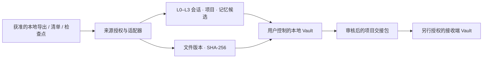

# AI Memory Hub · 开放、可迁移的 AI 记忆中枢
**Languages:** [English](README.md) · [简体中文](README.zh-CN.md) · [日本語](README.ja.md) · [한국어](README.ko.md) · [Español](README.es.md) · [Français](README.fr.md) · [Deutsch](README.de.md) · [Português (Brasil)](README.pt-BR.md) · [Русский](README.ru.md)
> **你的上下文、你的文件、你的控制权。** 一套本地优先、模型与平台中立的 AI 长期记忆、项目延续及跨 Agent 授权交接底座。
**当前版本：2.2.0 · Python 3.11+ · MIT 开源许可 · 命令行工具（CLI）**
AI 对话很方便，但**聊天记录本身并不等于可靠的长期记忆**。重要决策埋在长对话里，上传附件和生成文件逐渐与背景脱节；换一个 AI 或几周后继续项目，又要重新解释前因后果。AI Memory Hub 将**经过授权的上下文、来源证据、项目状态和真实文件字节**保存到独立、可追溯的本地存储中，而不是被某个 AI 平台锁定。
适用于需要同时使用多个 AI 工具的人、使用编程 Agent 的开发者，以及希望长期保存项目来龙去脉的个人用户。核心在本机运行，不要求订阅托管式 AI 服务。
## 为什么需要它？
- **减少重复解释：** 保存目标、限制、决策、验证结果、遗留问题和下一步，随时接续长期项目。
- **能追溯，而不只是摘要：** 每条记录保留来源、修订、时间及相关文件哈希，区分事实、候选和推断。
- **真正保存文件：** 对获准的用户上传件和 AI 生成件保存原始字节与版本，而非只存一个可能失效的链接。
- **可以更换 AI：** 在独立授权下，将选定的项目上下文和文件版本交给另一个 AI 或 Vault。
- **用户掌握范围：** 明确指定来源和敏感等级，原始消息（L3）必须另行授权。
## V2.2 已实现的能力
| 功能 | 实际提供的能力 |
| --- | --- |
| 长期记忆候选 | 保存并审核候选事实、偏好和决策，不把原始聊天自动认定为长期事实 |
| 四层会话上下文 | L0 会话索引、L1 摘要、L2 详细检查点、可选 L3 有真实来源的可见原文 |
| 项目连续性 | 管理项目状态、历史决策、证据和下一步，生成可检查的交接上下文 |
| 文件资产归档 | 用户上传件与 AI 生成件实际落盘、SHA-256 去重、不可变修订和校验取回 |
| 来源导入 | 本地 JSON/清单、显式编程 Agent 工作区清单、手动获取的 ChatGPT JSON 或受支持的 ZIP |
| 跨 AI 交接 | 离线交接包；双方授权后可传输指定文件版本，并在接收端 Vault 验证字节 |
| 五种同步机制 | 每周、按需全量、事件、每日补漏、即时交接独立开关及覆盖状态 |
| 恢复能力 | 幂等重试、历史保留、完整性检查、备份恢复和副本回滚 |
**请注意：** 以上是已完成并通过 Windows、Ubuntu 合成数据验证的程序能力。它**不会自动读取所有 AI 平台聊天、默认安装定时任务、捕获所有附件，或提供开箱即用的云端实时同步**。
## 系统如何工作？

**Vault** 是位于 Git 仓库之外、由用户控制的本地目录，使用 SQLite 索引与按内容哈希存放的文件字节。每个实例对应一种敏感等级，并依靠操作系统访问权限隔离；面对不同访问主体时需要独立账号或存储边界。
L0 解决“是哪段会话”；L1 解决“谈了什么”；L2 记录“决定了什么、验证了什么、接下来做什么”；L3 在**额外授权**下保存真实来源的可见消息及其修订证据。后续更新 L2 不会篡改或臆造历史 L3 原文。
## 典型使用场景
**换一个 AI 继续工作。** 保存需求、被否决的方案、测试结果和未完成任务。交给新 Agent 前检查交接包；必要时仅勾选特定版本文件，让接收端确认实际可读。
**管理 AI 交付物。** 将生成报告登记为 `ai_generated`，用户上传原件登记为 `user_upload`。即使源文件后来变化或消失，也能核对已存档版本与 SHA-256。
**导入 ChatGPT 历史。** 用户通过官方方式自行下载导出文件，授权本地 JSON/ZIP 路径后导入。存储可见原文需另行授权，附件须单独登记；不认识的格式需人工规范化。
**追溯项目决策。** 阅读历史会话修订、证据、未解决问题和项目时间线，不把 AI 的推断冒充确定事实。
## 五分钟体验：使用合成示例
准备 **Python 3.11 或更高版本**，并在可信的本地文件系统上运行。克隆源码后可先执行 `python -m pip install .`。Windows 使用 PowerShell，Linux/macOS 使用终端。**Vault 路径必须位于源码仓库外**。
```sh
python -m ai_memory_hub --root ../hub-demo init --preset ordinary
python -m ai_memory_hub --root ../hub-demo source grant demo normalized --path examples --consent
python -m ai_memory_hub --root ../hub-demo local run --source demo
python -m ai_memory_hub --root ../hub-demo local status
python -m ai_memory_hub --root ../hub-demo session show calibration-session --layer L2
python -m ai_memory_hub --root ../hub-demo asset check calibration-notes
python -m ai_memory_hub --root ../hub-demo asset copy calibration-notes --consent
```
`examples/memory-hub.json` 选中四条合成记录，其中包括一个实际文件。重复运行时相同内容会标记为未变更，不再重复写入。文件取回会在 Vault 内生成校验通过的本地副本。想重新试验请选择新的演示 Vault，**不要删除真实资料目录**。
### 接入自己的授权数据
先初始化 `../my-vault`，再指定包含 `memory-hub.json` 的来源目录，或者选择支持的导出文件：
```sh
python -m ai_memory_hub --root ../my-vault source grant work normalized --path /path/to/approved-inbox --consent
python -m ai_memory_hub --root ../my-vault local run --source work
python -m ai_memory_hub --root ../my-vault local status
```
以上目录是占位符，使用真实文件前需明确敏感等级和授权范围。ChatGPT 导出使用 `chatgpt_export` 适配器及已下载的受支持 `.json` / `.zip`；只有用户明确批准保存原文时才添加独立的 `--allow-raw` 授权。软件不会自动安装平台连接器或后台监听器。详见[来源适配器](docs/adapters.md)和[本地部署指南](docs/deployment.md)。
### 将项目交给另一个独立 Vault
默认关闭 `handoff`，需要在双方实例分别开启。交接包默认只有上下文及引用，附带 `ID@REV` 才会选择特定获准文件版本。
```sh
python -m ai_memory_hub --root ../hub-demo config set handoff on
python -m ai_memory_hub --root ../hub-demo transfer pack --project greenhouse-demo --asset calibration-notes@1 --consent
python -m ai_memory_hub --root ../recipient init --preset ordinary
python -m ai_memory_hub --root ../recipient config set handoff on
python -m ai_memory_hub --root ../recipient transfer receive --input APPROVED_COPY.zip --consent
python -m ai_memory_hub --root ../recipient transfer inspect PACKAGE_ID --consent
python -m ai_memory_hub --root ../recipient transfer file PACKAGE_ID calibration-notes@1 --consent
```
其中 `APPROVED_COPY.zip` 是发送方审核后产生、通过另外批准的可信渠道传输的实际文件；`PACKAGE_ID` 是接收命令返回的 ID。**ZIP 不加密**，SHA-256 校验内容完整性，**并不能证明发送人身份**。L3 原文和未经选择的文件字节不会默认外发。参见[交接及运维手册](docs/deployment.md)。
## 五种独立同步开关
| 开关 | 普通模式默认 | 作用 |
| --- | --- | --- |
| `weekly` | 开 | 每周归档/治理入口；**不会自行安装定时任务** |
| `full` | 开 | 按需运行的全量或指定来源导入 |
| `event` | 关 | 显式触发、经过授权的重要事件 |
| `daily` | 关 | 可选的每日增量补漏 |
| `handoff` | 关 | 主动项目交接与文件传输 |
使用 `config set FEATURE on|off` 修改开关。`local run --source ID` 默认使用 `full`；`--mode weekly` 只执行本地归档，不等于另外运行云端长期记忆治理。状态报告分别说明已启用能力、来源是否可读、实际归档覆盖率和调度状态。**打开开关不代表任务已经真实运行。**
## 隐私、安全及能力边界
- **数据归用户所有：** Vault 与备份放在 Git 外，依靠操作系统权限和磁盘加密保护；程序本身不加密 Vault。
- **最小授权：** 每个来源独立许可；L3 原文与选定文件外发需要额外同意。撤销来源授权只阻止未来读取，不会自动清除已保存的历史版本。
- **离线交接：** 双方确认范围、版本和传输渠道。ZIP 未加密，需要自行规定保存与清理周期。
- **不会无感监听全部平台：** 支持官方导出和显式清单，不自动获取平台凭证或安装生产定时任务。
- **不混淆文件与链接：** 外部 URL 仅是引用；只有取得并写入真实字节才算文件归档。来源缺失也不会报告为全量成功。
- **兼容性：** 软件版本 2.2.0 继续使用既有的 2.1 记录 Schema，同时加入 2.2 离线传输包；升级请先备份并在恢复副本测试。
## 文档、开源与贡献
- [部署、恢复和跨 Vault 交接](docs/deployment.md)
- [完整使用指南](docs/guide.md)
- [数据源适配器及平台限制](docs/adapters.md)
- [数据协议](docs/protocol.md) · [记录 JSON Schema](schemas/protocol.schema.json) · [传输 Schema](schemas/transfer.schema.json)
- [安全边界](SECURITY.md) · [MIT 许可证](LICENSE)
开发者可创建分支、使用合成测试材料，避免提交任何私人导出和真实附件，并执行 Windows/Linux 适用的测试：
```sh
python -m pip install jsonschema
python -m unittest discover -s tests -v
python scripts/smoke_release.py
python scripts/smoke_v22.py
```
**发布状态：** 核心已经实现并通过合成端到端验证。正式公开 GitHub 仓库和创建 2.2.0 Release 是单独的发布步骤；有仓库访问权限时，无需等待公开也可以从授权的源码检出安装使用。
