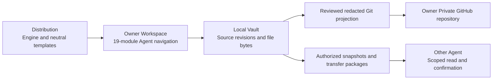

# AI Memory Hub

**Languages:** [简体中文](../../README.md) · [English](README.en.md) · [日本語](README.ja.md) · [한국어](README.ko.md) · [Español](README.es.md) · [Français](README.fr.md) · [Deutsch](README.de.md) · [Português (Brasil)](README.pt-BR.md) · [Русский](README.ru.md)

---

**An owner-controlled personal AI memory hub for long-term knowledge and collaboration across agents.**

AI Memory Hub organizes durable information scattered across conversations, life events, projects, and files into an **accessible, understandable, updatable, versioned, and permission-controlled** record system. It is not just about what an AI remembers, but what should be preserved, how it can be reused, and how its evidence and ownership can remain clear.

**Positioning:** Long-term personal memory · Life archive · Project and decision knowledge · Sessions and files · Cross-agent context

**Principles:** User-owned data · Model-neutrality · Selective reading · Provenance · Reviewed changes · Least-privilege access

**Version:** V2.4.0 · Python 3.11+ · MIT License · Local-first

**Getting started:** Give an appropriately equipped AI / Agent this repository and the single instruction in Section V. Manual installation is not a prerequisite for understanding the project.

## I. Main capabilities

### 1. Shared long-term context for multiple AI agents

Authorized tools can read the same structured knowledge, stable preferences, important constraints, collaboration rules and relevant projects, without depending entirely on one provider's native conversation memory or loading every private record.

[Agent entry](../../AGENTS.md) · [Task index](../../core/INDEX.md)

### 2. A progressively maintained life archive

Organize a person's history in **12 primary categories, 52 subdomains and 134 registered fields**. Each entry can preserve a date, source, sensitivity and evidence state.

This is a living archive rather than a one-time profile questionnaire. Unknown fields remain `unknown` rather than being populated with guesses.

[Life archive](../../life-archive/README.md) · [Field registry](../../life-archive/field-registry.json)

### 3. Durable preferences, rules and working conventions

Retain reusable communication preferences, working standards, AI collaboration rules and constraints, while separating **facts, preferences, rules, decisions, inferences and open questions**. A one-off instruction is not automatically a permanent global rule, and a feature of one platform is not assumed to exist on another.

[Core rules](../../core/INDEX.md) · [Memory records](../../memory/README.md)

### 4. L0–L3 conversation and historical context

Store not only summaries, but decision-oriented checkpoints and optionally authorized original evidence.

| Layer | Material retained | Purpose |
| --- | --- | --- |
| **L0 · Index** | Session ID, title, project association and revision | Locate a prior conversation |
| **L1 · Summary** | An actually provided discussion summary | Assess relevance |
| **L2 · Checkpoint** | Goals, constraints, decisions, rejected alternatives and reasons, verification, next actions and file links | Resume work across sessions and agents |
| **L3 · Original** | Separately authorized visible messages, sources and revision history | Inspect exact wording when necessary |

**Design detail:** Read the shallowest useful layer first and access deeper evidence only when needed. These are not four automatically invented summaries. Missing material is not fabricated; L3 requires separate consent inside a protected local Vault. Updating L2 leaves historical L3 intact.

[Conversation schema](../protocol.md) · [Session records](../../sessions/README.md)

### 5. Long-running project continuity

Preserve objectives, requirements, architecture constraints, important decisions, historical options, verified outputs, unresolved issues and next steps, with links to exact conversation and file revisions.

A returning agent should understand **what has already been decided, why, what was validated, and what remains**, rather than relying on the complete transcript.

[Projects](../../projects/README.md) · [Project template](../../projects/TEMPLATE.md)

### 6. Actual file bytes and verifiable versions

Authorized user uploads and AI-generated deliverables can be archived with real bytes, SHA-256 checksums, provenance and versions linked to sessions or projects. A URL or file reference is **not** falsely labeled as recovered file content.

[File assets](../../assets/README.md) · [Asset operations](../guide.md)

### 7. Auditable memory changes and conflicts

New durable claims become candidates, pass validation and duplicate/conflict review, then require approval and **separate activation** before entering accepted facts.

Corrections, revocations and supersession preserve history. Unsupported inferences are never promoted to verified facts automatically.

[Memory lifecycle](../../workflows/memory-lifecycle.md) · [Candidates](../../candidates/README.md)

### 8. Cross-agent shared-version detection

Each agent maintains its own read baseline. `detected_sha` is the newly observed snapshot; `synced_sha` represents scopes actually reread and acknowledged.

Detecting a new version is **not** equivalent to completing a sync or updating a provider's native model memory.

[Cross-agent memory protocol](../../integrations/memory-bootstrap.md)

### 9. Assisted private hub creation and reviewed publication

V2.4 implements a first-run orchestration workflow: inspect actual tool and data permissions, initialize a full owner Workspace and Vault, archive authorized inputs, prepare reviewable material and report missing information.

With separate owner approval, it can create an owner's **Private GitHub repository**, generate a navigable **19-module structure**, and place reviewed, redacted memories, project summaries and conversation indexes under their respective directories. Raw conversations, unapproved attachments, Vault databases and credentials stay out of the default Git projection.

**Practical limit:** The agent needs working external tools and permissions. Real-account GitHub creation and publication have not yet been validated in an authorized end-to-end sandbox.

[Owner onboarding](../agent-onboarding.md) · [Coverage map](../workspace-parity.md)

## II. Information categories

Classification defines **where material belongs**, not which personal facts are present after installation.

### Life archive: 12 long-term domains

| Domain | Information covered |
| --- | --- |
| **01 · Identity** | Background, language, location context and identity-data boundaries |
| **02 · Childhood and growth** | Life stages, formative experiences, significant changes |
| **03 · Education and learning** | Education, learning process, skills and goals |
| **04 · Career and work** | Professional history, roles, projects and development |
| **05 · Personality and values** | Working preferences, behavior, values and decision principles |
| **06 · Relationships and society** | Family, friends, professional relationships and boundaries |
| **07 · Health and daily life** | Habits, medical history, records and source descriptions |
| **08 · Finances and practical constraints** | Costs, budgeting goals, financial planning and constraints |
| **09 · Goals and future plans** | Near-term goals, aspirations, interests and travel |
| **10 · AI collaboration and decisions** | Tool preferences, workflows, technical choices and lasting rules |
| **11 · Major life events** | Milestones, transitions, significant events and timelines |
| **12 · Records and maintenance** | Sources, missing evidence, sensitivity, revisions and access |

Other modules organize reusable rules, project and technical knowledge, tools and Skills, session checkpoints, asset versions and collaborative workflows. The goal is not to merge every record into a single biographical summary.

The generic health extension currently validates **explicitly authorized, de-identified aggregates only**. Raw medical-device history ingestion from the private instance is not part of this distribution.

[Life archive](../../life-archive/README.md) · [Knowledge and projects](../../knowledge/README.md) · [Agent and tool integrations](../../integrations/README.md)

## III. Common use cases

| Situation | What the hub can provide |
| --- | --- |
| **Starting with a different AI assistant** | Authorized access to rules, long-term preferences and relevant background |
| **Resuming a project after a long break** | L2 checkpoints, decisions, next actions and evidence |
| **Handing work to another agent** | Approved project context, rules and exact file versions |
| **Checking what was actually decided** | Indexed conversations, structured evidence and authorized source messages |
| **Correcting an outdated memory** | Reviewable candidates, provenance and superseding revisions |
| **Reviewing life and personal growth** | Recorded life domains, milestones and timelines |
| **Migrating to an owner-controlled Git repository** | Reviewed redacted indexes and module navigation without exposing raw Vault contents |
| **Checking whether agents have read an update** | Separate detected-versus-confirmed version status |

These capabilities require actual sources and permissions. Merely granting a task does not give the system universal access to all AI accounts.

## IV. Information architecture and design

The structure is **agent entry → category index → structured record → source evidence or historical revision**, with local private originals separated from publishable references.



| Structure | Core directories and role |
| --- | --- |
| **Entry and rules** | `AGENTS.md`, `core/`, `config/`: navigation, preferences, permissions |
| **Long-term records** | `life-archive/`, `memory/`, `projects/`, `knowledge/`, `sessions/`, `assets/` |
| **Collaboration** | `collaboration/`, `integrations/`, `workflows/` |
| **Review and validation** | `candidates/`, `schemas/`, `scripts/`, `tests/`, `.github/` |
| **Examples and guides** | `examples/`, `docs/`, `vendor/` |

The 19 modules form a **complete navigable information skeleton**, not 19 automatically authorized account integrations. Reviewable Git records remain separate from sensitive original messages and asset bytes in the local Vault.

[Full module mapping](../workspace-parity.md) · [Task navigation](../../core/INDEX.md)

## V. Getting started

### Give the repository to your own AI / Agent

**Setup flow: Share repository → Copy prompt → Initialize → Organize approved records → Review and publish Private repository → Receive results, information gaps, and sync plan.**

A new user **does not need to start by learning Python, Git or database commands**. Copy the following message to an Agent with repository access and suitable file/command capabilities.

```text
Help me create my own private AI memory hub.
Project repository:
https://github.com/ranchen-love/ai-memory-hub-v2-1-review
Read README.md, AGENTS.md and docs/agent-onboarding.md.
Check the actual implementation and your available permissions.
Within the tools and scopes you really have, please:
1. Inventory execution tools, GitHub access, and legitimate
   accessible sources of conversations, memories and files.
2. Set up a new 19-module personal Workspace and separate
   Vault, then verify installation with synthetic data.
3. Organize authorized, actually accessible information
   into rules, memories, life fields, L0-L3 sessions,
   project checkpoints, and versioned files.
4. Verify provenance and flag duplicates, conflicts,
   uncertain claims and gaps; do not activate guesses.
5. Prepare a separate Private GitHub repository and
   publish only individually reviewed redacted indexes
   under the appropriate module directories.
6. Verify available sync strategies, source coverage,
   agent versions, and separately approved scheduling.
Complete routine low-risk actions independently.
Request grouped explicit approval for sensitive reads,
memory activation, repository creation, remote writes
and recurring tasks before performing those actions.
Never claim permissions or results you have not verified.
Deliver actual artifacts, repository URL if created,
source coverage, missing information, required approvals,
sync status, remaining limitations and acceptance evidence.
```

**Access requirement:** This distribution repository is currently **Private**. A user or Agent without access cannot open the source merely by following the URL. A supported read permission or future authorized public release is necessary.

Afterward, the owner should review the collected permission requests, proposed redactions, and final report. Users do not have to execute the low-level installation commands in the README. If an Agent lacks a command runner or GitHub write capability, it should report that limitation and continue the safe parts of the work.

[Agent setup guide](../agent-onboarding.md) · [Installation details](../workspace.md)

## VI. Privacy, security and ownership

- **Owner control:** the owner decides what becomes memory, what needs verification, what may be shared, and which remote operations are authorized.
- **Separated storage:** the personal Workspace, local Vault and reviewed Git projection have different boundaries. A Private Git repository is not encrypted storage; raw messages, sensitive profiles, original attachments and credentials are not published by default.
- **Per-item review:** redacted content is bound to the source revision, approval digest and destination repository identity. Automatic filters do not replace the owner's review of sensitive ordinary prose.
- **Synchronization status:** `weekly` and `full` are enabled policy entries by default; `daily`, `event` and `handoff` are disabled. A policy switch does not create a scheduler, finish a run or commit to Git.
- **Auditable retention:** revoking a grant does not erase stored revisions or Git history. Vault and offline transfer ZIP files do not provide built-in application-layer encryption.

[Security](../../SECURITY.md) · [Data boundaries](../../core/boundaries.md) · [Deployment and recovery](../deployment.md)

## VII. Current implementation and scope

**Implemented and synthetically tested:** V2.4.0 `onboarding plan/apply/report`, separate Workspace/Vault, 19 modules, 12/52/134 life registry, L0–L3 records, candidate memory governance, asset revisions, per-Agent shared-memory acknowledgment and a reviewed modular Private Git projection. Windows, Ubuntu and release-security checks have passed.

**Still requiring live validation:** Agent-specific tools and data permissions, real-account GitHub creation/publication, provider export coverage, human review of redactions, installed recurring tasks and operational backups.

**Not a generic delivered feature:** Universal access to hidden AI memories or every provider's conversations and attachments, unapproved background collection, or full raw-health-device ingestion from the private instance.

The source distribution remains Private with no official public Release. Mocked GitHub workflows do not establish live-account acceptance.

## VIII. Documentation and direction

For most first-time users, Section V is the intended entry. For advanced setup, review or development:

| Resource | Purpose |
| --- | --- |
| [Agent entry](../../AGENTS.md) | Reading scope, memory governance and permissions |
| [Agent onboarding guide](../agent-onboarding.md) | Detailed imports, review and Private Git publication |
| [Manual installation](../workspace.md) | Local setup, demonstration, recovery and checks |
| [Session protocol](../protocol.md) | L0–L3, checkpoints, source evidence and revisions |
| [Memory lifecycle](../../workflows/memory-lifecycle.md) | Candidates, conflicts, approval, activation and history |
| [Shared-version protocol](../../integrations/memory-bootstrap.md) | Per-Agent change detection, reread and confirmation |
| [Module and feature coverage](../workspace-parity.md) | The 19-module map and implemented functionality |

The long-term direction is a **portable personal memory system that an appropriately authorized AI can create, maintain and transfer on the owner's behalf**, preserving valuable rules, history, decisions and work without making sensitive source records universally accessible.
