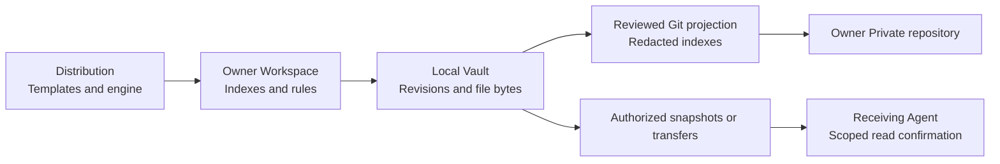

# AI Memory Hub

**Languages:** [简体中文](../../README.md) · [English](README.en.md) · [日本語](README.ja.md) · [한국어](README.ko.md) · [Español](README.es.md) · [Français](README.fr.md) · [Deutsch](README.de.md) · [Português (Brasil)](README.pt-BR.md) · [Русский](README.ru.md)

---

AI Memory Hub is a **user-controlled long-term memory management system for multi-agent workflows**. It provides reusable personal workspace templates, a versioned local Vault, governed memory records, and explicitly authorized cross-agent sharing and Private Git publication.

**Version:** V2.4.0 · Python 3.11+ · MIT License · local-first

**Distribution:** This repository remains Private; no official public Release has been issued.

[Agent onboarding](../agent-onboarding.md) · [Installation](../workspace.md) · [Agent entry](../../AGENTS.md)

## I. Project overview

AI Memory Hub organizes long-lived knowledge from permitted AI conversations, projects, decisions and real files into **owner-held records with traceable evidence, revisions and access boundaries**. The purpose is continuity across tools rather than dependence on the native memory of any individual AI provider.

It is intended for individuals managing durable preferences, teams of authorized agents, long-running projects, versioned deliverables and structured personal archives.

The distribution contains **neutral templates and an engine, not the author's personal history**. Installing it grants no automatic access to provider accounts or hidden conversation records.

## II. System architecture and data organization

The application, a user's Workspace, their Vault and optional shared Git records are separate:



| Component | Responsibility | Default boundary |
| --- | --- | --- |
| **Distribution** | Program, schemas, tests and templates for 19 modules | No real user data |
| **Owner Workspace** | Agent entry, durable rules, life profile, project and session indexes | Separate from distribution; deny-all Git tracking |
| **Local Vault** | Sources, revisions, byte-addressed assets, optional raw messages and receipts | Local storage protected by operating-system permissions |
| **Optional Private GitHub repository** | Reviewed and redacted memory, project/session indexes and modular navigation | Per-item and per-destination permission; raw Vault data excluded |

Authorized first publication can create a navigable 19-module scaffold and place reviewed content under the corresponding indexes. A Private Git repository is not an encrypted substitute for the Vault.

[Module mapping](../workspace-parity.md) · [Security boundaries](../../core/boundaries.md)

## III. Core capabilities and design

### 3.1 L0–L3 conversation records

Conversation data is accessed according to the detail required for a task:

| Layer | Available information | Typical use |
| --- | --- | --- |
| **L0 · Index** | Title, ID, project association and revision | Locate prior conversations |
| **L1 · Summary** | L0 plus an actually supplied summary | Assess relevance |
| **L2 · Structured checkpoint** | Goals, constraints, decisions, rejected options and reasons, verification, next actions and file references | Resume work without a full transcript |
| **L3 · Optional original messages** | Actually archived visible messages, source references and original revisions | Verify exact statements with extra consent |

These are progressively richer **views**, not four generated summaries. Missing content is not fabricated. L3 requires separate consent and a `private` or `restricted` Vault; new L2 revisions do not overwrite historical L3 evidence.

### 3.2 Governed long-term memories

Candidates pass through source validation, duplicate/conflict review and approval, followed by **separate activation** before entering accepted facts. Supersession and revocation retain traceable history; unsupported inferences are not promoted automatically. The `candidate advance` operation validates the requested state transition and recorded revision.

### 3.3 Life archive and project continuity

The life archive has **12 categories, 52 subdomains and 134 registered fields**, with provenance, time, validity and sensitivity validation. All begin `unknown`. Project checkpoints capture context, decisions, evidence, file versions and subsequent actions.

### 3.4 File assets and revision history

Approved user uploads and generated artifacts can be archived as actual bytes with SHA-256, provenance and immutable version references. External URLs remain references unless their bytes have been stored.

### 3.5 Cross-agent read confirmation

Each agent tracks `detected_sha` (observed snapshot) separately from `synced_sha` (scopes explicitly read and acknowledged). A recipient explicitly confirms completed scoped reads with `version confirm`. Receipts do not prove model comprehension or automatically update a provider's native memory.

[Session protocol](../protocol.md) · [Memory lifecycle](../../workflows/memory-lifecycle.md) · [Shared memory versions](../../integrations/memory-bootstrap.md)

## IV. Agent-led initialization and delivery

V2.4 provides `onboarding plan / apply / report` so an appropriately equipped Agent can evaluate available inputs, establish separate local storage, ingest approved evidence, and report actual results and gaps.

| Stage | Agent activity | Owner authorization and review |
| --- | --- | --- |
| **Assessment** | Check runtime, selected sources, adapters and local paths | Confirm intended sources, scope and destinations |
| **Initialization** | Create Workspace/Vault and verify installed templates | Approve plan digest and local execution |
| **Data organization** | Import accessible evidence; create session/project records and memory candidates | Review private inputs and accepted memories |
| **Optional publication** | Build reviewed redacted modular projection and optionally create/update a Private repository | Independently approve redaction, destination and exact projection digest |
| **Handover** | Produce JSON and readable reports of completion, gaps, exceptions and next steps | Confirm follow-up permissions and scheduling preferences |

The Agent must have real tool access and permissions. **Reading a repository alone does not grant GitHub write access, provider exports or background scheduling privileges.**

[Agent onboarding guide](../agent-onboarding.md) · [Supported adapters](../adapters.md)

## V. Installation and usage examples

### 5.1 Install and initialize a Workspace

Use Python 3.11+ from an authorized checkout and choose fresh trusted directories:

```sh
python -m pip install .
ai-memory-hub workspace init --path ../my-hub
ai-memory-hub workspace check --path ../my-hub
```

No source grants or scheduled jobs are established automatically.

### 5.2 First-run orchestration

Copy [the request template](../../examples/onboarding-request.json), configure owner-selected local paths and sources, then run the read-only plan. Apply the exact approved digest:

```sh
ai-memory-hub onboarding plan --request hub-request.json
ai-memory-hub onboarding apply --request hub-request.json \
  --approve-plan APPROVED_PLAN_DIGEST --consent
ai-memory-hub onboarding report --request hub-request.json
```

The digest is a real value returned by the plan and confirmed by the owner. Source reads and remote publication require separately scoped permissions.

### 5.3 Synthetic data trial

The demonstration has no real personal history. Copying `--demo` files does not grant source access.

```sh
ai-memory-hub workspace init --path ../hub-demo --demo
ai-memory-hub workspace check --path ../hub-demo
ai-memory-hub --root ../hub-demo-vault source grant sample normalized \
  --path ../hub-demo/demo-inbox --consent
ai-memory-hub --root ../hub-demo-vault local run --source sample
ai-memory-hub --root ../hub-demo-vault session show calibration-session --layer L0
ai-memory-hub --root ../hub-demo-vault session show calibration-session --layer L2
ai-memory-hub --root ../hub-demo-vault memory review
ai-memory-hub --root ../hub-demo-vault local status
```

### 5.4 Reviewed Git records and offline transfer

A Private Vault share requires separately approved **redacted content, a projection digest and an exact remote target**. The complete review and publication steps are in [the Agent guide](../agent-onboarding.md). Never substitute an unreviewed bulk Git add of the Workspace.

Offline transfer requires authorization of both endpoints, handoff enabled, and actual package IDs and asset revisions:

```sh
ai-memory-hub --root OWNER_VAULT transfer pack \
  --project greenhouse-demo --asset calibration-notes@1 --consent
ai-memory-hub --root RECEIVER_VAULT transfer receive \
  --input APPROVED_COPY.zip --consent
ai-memory-hub --root RECEIVER_VAULT transfer inspect PACKAGE_ID --consent
ai-memory-hub --root RECEIVER_VAULT transfer file \
  PACKAGE_ID calibration-notes@1 --consent
```

Shell snippets use POSIX `\` continuation; PowerShell users should place each command on one line or use PowerShell continuation. Substitute the actual authorized values returned by the tools.

[Agent setup and Git review](../agent-onboarding.md) · [Adapters](../adapters.md) · [Operations](../guide.md)

## VI. Data security and synchronization

### 6.1 Permission and publication controls

- Reading personal sources, archiving L3, sharing private files, activating memories, remote writes and persistent scheduling require independently scoped permission.
- The personal Workspace is deny-all for Git by default. Vault databases, raw messages, attachments, secrets and local bindings are excluded from default publication.
- Redacted private records are bound to reviewed source revisions, approval digests and destination repository identity; changed inputs require fresh review.
- Vault storage and offline ZIP transfers have **no built-in application-layer encryption**; use OS permissions, disk encryption and an appropriate transfer channel.
- Revoking a grant stops future reads but does not automatically erase stored revisions or Git history.

### 6.2 Synchronization policy and observed status

| Switch | Ordinary default | Purpose |
| --- | --- | --- |
| `weekly` | On | Weekly archive/check entry |
| `full` | On | Manual full or selected source import |
| `event` | Off | Authorized event-based operation |
| `daily` | Off | Optional daily catch-up |
| `handoff` | Off | Explicit project and selected-version transfer |

**An enabled switch, a source grant, an archive receipt, a Git commit, an Agent read acknowledgment and an installed OS scheduler are different states.** Verify each before claiming a successful automatic sync.

[Sync workflow](../../workflows/hybrid-sync.md) · [Recovery](../deployment.md) · [Security](../../SECURITY.md)

## VII. Implementation status and limitations

**Implemented and synthetically validated:** V2.4 first-run orchestration, 19-module Workspaces, 12/52/134 archive structure, compatibility with Vault schema 2.1, L0–L3 records, candidate memory governance, versioned file storage, per-Agent shared-memory acknowledgments and reviewed modular Private Git projection with mocked remote publication.

**Requires environment-specific verification:** Actual Agent execution permissions, provider export coverage, authenticated GitHub CLI, live Private repository creation/publishing, human assessment of redaction quality, recurring schedules and operational backups.

**Not generally available:** Universal automatic access to all hidden AI memories, all provider chats and attachments, raw health-device ingestion, or unapproved background synchronization.

Windows, Ubuntu and security-release checks validate the engineering workflows, but **mocked GitHub publication is not a real-account production acceptance test**. Public visibility and a formal Release require a separate decision.

## VIII. Technical documentation and maintenance

| Document | Purpose |
| --- | --- |
| [Agent entry](../../AGENTS.md) | Access, permissions and memory rules for a new Agent |
| [Onboarding guide](../agent-onboarding.md) | Plan, import, review, Private publication and handover reporting |
| [Workspace installation](../workspace.md) | Initialization, examples, recovery and checks |
| [Conversation protocol](../protocol.md) | L0–L3, checkpoints, sources and revisions |
| [Memory lifecycle](../../workflows/memory-lifecycle.md) | Validation, review, activation, revocation and history |
| [Security boundaries](../../core/boundaries.md) | Sensitivity, storage isolation and authorization |
| [Coverage matrix](../workspace-parity.md) | Functional and 19-module mapping |
| [Agent version protocol](../../integrations/memory-bootstrap.md) | Detection, scoped reload and explicit confirmation |

The project follows **user ownership, verifiable provenance, traceable revisions and explicit sharing consent**. Documentation claims should advance only alongside tested capabilities and clear limitations.
