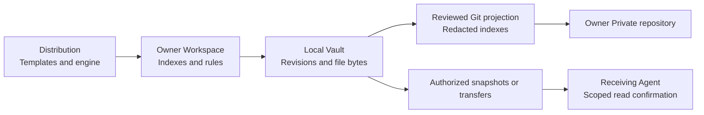

# AI Memory Hub

**Languages:** [简体中文](../../README.md) · [English](README.en.md) · [日本語](README.ja.md) · [한국어](README.ko.md) · [Español](README.es.md) · [Français](README.fr.md) · [Deutsch](README.de.md) · [Português (Brasil)](README.pt-BR.md) · [Русский](README.ru.md)

---

AI Memory Hub is a **user-controlled long-term memory management system for multi-agent workflows**. It provides reusable personal workspace templates, a versioned local Vault, governed memory records, and explicitly authorized cross-agent sharing and Private Git publication.

**Version:** V2.4.0 · Python 3.11+ · MIT License · local-first

**Distribution:** This repository remains Private; no official public Release has been issued.

**Getting started:** [Copy the Agent setup instruction](#41-copyable-setup-instruction) and let it carry out the permitted steps.

[Agent onboarding](../agent-onboarding.md) · [Installation](../workspace.md) · [Agent entry](../../AGENTS.md)

## I. Project overview

AI Memory Hub organizes long-lived knowledge from permitted AI conversations, projects, decisions and real files into **owner-held records with traceable evidence, revisions and access boundaries**. The purpose is continuity across tools rather than dependence on the native memory of any individual AI provider.

It is intended for individuals managing durable preferences, teams of authorized agents, long-running projects, versioned deliverables and structured personal archives.

The distribution contains **neutral templates and an engine, not the author's personal history**. Installing it grants no automatic access to provider accounts or hidden conversation records.

## II. System architecture and data organization

The application, a user's Workspace, their Vault and optional shared Git records are separate:



| Component | Responsibility | Default boundary |
| --- | --- | --- |
| **Distribution** | Program, schemas, tests and templates for 19 modules | No real user data |
| **Owner Workspace** | Agent entry, durable rules, life profile, project and session indexes | Separate from distribution; deny-all Git tracking |
| **Local Vault** | Sources, revisions, byte-addressed assets, optional raw messages and receipts | Local storage protected by operating-system permissions |
| **Optional Private GitHub repository** | Reviewed and redacted memory, project/session indexes and modular navigation | Per-item and per-destination permission; raw Vault data excluded |

Authorized first publication can create a navigable 19-module scaffold and place reviewed content under the corresponding indexes. A Private Git repository is not an encrypted substitute for the Vault.

[Module mapping](../workspace-parity.md) · [Security boundaries](../../core/boundaries.md)

## III. Core capabilities and design

### 3.1 L0–L3 conversation records

Conversation data is accessed according to the detail required for a task:

| Layer | Available information | Typical use |
| --- | --- | --- |
| **L0 · Index** | Title, ID, project association and revision | Locate prior conversations |
| **L1 · Summary** | L0 plus an actually supplied summary | Assess relevance |
| **L2 · Structured checkpoint** | Goals, constraints, decisions, rejected options and reasons, verification, next actions and file references | Resume work without a full transcript |
| **L3 · Optional original messages** | Actually archived visible messages, source references and original revisions | Verify exact statements with extra consent |

These are progressively richer **views**, not four generated summaries. Missing content is not fabricated. L3 requires separate consent and a `private` or `restricted` Vault; new L2 revisions do not overwrite historical L3 evidence.

### 3.2 Governed long-term memories

Candidates pass through source validation, duplicate/conflict review and approval, followed by **separate activation** before entering accepted facts. Supersession and revocation retain traceable history; unsupported inferences are not promoted automatically. The `candidate advance` operation validates the requested state transition and recorded revision.

### 3.3 Life archive and project continuity

The life archive has **12 categories, 52 subdomains and 134 registered fields**, with provenance, time, validity and sensitivity validation. All begin `unknown`. Project checkpoints capture context, decisions, evidence, file versions and subsequent actions.

### 3.4 File assets and revision history

Approved user uploads and generated artifacts can be archived as actual bytes with SHA-256, provenance and immutable version references. External URLs remain references unless their bytes have been stored.

### 3.5 Cross-agent read confirmation

Each agent tracks `detected_sha` (observed snapshot) separately from `synced_sha` (scopes explicitly read and acknowledged). A recipient explicitly confirms completed scoped reads with `version confirm`. Receipts do not prove model comprehension or automatically update a provider's native memory.

[Session protocol](../protocol.md) · [Memory lifecycle](../../workflows/memory-lifecycle.md) · [Shared memory versions](../../integrations/memory-bootstrap.md)

## IV. Agent-assisted setup

New users do not need to understand Python, Git, or internal memory formats before getting started. **Provide the project repository to an AI/Agent with the required tools, submit one setup request, and let it complete the verified steps autonomously within approved permissions.**

**User journey: Share the repository → Copy the instruction → Agent verifies access and initializes → Import approved information → Review and create a Private repository → Receive deliverables, missing-information report, and sync plan.**

### 4.1 Copyable setup instruction

```text
Help me set up my own private AI Memory Hub.
Project repository:
https://github.com/ranchen-love/ai-memory-hub-v2-1-review
First read README.md, AGENTS.md, and
docs/agent-onboarding.md. Follow their existing rules.
Verify your actual file, conversation, and GitHub access.
Within your real tool capabilities:
1. Initialize a full Workspace and separate local Vault.
2. Organize memories, sessions, projects, files, and
   life records that I authorize and you can actually read.
3. Classify evidence, flag duplicates and conflicts,
   and keep unverified details as candidates or unknown.
4. After I approve the account, name, and destination,
   create my own GitHub Private repository and module tree.
5. Publish only explicitly reviewed, redacted records
   to the correct module directories, then verify the result.
   Never upload raw chats, attachments, or the full Vault
   without a separate, specific authorization.
6. Explain synchronization, backups, and Agent handoffs;
   install ongoing schedules only after my approval.
Complete safe verifiable steps without repeated check-ins.
Group necessary approval requests by purpose and scope.
Finally report actual results, evidence, blockers, missing
information I should provide, and verified sync status.
```

### 4.2 Deliverables and approvals

The Agent can inspect available tools, initialize a blank Workspace/Vault, run synthetic checks, and process specifically authorized data. Creating a personal remote repository, reading sensitive sources, activating accepted memories, publishing redacted content, and installing recurring jobs require the owner's **separately scoped approval**.

Expected deliverables include **the local Workspace and Vault, an optional approved Private repository, organized records with provenance, gaps needing owner input, and an accurate synchronization and backup report**. Unavailable or unverified steps must be reported rather than presented as completed.

**The distribution repository remains Private.** A new user needs access to read it until it is formally made public. Actual execution and source access also depend on the Agent's tools and the owner's permissions.

[Agent onboarding](../agent-onboarding.md) · [Agent entry](../../AGENTS.md) · [Supported sources](../adapters.md)

## V. Typical applications

| Scenario | Supported outcome |
| --- | --- |
| **Changing AI providers** | Reuse approved preferences, standing rules, and relevant history |
| **Resuming a long-running project** | Continue from L2 checkpoints, decisions, verified outputs, and next actions |
| **Working across agents** | Share reviewed context and confirm individual read versions |
| **Maintaining a personal archive** | Fill 12/52/134 life-profile fields gradually with evidence and dates |
| **Preserving files and deliverables** | Archive approved real bytes, references, and exact revisions |
| **Correcting a long-term memory** | Review candidates, resolve conflicts, preserve revisions, and optionally update the owner's repository |

The goal is **continuity of useful, verifiable context**, not unlimited retention of every conversation.

## VI. Privacy and synchronization

**Owners control their information.** The local Vault holds authorized sources and revisions; an optional Private GitHub repository holds only selected, reviewed, redacted records. Raw conversations, attachments, credentials, and databases are not published by default. A Private repository is not encrypted storage.

**Synchronization is a sequence of distinct events:** detect changed sources, archive and verify records, review shareable projections, publish approved updates, and let recipients reread and confirm changed scopes. Success at one stage does not prove another.

The `weekly`, `full`, `event`, `daily`, and `handoff` policy switches do not install background schedulers on their own. An Agent should report actual source coverage, completed runs, scheduling status, blockers, and outstanding authorizations.

[Security](../../SECURITY.md) · [Sync workflow](../../workflows/hybrid-sync.md) · [Recovery](../deployment.md)

## VII. Implementation status and operating requirements

V2.4 implements Agent-led onboarding, 19-module Workspaces, a 12/52/134 life registry, L0–L3 sessions, governed candidate memories, file revisions, per-Agent read confirmation, and reviewed modular Private Git projection. Its Windows/Ubuntu and synthetic test workflows have passed.

Actual use depends on executable tools, GitHub access, user authorization, and available provider exports. **Live GitHub account creation and publication have not been independently verified**. The product does not automatically access every provider's hidden history, nor does it enable production scheduling or raw-health ingestion by default.

[Capability coverage](../workspace-parity.md)

## VIII. Documentation and maintenance

This README introduces **the product, its design decisions, and the primary user workflow**. Command syntax and detailed engineering procedures are maintained separately.

[Onboarding and Private publishing](../agent-onboarding.md) · [Workspace guide](../workspace.md) · [Session protocol](../protocol.md) · [Memory governance](../../workflows/memory-lifecycle.md) · [Agent versions](../../integrations/memory-bootstrap.md) · [README maintenance](../readme-sync.md)
