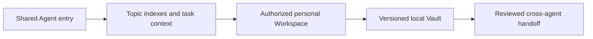

# AI Memory Hub

**Languages:** [简体中文](../../README.md) · [English](README.en.md) · [日本語](README.ja.md) · [한국어](README.ko.md) · [Español](README.es.md) · [Français](README.fr.md) · [Deutsch](README.de.md) · [Português (Brasil)](README.pt-BR.md) · [Русский](README.ru.md)

---

**A user-controlled, reusable AI memory hub designed for long-term growth.**
Turn scattered AI conversations, projects, files, and working preferences into a personal knowledge system that is **findable, understandable, updateable, traceable, and selectively portable**. The goal is not simply to make an AI “remember” things; it is to decide **what deserves preserving, how it may be used later, and how to keep the information reliable and under your control**.
> **Purpose:** long-term personal memory · life archive · project and decision knowledge · shared multi-agent context · conversation and file archive · reusable workspaces
>
> **Principles:** user ownership, model neutrality, least-necessary reading, traceable sources, reviewed updates, and explicit sensitive-data authorization.
>
> **Version:** V2.3.0 · Python 3.11+ · MIT · local-first · this repository remains **Private** and is not yet an official public Release.
This distribution is a **depersonalized working system**, not a copy of someone else's private memory repository. Installation includes no real user's biography, medical records, conversation exports, credentials, or automatically approved data sources.

**Why not just save every chat?**
| Common problem | Design response |
| --- | --- |
| Conversations grow too long for a new agent to reread | **L0–L3 layered retrieval**: locate, summarize, inspect a checkpoint, and only then request the source text |
| A temporary remark is mistaken for a permanent fact | **Candidate → review → separate activation**, with provenance and revisions |
| Shared knowledge silently grows stale | **Detected does not mean synced**: reread changed scopes and explicitly acknowledge |
| Old links vanish and deliverables cannot be recovered | **Stored bytes, exact revisions and SHA-256 verification** |
| Failed imports are retried and duplicate records appear | **Per-item receipts and idempotent retries**, with partial-failure reporting |
These capabilities are implemented and tested, but are not automatic connections to every provider.
---
## I. What can this repository do?
### 1. Provide a common long-term background to different AIs
Where the user has granted access and the environment can really read the content, different agents can reuse the same versioned memory instead of relying on incompatible, platform-specific chat summaries. A new agent can start with approved preferences, active projects, operational rules, and open decisions.
[Agent entry](../../AGENTS.md) · [Task-based index](../../core/INDEX.md) · [Bootstrap protocol](../../integrations/memory-bootstrap.md) · [Capabilities](../../integrations/capabilities.md)
**Limit:** having a document does not make every AI platform automatically read it, nor does it establish a background connection or native provider memory.
### 2. Maintain a living life archive
Organize long-term personal information into **12 major categories, 52 subdomains, and 134 registered fields** covering background, upbringing, learning, career, values, relationships, health and lifestyle, finances, plans, AI collaboration, milestones, and record governance.
Fields are linked to provenance, evidence strength, observation time, validity windows, sensitivity, and revision relations. All initial categories are `unknown`; a taxonomy is **not** a claim that the user supplied any actual facts.
[Life archive](../../life-archive/README.md) · [Taxonomy](../../life-archive/taxonomy.md) · [Field registry](../../life-archive/field-registry.json) · [Blank profile](../../life-archive/profile.json)
### 3. Preserve durable preferences and operating rules
Keep approved communication conventions, collaboration preferences, recurring standards, and restrictions separate from temporary prompts. Facts, preferences, standing rules, decisions, inferences, and unverified proposals are deliberately distinguished.
[Rules](../../core/hard-rules.md) · [Preferences](../../core/preferences.md) · [Structured memory](../../memory/facts.yaml)
### 4. Continue projects across sessions and agents
A long-lived project can preserve objectives, scope, architectural constraints, verified results, rejected approaches, deliverables, risks, and next steps. An agent taking over sees **what was decided, why, and what is unfinished**.
[Project template](../../projects/TEMPLATE.md) · [Project index](../../projects/README.md) · [Handoff protocol](../../collaboration/handoff-protocol.md)
**Limit:** dated project context does not replace checking current source code, tickets, or deployed environments.
### 5. Retain reasoning behind decisions and lessons learned
Keep original rationale, supporting sources, alternatives, time of validity, conditions for reconsideration, and a versioned history rather than overwriting a previous conclusion.
[Decisions](../../memory/decisions.md) · [Changelog](../../memory/changelog.md) · [Pending review](../../memory/pending-review.md)
### 6. Document tools and transferable capabilities
Describe AI applications, Skills, plugins, MCP (Model Context Protocol) services, their supported tasks, connection requirements, and actual validation evidence. A capability's existence is distinct from installation, account authorization, and successful use.
[Integrations](../../integrations/README.md) · [Capability matrix](../../integrations/capabilities.md)
### 7. Archive conversations and real files, with optional health summaries
Represent conversation history as **L0 index, L1 summary, L2 detailed checkpoint, and separately authorized L3 visible source messages**. Store the **actual bytes** of selected user uploads or AI-generated artifacts with SHA-256, immutable revisions, and source references—not only links that can expire.
#### L0–L3: why do conversations have four layers?
| Layer | What it contains or returns | When to use it |
| --- | --- | --- |
| **L0 · Index** | Title, session ID, related project, revision and locating information | Find which conversation discussed a topic |
| **L1 · Summary** | L0 context plus an explicitly supplied summary | Decide whether a conversation is relevant |
| **L2 · Structured checkpoint** | Goal, requirements, constraints, decisions, rejected options *with reasons*, results, verification, open questions, next actions and file references | Resume a project without rereading the entire transcript |
| **L3 · Optional visible source messages** | Actually archived user, assistant or tool messages, source metadata and original revision evidence | Check the exact wording, only with additional permission |
**These are progressively richer views, not four automatically generated summaries.** If a layer was never supplied or authorized, the application does not invent it. L3 archiving and access require specific consent and a `private` or `restricted` Vault.
For example, a new agent can locate the synthetic `calibration-session` at L0, judge relevance at L1, and read a rejected calibration approach and remaining work at L2. Only if a real authorized transcript exists should it drill down to L3. **Updating L2 leaves historical L3 intact**, preserving the raw revision and source digest for later verification.
[Session protocol](../protocol.md) · [Session guide](../../sessions/README.md) · [Revision and raw authorization](../guide.md)

An optional health extension validates **explicitly authorized de-identified aggregates only**. It is not an Apple Health or device-level raw-data sync engine.
[Sessions](../../sessions/README.md) · [Assets](../../assets/README.md) · [Health extension](../../life-archive/health/README.md) · [Adapters](../adapters.md)
### 8. Govern memory proposals, conflicts, corrections, and approval
A lasting claim does not immediately become an accepted fact. V2.3 supports **candidate validation, duplicate/conflict advice, evidence-backed approval, separate activation, revocation, supersession, and auditable history**.
```text
Discover potentially durable information
                  ↓
Check type, source, date and sensitivity
                  ↓
Create a candidate and inspect duplicates/conflicts
                  ↓
Verify evidence and explicitly approve or reject
                  ↓
Separately authorize activation or optional PR review
                  ↓
Publish an accepted revision with preserved history
                  ↓
Authorized receiving agents reread the changed scope
```
**Approval alone does not activate a candidate**, and an optional PR flow does not upload any private data automatically.
[Memory lifecycle](../../workflows/memory-lifecycle.md) · [Candidate intake](../../candidates/README.md)
### 9. Detect shared-version changes without claiming automatic synchronization
A recipient can inspect a user-approved local shared-memory snapshot, reread changed scopes, and acknowledge them independently. `detected_sha` is the observed version; `synced_sha` is the version whose scopes were explicitly read and confirmed. `pending_reload` and `reload_scope` make outstanding work visible. Unavailable sources report `unknown`.
This confirms a scoped read and acknowledgment, **not an AI's comprehension or an update to the provider's native memory**.
[Memory version procedure](../../integrations/memory-bootstrap.md) · [Snapshot schema](../../schemas/shared-memory.schema.json)
### 10. Validate structure, access boundaries, and maintenance
The product includes JSON Schema definitions, a strict release-file allowlist, Windows and Ubuntu tests, and independently checked review ZIP/Bundle artifacts. Each user's workspace and Vault are created separately; **no data source is authorized by default**.
[Security](../../SECURITY.md) · [Access boundaries](../../core/boundaries.md) · [Recovery](../deployment.md) · [CI](../../.github/workflows/test.yml)

### Small design decisions that make a big difference
| Detail | Why it matters |
| --- | --- |
| **Start with checkpoints; seek raw messages only when needed** | Most handoffs need goals, evidence and next actions—not an entire transcript. Layered reading avoids unnecessary context ingestion |
| **New summaries never rewrite old source evidence** | L2 supports append-only revisions with checkpoint sources; historical L3 remains tied to its original source and revision |
| **Approval and activation are separate operations** | Even reviewed candidates cannot become active facts without a further authorized action; conflicting peers use exact record revisions |
| **Each agent maintains its own confirmed baseline** | Agent A's read is not Agent B's read. `synced_sha` advances only after all changed scopes are acknowledged; unavailable sources report `unknown` |
| **URLs are not stored file bytes** | External links remain references; content-addressed local blobs offer hash-based verification and exact version retrieval |
| **Retries are scoped, not blind rewrites** | Item-level receipts return `unchanged` for previously processed records and report incomplete source coverage |
| **An enabled switch is not a running schedule** | Configuration, local source permission, scheduler installation and actual run evidence are tracked independently |
| **Workspace is not the Vault** | Agent-facing navigation and reusable templates are separated from durable private records and file bytes |
These choices are about **provenance, recovery, and user permission**, not universal invisible capture or automatic native AI memory.

---
## II. What information does the system organize?
These sections describe **supported subject areas, not a list of stored personal facts**. A freshly initialized workspace is empty of real personal history.
### A. Life archive: 12 categories
| Category | Information that may be recorded |
| --- | --- |
| **01 · Identity** | Background, location, languages, identity-related boundaries |
| **02 · Upbringing** | Family context, childhood phases, formative experiences |
| **03 · Education** | Learning history, skills, study approaches and goals |
| **04 · Career** | Roles, technical expertise, projects, career direction |
| **05 · Personality and values** | Self-reports, values, decision tendencies, communication |
| **06 · Relationships** | Family, social and professional relationships and boundaries |
| **07 · Health and lifestyle** | Health history, routines, activity, the provenance of records |
| **08 · Finance and circumstances** | Income/expenses, assets/liabilities, costs and plans |
| **09 · Goals and plans** | Near-term aims, long-term vision and changing priorities |
| **10 · AI collaboration** | Agent roles, decisions, reusable workflows and tools |
| **11 · Major life events** | Milestones, transitions, dated events and context |
| **12 · Provenance and maintenance** | Source quality, review, privacy classes and revisions |
**Coverage is not completeness.** The 52 subdomains and 134 fields are a validated registry of possible records; they start as unknown and require individual evidence.
[Taxonomy](../../life-archive/taxonomy.md) · [Field schema](../../schemas/life-fields.schema.json)
### B. Durable memory and collaboration rules
| Area | Examples |
| --- | --- |
| Background and preferences | Stable communication styles, recurring working preferences |
| Standing rules and limits | Approved constraints, authorization boundaries and risk handling |
| Evidence and confidence | Firsthand statements, documents, inference, competing claims |
| Decision history | Rationales, replacements, date-scoped applicability |
| Agent cooperation | Scope selection, verification, handoffs, version receipts |
| Reusable practices | Research, development, writing, verification and review |
[Core index](../../core/INDEX.md) · [Memory governance](../../memory/README.md) · [Workflows](../../workflows/memory-lifecycle.md)
### C. Work, technology, and project knowledge
| Area | Examples |
| --- | --- |
| Project context | Goals, requirements, scope, responsibility and history |
| Options and tradeoffs | Architectural decisions, rejected plans and their reasons |
| Development and verification | Environments, schemas, tests and confirmed results |
| Troubleshooting | Incidents, verified fixes, reusable lessons |
| Continuity | Checkpoints, deliverables, unresolved work and next actions |
| General knowledge | Transferable concepts, methods and tools |
[Projects](../../projects/TEMPLATE.md) · [Knowledge template](../../knowledge/TOPIC.md) · [Development workflow](../../workflows/development.md)
### D. AI tools, Skills, and integration knowledge
| Area | Examples |
| --- | --- |
| AI integration | Permission models, supported source formats and access status |
| Skills and plugins | Provenance, capabilities, validation and compatibility |
| MCP services | Discovery, authorization, execution evidence and limitations |
| Agent responsibilities | Role division, verification, handoff acceptance criteria |
| Environment compatibility | Dependencies, supported systems and constraints |
[Integration capabilities](../../integrations/capabilities.md) · [Agent roles](../../collaboration/agent-roles.md)
### E. Health, lifestyle, and file assets
| Area | Examples |
| --- | --- |
| Health and lifestyle context | Authorized dated background records and provenance |
| De-identified health summaries | Selected periods, metrics, units and sample counts |
| User uploads | Original bytes, versions, hashes, origin and links to projects |
| AI-generated artifacts | Archived outputs with exact revisions |
| Conversation context | L0–L2 and optional L3 subject to extra consent |
| Derived results | Traceable summaries and analyses from approved sources |
**Limit:** health-aggregate validation is not continuous raw-device ingestion; an external URL is not an archived file until its bytes have been stored.
[Health boundary](../../life-archive/health/README.md) · [Assets](../../assets/README.md) · [User guide](../guide.md)
---
## III. Common use cases
| Goal | How AI Memory Hub helps |
| --- | --- |
| **Start with a new AI assistant** | Read authorized rules and context from common entry points or an approved handoff |
| **Resume an interrupted project** | Recover verified decisions, evidence, asset versions and open tasks |
| **Transfer work to another agent** | Hand over selected project state and exact file versions for recipient verification |
| **Preserve long-term user preferences** | Read task-relevant rules without promoting temporary instructions |
| **Build a life archive gradually** | Fill the 12/52/134 taxonomy with sourced, dated and permissioned facts |
| **Archive AI deliverables** | Store immutable file bytes and provenance instead of fragile links |
| **Correct a long-term memory** | Review, approve, separately activate, supersede or revoke with audit history |
| **Check shared-memory freshness** | Detect changes, fetch scoped content, explicitly confirm acknowledgment |
| **Review a health aggregate** | Validate an authorized de-identified summary, not raw devices |
| **Understand scheduled work** | Distinguish switches, permissions, receipts and proven scheduler execution |
Outcomes still depend on actual platform access, source coverage, and operational permissions. Templates alone do not establish an automatic connection.
---
## IV. How is data organized?
Like the private instance's design, the navigational path is **common entry → topic index → record or asset → source and revision history**.

```text
AI Memory Hub
├── README.md                   Default Chinese introduction
├── AGENTS.md                   Neutral Agent entry
├── core/                       Rules, preferences and task index
├── memory/                     Structured facts, decisions and changes
├── projects/                   Project status and templates
├── sessions/                   L0–L3 session organization
├── life-archive/               12/52/134 classification and fields
├── knowledge/                  General knowledge templates
├── assets/                     File records and version references
├── candidates/                 Proposed durable memories
├── collaboration/              Agent division and handoff rules
├── integrations/               Provider access and shared versions
├── workflows/                  Research, development and review
├── config/                     Sync settings and workspace policies
├── ai_memory_hub/              Local CLI, Vault and governance engine
├── schemas/                    Schemas and validators
├── docs/
│   └── i18n/                   English and other translated READMEs
├── examples/                   Public synthetic examples
├── scripts/                    Testing and release verification
├── tests/                      Cross-platform regression tests
├── vendor/                     Dependency/source relationships
└── .github/workflows/          CI and release audit
```
Three boundaries matter: the **product source tree** contains public templates and code; an **individual Workspace** contains the owner's local navigation and custom records; a **separate Vault** holds the SQLite index and approved versioned bytes. Do not commit a real workspace or Vault to the public product repository.
[19-module comparison](../workspace-parity.md) · [Workspace setup](../workspace.md) · [Vault protocol](../protocol.md)
---
## V. How do I install and use it?
This section is deliberately more hands-on than the private instance's README. Commands apply to the **authorized V2.3.0 checkout** on Python 3.11+; use PowerShell on Windows or a terminal on Linux/macOS. Paths below are examples.
### 1. Install the local CLI
Obtain an authorized copy of the repository, open its root directory and run:
```sh
python --version
python -m pip install .
ai-memory-hub --help
```
The repository is currently Private, so source access is required. The CLI is `ai-memory-hub`; `python -m ai_memory_hub` is an alternative where the executable is not on PATH. A dedicated virtual environment is recommended for regular use.
### 2. Initialize a personal Workspace and Vault
```sh
ai-memory-hub workspace init --path ../my-hub
ai-memory-hub workspace check --path ../my-hub
```
This creates the personal Workspace at `../my-hub/` and a separate sibling Vault at `../my-hub-vault/`, both outside the repository. Initial sensitivity is `private`. No sources are granted, no real conversations are imported, and no scheduler is installed. Use `--vault PATH` and `--sensitivity LEVEL` when appropriate.
Initialization refuses to overwrite existing directories. Start with the generated `AGENTS.md` and `core/INDEX.md`.
### 3. Try the complete synthetic onboarding
Choose **new, unused demo paths**:
```sh
ai-memory-hub workspace init --path ../hub-demo --demo
ai-memory-hub workspace check --path ../hub-demo
ai-memory-hub --root ../hub-demo-vault source grant sample normalized --path ../hub-demo/demo-inbox --consent
ai-memory-hub --root ../hub-demo-vault local run --source sample
ai-memory-hub --root ../hub-demo-vault local status
ai-memory-hub --root ../hub-demo-vault memory review
ai-memory-hub --root ../hub-demo-vault project list
ai-memory-hub --root ../hub-demo-vault session list
ai-memory-hub --root ../hub-demo-vault asset check calibration-notes
```
`--demo` copies synthetic input only. The explicit source grant authorizes a read; re-running an unchanged import is idempotent. Review results remain candidates until independently accepted and activated.
[Synthetic onboarding](../workspace.md#synthetic-onboarding)

#### Read one session at L0, then L1, then L2
After importing the synthetic demo, query one session at increasing levels of detail. The sample has no L3 source transcript; the CLI cannot recreate an unprovided transcript.
```sh
ai-memory-hub --root ../hub-demo-vault session show calibration-session --layer L0
ai-memory-hub --root ../hub-demo-vault session show calibration-session --layer L1
ai-memory-hub --root ../hub-demo-vault session show calibration-session --layer L2
```
In L2, `rejected_options` records *what was rejected and why*, `verification` records the supplied checks, and `next_actions` captures unfinished work. The AI should not fabricate validation results.

### 4. Customize your archive and display accepted memory
Use the generated `core/` notes, `projects/` template, and `life-archive/profile.json` progressively. The 12 profile categories start `unknown`; there is no requirement to populate them at installation time.
```sh
ai-memory-hub workspace check --path ../my-hub
ai-memory-hub workspace facts --path ../my-hub --consent
```
A facts projection includes **accepted memory only** and does not create a Git commit, remote PR, or publication.
### 5. Import an authorized source
For a local inbox carrying a supported `memory-hub.json`:
```sh
ai-memory-hub --root ../my-hub-vault source grant work normalized --path APPROVED_INBOX --consent
ai-memory-hub --root ../my-hub-vault local run --source work
ai-memory-hub --root ../my-hub-vault local status
```
Replace `APPROVED_INBOX` with a selected local directory. A ChatGPT export must first be downloaded by its owner through the official provider process, then authorized using `chatgpt_export` for supported JSON/ZIP. L3 visible raw messages and attachments need separate authorization. The program does not silently monitor all AI accounts.
[Adapters](../adapters.md) · [Local deployment](../deployment.md)
### 6. Validate, review, and activate a memory
This illustration assumes the candidate has **no conflicting peer records** and is on memory revision 1. Replace the placeholder ID, base revisions and reviewer with live values:
```sh
ai-memory-hub --root ../hub-demo-vault candidate suggest CANDIDATE_ID --consent
ai-memory-hub --root ../hub-demo-vault candidate advance CANDIDATE_ID validated --base 0 --record-revision 1 --actor reviewer --reason "Source checked" --consent
ai-memory-hub --root ../hub-demo-vault candidate advance CANDIDATE_ID review --base 1 --actor reviewer --reason "Peers checked" --consent
ai-memory-hub --root ../hub-demo-vault candidate advance CANDIDATE_ID approved --base 2 --actor reviewer --reason "Owner approved" --evidence-verified --consent
ai-memory-hub --root ../hub-demo-vault candidate advance CANDIDATE_ID active --base 3 --actor reviewer --reason "Activate approved memory" --consent
ai-memory-hub --root ../hub-demo-vault candidate history CANDIDATE_ID --consent
```
For duplicate or conflicting keys, acknowledge exact `--ack-peer ID@REV` and, where warranted, `--supersede ID@REV`. Approval and activation are distinct and require the owner's actual evidence review.
[Governance flow](../../workflows/memory-lifecycle.md)
### 7. Share and confirm memory versions across agents
Create a **selected, authorized** snapshot from the owner's already accepted memory. Provide it to another owner-controlled Vault through a separately approved channel:
```sh
ai-memory-hub --root OWNER_VAULT version snapshot --name checkpoint-01 --include rules=MEMORY_ID --consent
ai-memory-hub --root RECEIVER_VAULT version check --channel shared --agent agent-b --snapshot APPROVED_JSON --consent
ai-memory-hub --root RECEIVER_VAULT version reload --channel shared --agent agent-b --scope rules --consent
ai-memory-hub --root RECEIVER_VAULT version confirm --channel shared --agent agent-b --sha DETECTED_SHA --receipt READ_RECEIPT --consent
```
Replace all uppercase placeholders with actual authorized paths, IDs, returned SHA and receipt. `synced_sha` advances **only after all changed scopes have been acknowledged**. A receipt is evidence of scoped retrieval and attestation, not proof that the AI comprehended the message or its native memory was updated.
[Detailed version and read-confirm protocol](../../integrations/memory-bootstrap.md)
### 8. Transfer a project and selected file revisions
The `handoff` switch is off by default. Enable it explicitly, then send an inspected offline transfer ZIP with only selected file versions:
```sh
ai-memory-hub --root ../hub-demo-vault config set handoff on
ai-memory-hub --root ../hub-demo-vault transfer pack --project greenhouse-demo --asset calibration-notes@1 --consent
ai-memory-hub --root RECEIVER_VAULT config set handoff on
ai-memory-hub --root RECEIVER_VAULT transfer receive --input APPROVED_COPY.zip --consent
ai-memory-hub --root RECEIVER_VAULT transfer inspect PACKAGE_ID --consent
ai-memory-hub --root RECEIVER_VAULT transfer file PACKAGE_ID calibration-notes@1 --consent
```
Initialize the recipient Vault independently. `APPROVED_COPY.zip` is the exact produced and reviewed ZIP; `PACKAGE_ID` comes from receive. **Transfer ZIPs are not encrypted.** SHA-256 validates bytes, not the identity of a sender, and L3 is excluded.
[Transfer and restore](../deployment.md)
### 9. Sync switches, upkeep, and recovery
| Switch | Default `ordinary` | Meaning |
| --- | --- | --- |
| `weekly` | On | Weekly entry point; **does not install a scheduler** |
| `full` | On | On-demand full or selected-source import |
| `event` | Off | Explicitly authorized event run |
| `daily` | Off | Optional daily catch-up |
| `handoff` | Off | User-approved project and file transfer |
Change switches with `config set FEATURE on|off`. An enabled switch does not establish a running schedule. Use `local status` for source grants, actual completion, and scheduler verification. Before upgrades, stop writers, back up both the Workspace and Vault, and verify restoration using a copy.
[Operations](../guide.md) · [Recovery](../deployment.md)
### 10. For maintainers
V2.3 keeps the Vault record schema at **2.1**, the new Workspace format is **1.0**, and the offline transfer envelope is **2.2**. Do not commit real personal workspaces, Vault databases, raw exports, credentials, or attachments to the product repository.
```sh
python -m pip install jsonschema
python -m unittest discover -s tests -v
python scripts/smoke_release.py
python scripts/smoke_v22.py
python scripts/smoke_workspace.py --installed
python scripts/check_readme_i18n.py
```
Install the local package first for the installed-CLI smoke test. CI runs on Windows and Ubuntu, but does not prove that a specific external provider or user's production environment has been connected.
---
## VI. Privacy, safety, and ownership
- **The owner chooses what to store, who may read it, and when to update it.** Sources, L3, file sharing and remote recipients require specific authorization.
- **The product repository is not a personal data repository.** Templates and synthetic fixtures can be shared; real Workspaces and Vaults are separate.
- **Vaults rely on OS permissions and disk encryption.** The application does not encrypt Vault contents or transfer ZIPs itself.
- **Sensitivity labels are not filesystem ACLs.** Different audiences require suitable OS identities or storage isolation.
- **Revoking a grant stops future reads**, but does not automatically delete historical revisions. Removing a Git file does not erase earlier commits.
- **An inference is not a fact.** Preserve provenance, date, evidence, review and explicit activation.
- **Do not assume cross-platform access.** Each provider's ability to read local files or approved snapshots must be tested.
- **Do not overstate automation.** Uninstalled schedules, untested recovery and unavailable raw-health import are not finished capabilities.
[Security](../../SECURITY.md) · [Boundaries](../../core/boundaries.md) · [Memory lifecycle](../../workflows/memory-lifecycle.md)
---
## VII. Current implementation and limits
**As of 2026-11-19**, V2.3 has passed synthetic engineering validation:
| Capability | Current status |
| --- | --- |
| **19 reusable workspace modules** | Implemented and owner-initializable |
| **12/52/134 life taxonomy** | Registered and validated; no personal records by default |
| **L0–L3 sessions, Vault, asset versions** | Implemented; raw/sensitive access separately granted |
| **Candidate lifecycle** | Validation, conflict advice, approval, separate activation and history |
| **Shared Agent memory acknowledgment** | Authorized snapshots, scoped reloads and receipts |
| **Offline project and file transfer** | Synthetic end-to-end tested; no hosted live sync |
| **Windows/Ubuntu and ZIP/Bundle audits** | Engineering tests passed |
| **Live personal data or local production scheduler** | Not enabled by installation |
| **Raw health-device synchronization** | Not part of the generic product; de-identified aggregate checking only |
| **Public GitHub repository and formal 2.3.0 Release** | Not published; repository remains Private |
[Coverage matrix](../workspace-parity.md) · [Security](../../SECURITY.md) · [CI](../../.github/workflows/test.yml)
---
## VIII. Long-term goal
**Make personal memory a lasting, inspectable, portable digital asset that belongs to the user rather than an opaque fragment inside each AI platform.**
The hub is not designed to retain every sentence or maximize the amount of data collected. It aims for **clear categories, reliable provenance, reviewable change history, bounded access, and continuity even as AI tools change**.
