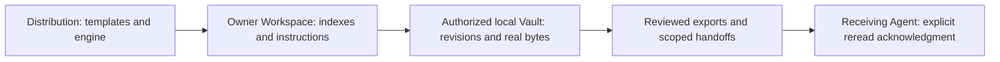

# AI Memory Hub

**Languages:** [简体中文](../../README.md) · [English](README.en.md) · [日本語](README.ja.md) · [한국어](README.ko.md) · [Español](README.es.md) · [Français](README.fr.md) · [Deutsch](README.de.md) · [Português (Brasil)](README.pt-BR.md) · [Русский](README.ru.md)

---
**Own your AI memory: organized, verifiable, portable, and under your control.**
AI Memory Hub combines a **complete personal memory Workspace template with a local versioned Vault engine** for durable facts, conversations, projects, files, a life archive, and authorized transfers between different AI agents.
**V2.4.0** · Python 3.11+ · MIT · local-first · the distribution repository remains **Private** and has not yet had an official public Release.
The core examples retain the V2.3.0 Workspace and Vault workflow.
**Start here:** [Agent-led first-time setup](../agent-onboarding.md) · [中文入门指南](../agent-onboarding.zh-CN.md) · [Manual setup](../workspace.md)
## I. What is it, and who is it for?
The project supplies **organization conventions, reviewable memory governance, and a working local storage engine**, not one giant text file containing every conversation.
It is useful for people who switch between AI assistants, maintain long-lived projects, want verifiable file versions and decisions, or plan to build a long-term personal archive organized into **12 categories, 52 subdomains and 134 registered fields**.
It is **not** an automatic scraper for all AI accounts, a hosted sync service, or a program that uploads raw chats and health records to GitHub by default. Each ability depends on actual tools, available evidence and explicit permissions.
## II. First use: let your own Agent help set it up
A user can send the distribution repository to an AI/Agent that has **actual repository access and appropriate local execution tools**, and ask it to follow [the Agent onboarding protocol](../agent-onboarding.md).
### A single practical setup instruction
```text
Read README.md, AGENTS.md and docs/agent-onboarding.md
from this AI Memory Hub repository.
I want to create a private memory hub of my own.
Inventory the tools, source coverage and permissions you
actually have, without claiming access to hidden chats.
Initialize a new Workspace and separate Vault and test them
using only synthetic data.
Ask for explicit scoped approval before creating a GitHub
repository, ingesting real private sources, pushing to a
remote, sharing with another agent or installing schedules.
Organize accessible sessions, candidate memories, projects
and file references according to evidence and classifications.
Finally report completed actions, exact evidence, gaps,
questions for me, and actual sync and scheduler status.
```
### The intended owner journey
| Phase | Safe, verifiable work | Additional owner decision |
| --- | --- | --- |
| **Discover** | Read entry points and verify live GitHub/file/command/provider access | Missing account connections and data scope |
| **Initialize** | Install, create separate Workspace and Vault, verify default templates | Authorized local path and execution scope |
| **Organize** | Process approved accessible sources into sessions, projects, file records and memory proposals | Real source grants; separate L3/raw/sensitive permissions |
| **Review** | Present duplicate/conflict advice and a preview of any Git projection | Explicit memory activation, repo creation and remote publishing authority |
| **Maintain** | Report missing sources, field coverage, sync switches and run evidence | Scheduler, backup and recipient-sharing decisions |
The [V2.4 setup guide](../agent-onboarding.md) covers executable `onboarding plan`, `apply` and `report`, along with separately approved repository creation and publication. Use the owner's actual source grants and the current runtime's verified capabilities.
[Agent setup and acceptance checklist](../agent-onboarding.md) · [Supported adapters](../adapters.md) · [Feature coverage](../workspace-parity.md)
## III. Important capabilities and the design behind them
### L0–L3: read conversations only as deeply as necessary
| Layer | What it contains or returns | Useful when |
| --- | --- | --- |
| **L0 · Index** | Session title, ID, project link, version | Find a relevant past conversation |
| **L1 · Summary** | L0 plus an actual supplied summary | Quickly decide whether to dive deeper |
| **L2 · Structured checkpoint** | Goals, requirements, constraints, decisions, rejected options *and reasons*, verification, next actions and file references | Continue a long-running project after changing agents |
| **L3 · Optional original** | Actually archived visible messages, their provenance and original revisions | Confirm the exact wording with extra consent |
These are **progressively richer views**, not four automatically invented summaries. Missing L1–L3 content is not fabricated. L3 requires separate consent and a `private` or `restricted` Vault. Later L2 revisions do not overwrite historical L3 records.
[Session protocol](../protocol.md) · [Session query examples](../guide.md) · [Session index](../../sessions/README.md)
### Memory proposals must be reviewed and activated separately
The lifecycle is: create candidate → verify evidence → compare duplicates/conflicts and exact revisions → approve or reject → **separately authorize activation**. History remains available, and inferences do not automatically become accepted personal facts.
[Memory lifecycle](../../workflows/memory-lifecycle.md)
### Preserve actual file bytes, not only links
Approved uploads and AI outputs can be stored as **content-addressed Vault bytes**, with SHA-256, immutable asset versions, provenance and associated sessions/projects. An external URL is only a reference unless the actual file bytes were archived; transfer requests select exact versions.
[Asset operations](../guide.md) · [Assets](../../assets/README.md)
### Each receiving Agent has its own confirmed version
`detected_sha` means the version it has detected; `synced_sha` means the version whose changed scopes it explicitly reread and confirmed. An unavailable source returns `unknown`. A receipt is not proof of model comprehension or native provider memory synchronization.
[Read-and-confirm protocol](../../integrations/memory-bootstrap.md)
### Further details that matter
- **Life archive** has 12 categories, 52 domains, 134 registered fields, all `unknown` at initialization and linked to provenance, dates and sensitivity.
- **Idempotent imports** track scoped receipts. Unchanged items return `unchanged`; errors are reported separately rather than hidden by partial success.
- **Long-term project continuity** ties decisions, rejected approaches, evidence, next steps and exact file versions to checkpoints.
- **Separate storage layers** prevent a reusable Git template from silently becoming a repository for sensitive raw data.
[Life profile](../../life-archive/README.md) · [Project template](../../projects/TEMPLATE.md) · [Sync workflow](../../workflows/hybrid-sync.md)
## IV. Where is the information stored?

| Location | Responsibility | GitHub policy |
| --- | --- | --- |
| **Distribution repository** | Source code, tests, sample records and neutral templates | Only release-audited public-product files |
| **Personal Workspace** | Customized rules, archive fields, projects, indexes | **Ignored by default**; only individual approved projections may be published |
| **Local Vault** | SQLite history, source grants, raw transcripts and actual files | Not uploaded by default; protect with OS and backup controls |
| **Optional owner's Private Git repo** | Reviewed non-sensitive facts, project summaries, workflows, provenance and asset-version references | Created and written only with user authorization; Private is not end-to-end encryption |
The generated Workspace `.gitignore` intentionally ignores everything. Do not force-add all raw contents to Git to simulate a completed setup. Keep sensitive records local or in separately authorized storage.
[Full 19-module mapping](../workspace-parity.md) · [Security boundaries](../../core/boundaries.md) · [Approved Git projection](../agent-onboarding.md)
## V. Installation and a synthetic first run
### Initialize with Python 3.11+
Use a trusted checkout and new directories outside the distribution repository.
```sh
python -m pip install .
ai-memory-hub workspace init --path ../my-hub
ai-memory-hub workspace check --path ../my-hub
```
The result is an independent Workspace plus sibling Vault. **No data sources are authorized and no recurring tasks are installed** by default.
### Complete a synthetic trial
```sh
ai-memory-hub workspace init --path ../hub-demo --demo
ai-memory-hub workspace check --path ../hub-demo
ai-memory-hub --root ../hub-demo-vault source grant sample normalized \
  --path ../hub-demo/demo-inbox --consent
ai-memory-hub --root ../hub-demo-vault local run --source sample
ai-memory-hub --root ../hub-demo-vault session show calibration-session --layer L0
ai-memory-hub --root ../hub-demo-vault session show calibration-session --layer L1
ai-memory-hub --root ../hub-demo-vault session show calibration-session --layer L2
ai-memory-hub --root ../hub-demo-vault memory review
ai-memory-hub --root ../hub-demo-vault asset check calibration-notes
ai-memory-hub --root ../hub-demo-vault local status
```
The demo is synthetic; copying it does not authorize reading. L2 shows the evidence and decisions actually recorded, not an invented L3 transcript. Real provider exports require an authorized supported format and separate consent for raw messages.
### Candidate, shared version, and handoff commands

The multiline examples use POSIX shell `\` continuation. In Windows PowerShell, combine each command on one line or use PowerShell backtick continuation.
```sh
ai-memory-hub --root VAULT candidate suggest CANDIDATE_ID --consent
ai-memory-hub --root VAULT candidate advance CANDIDATE_ID validated \
  --base 0 --record-revision 1 --actor reviewer \
  --reason "Source checked" --consent
ai-memory-hub --root VAULT candidate history CANDIDATE_ID --consent
ai-memory-hub --root RECEIVER_VAULT version check --channel shared \
  --agent agent-b --snapshot APPROVED_JSON --consent
ai-memory-hub --root RECEIVER_VAULT version reload --channel shared \
  --agent agent-b --scope rules --consent
ai-memory-hub --root RECEIVER_VAULT version confirm --channel shared \
  --agent agent-b --sha DETECTED_SHA \
  --receipt READ_RECEIPT --consent
ai-memory-hub --root OWNER_VAULT transfer pack --project greenhouse-demo \
  --asset calibration-notes@1 --consent
ai-memory-hub --root RECEIVER_VAULT transfer receive --input APPROVED_COPY.zip --consent
ai-memory-hub --root RECEIVER_VAULT transfer inspect PACKAGE_ID --consent
ai-memory-hub --root RECEIVER_VAULT transfer file PACKAGE_ID calibration-notes@1 --consent
```
Uppercase paths, IDs, receipt hashes, and exact revision numbers must be replaced with **real authorized values**; transfer needs an enabled handoff policy and initialized recipient Vault. Candidate acceptance is a separately reviewed multi-step workflow, not complete merely by running the displayed status commands.
[Installation guide](../workspace.md) · [Full memory review](../../workflows/memory-lifecycle.md) · [Version protocol](../../integrations/memory-bootstrap.md) · [Transfer/recovery](../deployment.md)
## VI. Synchronization, access and operations
### Five switches do not mean five running background tasks
| Switch | Ordinary default | Meaning |
| --- | --- | --- |
| `weekly` | On | Weekly entry point, **without installing a scheduler** |
| `full` | On | Manual full/selected-source import |
| `event` | Off | Explicit approved event invocation |
| `daily` | Off | Optional daily catch-up invocation |
| `handoff` | Off | Approved project and file-version handoff |
**Enabled policy ≠ completed run ≠ all accounts connected ≠ remote Git sync.** Source grants, scheduler installation, per-item receipts, actual remote Git commits and per-Agent reread acknowledgment require separate proof. Use `local status` and `config show` for recorded local evidence; if scheduling was not installed, report `not_verified`.
Only read accessible authorized sources. L3, sensitive files, external recipients, permanent schedules and remote publication need scoped approval. Revoking a source grant stops future reads, not historical data retention. The Vault and transfer ZIP are **not encrypted by this application**; OS access controls, disk encryption and an approved transfer channel are required.
[Security](../../SECURITY.md) · [Boundaries](../../core/boundaries.md) · [Operations](../guide.md)
## VII. What works today, and what still needs development?
| Capability | Actual V2.4 status |
| --- | --- |
| 19-module owner Workspace and independent Vault | **Implemented and synthetic-tested** |
| 12/52/134 life registry and unknown coverage | **Implemented** |
| L0–L3 session records, projects and file versions | **Engine implemented**, actual content needs real authorized sources |
| Memory proposal review, activation and audit | **Implemented** |
| Approved snapshot detection and per-Agent confirmation | **Implemented**, not native provider memory sync |
| Optional Private GitHub repository creation | **Supported** for authenticated GitHub CLI personal accounts with explicit owner approval |
| Automatic harvesting of all AI memories/chats/files | **Not universally supported**; depends on exports and permitted connectors |
| Independently reviewed Git projection and publish | **Implemented**. An empty Private repository receives the neutral 19-module scaffold on first publication. Explicitly reviewed and redacted memory, project and session indexes from a private Vault are grouped into modules. The user approves the review and then the exact projection digest and target |
| First-run plan, apply and coverage report | **Implemented** with local source grants and evidence of missing information |
| Recurring scheduling, Git mirroring and production backups | Not installed or enabled by default |
| Raw health-device capture | Not in the generic product; de-identified aggregate validation only |
| Public GitHub visibility and formal Release | Not published; repository remains Private |
[Implementation comparison and tests](../workspace-parity.md) · [Agent protocol](../agent-onboarding.md) · [CI](../../.github/workflows/test.yml)
## VIII. Long-term vision
**Give a trusted Agent the project, grant only the required permissions, and receive a fully organized, owner-controlled, portable private memory hub.**
The path forward is more automation without pretending to know hidden platform data, skipping evidence review or permanently uploading sensitive raw records. The goal is not to preserve every chat but to maintain **valuable, versioned and verifiable personal context under the owner's control**.
