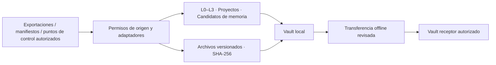

# AI Memory Hub — Memoria de IA bajo tu control
**Languages:** [English](../../README.md) · [简体中文](README.zh-CN.md) · [日本語](README.ja.md) · [한국어](README.ko.md) · [Español](README.es.md) · [Français](README.fr.md) · [Deutsch](README.de.md) · [Português (Brasil)](README.pt-BR.md) · [Русский](README.ru.md)
> **Tu contexto, tus archivos, tus decisiones.** Una base local y neutral respecto a las plataformas para la memoria a largo plazo, la continuidad de proyectos y las transferencias autorizadas entre agentes de IA.
**Versión 2.2.0 · Python 3.11+ · Licencia MIT · Interfaz de línea de comandos (CLI)**
El historial de un chat no es necesariamente una memoria fiable. Las decisiones importantes quedan enterradas, los adjuntos pierden su contexto y cambiar de asistente implica volver a explicar el proyecto. **AI Memory Hub** conserva el contexto autorizado, su procedencia, el estado del proyecto y los **bytes reales** de archivos seleccionados en un Vault local e independiente de cualquier proveedor.
## ¿Qué problema resuelve?
- **Continuidad:** Guarda objetivos, restricciones, decisiones, resultados verificados, dudas y próximos pasos.
- **Trazabilidad:** Registra fuentes, revisiones, evidencias y huellas SHA-256.
- **Archivos recuperables:** Conserva versiones de archivos subidos y resultados generados por IA, no solo enlaces.
- **Portabilidad entre agentes:** Comparte paquetes revisados y únicamente las versiones de archivos expresamente aprobadas.
- **Control del usuario:** Elige fuentes y niveles de sensibilidad; los mensajes literales de L3 requieren autorización adicional.
## Funcionalidades disponibles en V2.2
| Área | Capacidad real |
| --- | --- |
| Memoria duradera | Candidatos de hechos, preferencias y decisiones sujetos a revisión; un chat no se convierte automáticamente en verdad aceptada |
| Conversaciones | L0 índice, L1 resumen, L2 punto de control detallado y L3 opcional con mensajes visibles y fuente verificable |
| Proyectos | Versiones de estado, decisiones, pruebas, historial y trabajo pendiente |
| Archivos | Almacenamiento de bytes autorizados, deduplicación SHA-256, revisiones y recuperación verificada |
| Importación | JSON local, manifiestos explícitos de agentes de programación y exportaciones ChatGPT JSON/ZIP obtenidas por el usuario |
| Transferencia | ZIP sin conexión, selección precisa `ID@REV`, consentimiento en ambos extremos y comprobación en el Vault receptor |
| Sincronización | Cinco interruptores independientes: semanal, completa, eventos, diaria y entrega |
| Recuperación | Reintentos idempotentes, historial conservado, copias de seguridad, restauración y pruebas de reversión |
**Alcance real:** el código se ha probado con datos sintéticos en Windows y Ubuntu. **No** vigila automáticamente todos los chats, no instala tareas programadas ni ofrece sincronización en la nube en tiempo real.
## Arquitectura

Un **Vault** es un directorio local, controlado por su propietario y separado del repositorio Git. Usa un índice SQLite y blobs identificados por el hash de su contenido. Cada instancia tiene un nivel de sensibilidad; los permisos del sistema operativo protegen el acceso. Para usuarios distintos se requieren cuentas o límites de almacenamiento separados.
L0 identifica la conversación; L1 la resume; L2 registra objetivos, decisiones, pruebas y tareas pendientes. L3 conserva mensajes visibles originales **solo con consentimiento adicional**, incluyendo su fuente y revisión. Una actualización L2 no inventa ni sobrescribe los mensajes históricos L3.
## Casos prácticos
**Continuar con otra IA:** entrega requisitos, alternativas descartadas y resultados verificados en un paquete revisado; añade únicamente las versiones de archivos elegidas.
**Archivar entregables:** registra entradas como `user_upload` y resultados como `ai_generated`. Si el original se mueve o desaparece, puedes verificar y recuperar la versión ya guardada.
**Importar conversaciones ChatGPT:** descarga tu exportación mediante el procedimiento oficial, autoriza su ruta JSON/ZIP y ejecuta la importación. Guardar texto literal exige permiso específico; los archivos adjuntos se autorizan aparte.
## Inicio rápido con datos de ejemplo
Necesitas **Python 3.11 o posterior** y un sistema de archivos local fiable. Desde el repositorio descargado, puedes instalar el paquete mediante `python -m pip install .`. Usa PowerShell en Windows o una terminal en Linux/macOS. Sitúa el Vault **fuera del repositorio**.
```sh
python -m ai_memory_hub --root ../hub-demo init --preset ordinary
python -m ai_memory_hub --root ../hub-demo source grant demo normalized --path examples --consent
python -m ai_memory_hub --root ../hub-demo local run --source demo
python -m ai_memory_hub --root ../hub-demo local status
python -m ai_memory_hub --root ../hub-demo session show calibration-session --layer L2
python -m ai_memory_hub --root ../hub-demo asset check calibration-notes
python -m ai_memory_hub --root ../hub-demo asset copy calibration-notes --consent
```
`examples/memory-hub.json` contiene cuatro entradas sintéticas, incluido un archivo. Una segunda importación informa que no hay cambios, sin duplicar registros. `asset copy` crea una copia local verificada dentro del Vault.
### Importar una fuente autorizada
Inicializa primero tu Vault. Registra un directorio con un manifiesto `memory-hub.json` usando `source grant ID normalized --path PATH --consent`; después ejecuta `local run --source ID` y consulta `local status`. Para ChatGPT usa el adaptador `chatgpt_export` y un archivo `.json` o `.zip` compatible que hayas descargado. Solo autoriza `--allow-raw` si deseas guardar L3 de forma explícita. No existe un vigilante global de chats. Más detalles en [adaptadores](../adapters.md) y [despliegue](../deployment.md).
### Transferir un proyecto a otro Vault
El interruptor `handoff` está desactivado por defecto. Actívalo en ambos Vaults y selecciona las versiones exactas de los archivos que deseas compartir.
```sh
python -m ai_memory_hub --root ../hub-demo config set handoff on
python -m ai_memory_hub --root ../hub-demo transfer pack --project greenhouse-demo --asset calibration-notes@1 --consent
python -m ai_memory_hub --root ../recipient init --preset ordinary
python -m ai_memory_hub --root ../recipient config set handoff on
python -m ai_memory_hub --root ../recipient transfer receive --input APPROVED_COPY.zip --consent
python -m ai_memory_hub --root ../recipient transfer inspect PACKAGE_ID --consent
python -m ai_memory_hub --root ../recipient transfer file PACKAGE_ID calibration-notes@1 --consent
```
`APPROVED_COPY.zip` representa el paquete revisado, copiado mediante un canal seguro aprobado. `PACKAGE_ID` es el identificador devuelto al recibirlo. El ZIP **no está cifrado** y SHA-256 garantiza integridad, **no la identidad del remitente**. L3 y los archivos no seleccionados quedan fuera.
## Cinco controles independientes
| Control | Valor inicial | Función |
| --- | --- | --- |
| `weekly` | Activado | Entrada semanal; no instala un programador |
| `full` | Activado | Importación completa o por fuente, bajo demanda |
| `event` | Desactivado | Evento autorizado y explícito |
| `daily` | Desactivado | Actualización diaria opcional |
| `handoff` | Desactivado | Entrega explícita de proyectos |
Modifica un control con `config set FEATURE on|off`. `local run --source ID` utiliza `full` de forma predeterminada. El archivado semanal local y la gestión de memoria en la nube son ejecutores distintos. Un interruptor activado no demuestra que exista una programación operativa.
## Privacidad, límites y compatibilidad
El Vault no dispone de cifrado incorporado: configura permisos del sistema, cifrado de disco y copias de seguridad. Revocar una fuente detiene futuras lecturas, pero no borra automáticamente los registros existentes. Los ZIP de transferencia carecen de cifrado y requieren un canal confiable y la autorización del destinatario. Un enlace externo sigue siendo una referencia hasta que se almacenen los bytes.
La aplicación es V2.2.0, compatible con el esquema de registros `2.1`, y usa una envoltura independiente 2.2 para transferencias. Haz copias de seguridad y prueba actualizaciones en una restauración antes de cambiar la instancia real.
## Documentación y contribuciones
[Despliegue y recuperación](../deployment.md) · [Guía completa](../guide.md) · [Adaptadores](../adapters.md) · [Protocolo](../protocol.md) · [Seguridad](../../SECURITY.md) · [Licencia MIT](../../LICENSE)
Usa datos sintéticos en pruebas y contribuciones; nunca subas exportaciones personales. Pruebas: `python -m pip install jsonschema`, `python -m unittest discover -s tests -v`, `python scripts/smoke_release.py` y `python scripts/smoke_v22.py`.
**Estado de publicación:** el núcleo ya funciona y está validado con datos sintéticos; hacer público el repositorio y crear una Release oficial 2.2.0 son pasos separados.
