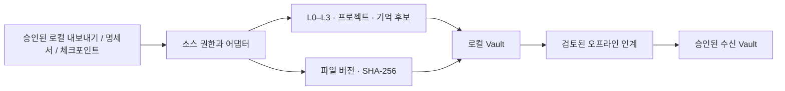

# AI Memory Hub — 사용자가 소유하는 AI 기억 허브
**Languages:** [English](../../README.md) · [简体中文](README.zh-CN.md) · [日本語](README.ja.md) · [한국어](README.ko.md) · [Español](README.es.md) · [Français](README.fr.md) · [Deutsch](README.de.md) · [Português (Brasil)](README.pt-BR.md) · [Русский](README.ru.md)
> **대화 맥락도, 파일도, 통제권도 사용자에게.** 로컬 우선·플랫폼 중립 방식으로 장기 기억, 프로젝트 이어 하기, AI 에이전트 간 승인된 인계를 지원하는 기반입니다.
**버전 2.3.0 · Python 3.11 이상 · MIT 라이선스 · CLI**
대화 기록만으로는 장기 프로젝트를 안정적으로 이어가기 어렵습니다. 중요한 결정은 긴 대화 속에 묻히고 첨부 파일이나 AI 결과물은 생성 당시의 맥락에서 분리됩니다. 다른 AI로 옮기면 설명부터 다시 해야 하죠. **AI Memory Hub**는 명시적으로 허용한 대화 맥락, 증거, 프로젝트 상태, 실제 파일 바이트를 특정 AI 서비스와 독립된 로컬 Vault에 저장합니다.
## 어떤 문제를 해결하나요?
- **반복 설명 최소화:** 목표, 제약, 결정, 검증 결과, 미해결 문제, 다음 작업을 이어받습니다.
- **출처와 이력:** 기록에 출처, 버전, 증거 및 파일 SHA-256을 연결합니다.
- **실제 파일 보관:** 승인된 사용자 업로드와 AI 생성물을 링크가 아닌 실제 데이터로 버전 관리합니다.
- **에이전트 간 이동:** 필요한 프로젝트 맥락과 특정 파일 버전만 명시적으로 전달합니다.
- **승인 범위 통제:** 입력 소스와 민감도를 고르고 L3 원문은 별도로 허가합니다.
## V2.3의 주요 기능
| 기능 | 제공 사항 |
| --- | --- |
| 장기 기억 후보 | 사실·선호·결정의 후보와 검토 절차, 대화 원문 자동 확정 방지 |
| 4단계 대화 맥락 | L0 색인, L1 요약, L2 상세 체크포인트, 선택적 L3 출처가 있는 실제 표시 메시지 |
| 프로젝트 연속성 | 프로젝트 상태, 과거 결정, 검증과 다음 작업의 버전 및 인계 |
| 파일 아카이브 | 실제 업로드/생성 파일, SHA-256 중복 제거, 버전 이력, 검증된 복구 |
| 입력 어댑터 | 로컬 JSON/manifest, 명시적 코딩 에이전트 작업 영역, 다운로드한 ChatGPT JSON/지원 ZIP |
| AI 간 인계 | 오프라인 패키지, 송·수신자 동의, 지정 `ID@REV` 파일과 수신 Vault 바이트 검증 |
| 동기화 제어 | 주간·전체·이벤트·일일·인계의 독립적인 5개 스위치 |
| 복구 | 중복 없는 재시도, 백업·복구, 이전 버전 확인과 롤백 테스트 |
**주의:** 이 기능들은 Windows/Ubuntu에서 합성 데이터로 검증되었습니다. 모든 AI의 대화를 자동으로 수집하거나, 스케줄러와 클라우드 실시간 동기화를 자동으로 설치하는 제품은 아닙니다.
## V2.3: 재사용 가능한 완전한 개인 기억 작업 공간
V2.3은 Python 엔진만 제공하는 라이브러리가 아닙니다. **검증된 로컬 엔진과 사용자가 직접 초기화하는 기억 작업 공간**을 함께 제공합니다. `AGENTS.md`, `core/`, `memory/`, `candidates/`, `projects/`, `sessions/`, `assets/`, `life-archive/`, `integrations/`, `workflows/` 등을 포함한 19개 구성 모듈에 대응하며, 개인의 실제 기록은 들어 있지 않습니다.
인생 기록은 **12개 분류, 52개 하위 영역, 134개 등록 필드**를 갖추고 출처, 유효 기간, 민감도를 검사합니다. 처음에는 전부 `unknown`입니다. 장기 기억 후보는 검증, 중복·충돌 검토, 근거 기반 승인, **별도 활성화**, 철회 및 버전 이력 관리 과정을 거칩니다.
### 개인 작업 공간 초기화
Python 3.11 이상 환경에서 V2.3 소스 디렉터리에서 실행하세요. Git 밖에 **서로 독립된 작업 공간과 Vault**를 만들고 합성 예제만 복사합니다. 예제 복사만으로는 소스 읽기 권한이 생기지 않으며 별도의 `source grant`가 필요합니다.
```sh
python -m pip install .
ai-memory-hub workspace init --path ../workspace-demo-v23 --demo
ai-memory-hub workspace check --path ../workspace-demo-v23
ai-memory-hub --root ../workspace-demo-v23-vault source grant sample normalized --path ../workspace-demo-v23/demo-inbox --consent
ai-memory-hub --root ../workspace-demo-v23-vault local run --source sample
ai-memory-hub --root ../workspace-demo-v23-vault memory review
ai-memory-hub --root ../workspace-demo-v23-vault project list
ai-memory-hub --root ../workspace-demo-v23-vault local status
```
후보는 자동으로 승인된 사실이 되지 않습니다. [작업 공간 안내](../workspace.md), [19개 모듈 대응표](../workspace-parity.md), [Agent 진입점](../../AGENTS.md), [인생 기록 필드](../../life-archive/field-registry.json)를 참고하세요.
### Agent 간 버전 확인과 기억 관리
명시적으로 승인한 기억만 로컬 스냅샷으로 전달합니다. 수신측의 `version check`는 변경을 감지하고, `version reload`는 변경 범위와 일회용 확인표를 반환하며, `version confirm` 이후에만 `synced_sha`가 갱신됩니다. **`detected_sha`는 동기화 완료를 뜻하지 않습니다.** 읽을 수 없으면 `unknown`을 표시합니다. 확인표는 Agent의 이해를 증명하지 않으며 전체 AI 서비스 자동 연결을 의미하지 않습니다. [접속 및 버전 안내](../../integrations/memory-bootstrap.md)를 참고하세요.
`candidate suggest`, `candidate advance`, `candidate history`로 후보를 검토하고 명시적 승인 후 활성화합니다. [기억 수명 주기](../../workflows/memory-lifecycle.md)를 참고하세요. 건강 확장은 **비식별 집계 검증만** 지원하며 원시 건강 데이터 동기화는 지원하지 않습니다. 제품은 **2.3.0**, 기존 Vault 기록 스키마는 **2.1**, 새 작업 공간 형식은 **1.0**입니다.

## 구조

**Vault**는 Git 저장소 밖에 둔 사용자 소유의 로컬 디렉터리입니다. SQLite 색인과 SHA-256 기반 파일 저장소를 사용하며, 인스턴스마다 하나의 민감도 등급을 갖습니다. 접근 통제는 운영체제 권한으로 처리하므로 서로 다른 접근 주체에는 별도의 계정이나 저장 경계가 필요합니다.
L0는 대화 목록, L1은 개요, L2는 목표·결정·검증·후속 작업, L3는 **추가 동의를 받은 실제 표시 메시지**입니다. L2가 나중에 갱신되어도 원래 L3 원문 및 출처를 덮어쓰지 않습니다.
## 실제 사용 사례
**AI를 바꿔 프로젝트 이어 하기:** 요구 사항, 거절한 대안, 테스트, 미완료 작업을 L2에 남긴 뒤 검토된 인계 패키지를 전달합니다. 파일은 선택한 버전만 전달할 수 있습니다.
**AI 결과물과 입력 파일 관리:** 승인된 원본은 `user_upload`, 생성된 결과물은 `ai_generated`로 저장합니다. 출처 파일이 사라져도 이미 보관한 버전을 검증하고 복구할 수 있습니다.
**ChatGPT 기록 가져오기:** 공식 절차로 본인의 내보내기를 다운로드하고 로컬 JSON/ZIP에 권한을 부여합니다. 원문 저장은 별도 권한이 필요하며 첨부 파일도 따로 등록합니다.
## 5분 만에 체험하기
Python 3.11 이상이 필요합니다. 저장소를 체크아웃하고 필요하면 `python -m pip install .`을 실행하세요. Windows에서는 PowerShell, Linux/macOS에서는 터미널을 사용합니다. Vault는 반드시 **Git 작업 디렉터리 밖**에 만드세요.
```sh
python -m ai_memory_hub --root ../hub-demo init --preset ordinary
python -m ai_memory_hub --root ../hub-demo source grant demo normalized --path examples --consent
python -m ai_memory_hub --root ../hub-demo local run --source demo
python -m ai_memory_hub --root ../hub-demo local status
python -m ai_memory_hub --root ../hub-demo session show calibration-session --layer L2
python -m ai_memory_hub --root ../hub-demo asset check calibration-notes
python -m ai_memory_hub --root ../hub-demo asset copy calibration-notes --consent
```
`examples/memory-hub.json`에는 파일을 포함한 4개의 합성 항목이 있습니다. 다시 실행하면 변경되지 않은 항목을 중복 저장하지 않습니다. `asset copy`는 Vault 안에 해시가 검증된 사본을 생성합니다.
### 승인된 소스 가져오기
먼저 Vault를 초기화하세요. `memory-hub.json`이 있는 디렉터리를 `source grant ID normalized --path PATH --consent`로 등록하고 `local run --source ID`를 실행합니다. `local status`에서 권한, 처리 상태와 오류를 확인하세요. ChatGPT 내보내기는 `chatgpt_export`와 다운로드한 지원 `.json`/`.zip`을 사용합니다. L3를 보관할 때에만 별도의 `--allow-raw` 승인을 추가합니다. 전역 채팅 감시 기능은 없습니다. [어댑터](../adapters.md)와 [배포 안내](../deployment.md)를 참고하세요.
### 다른 Vault로 프로젝트 전달
`handoff`는 기본으로 꺼져 있으므로 양쪽 Vault에서 활성화합니다. 파일을 포함하려면 승인한 정확한 버전을 선택해야 합니다.
```sh
python -m ai_memory_hub --root ../hub-demo config set handoff on
python -m ai_memory_hub --root ../hub-demo transfer pack --project greenhouse-demo --asset calibration-notes@1 --consent
python -m ai_memory_hub --root ../recipient init --preset ordinary
python -m ai_memory_hub --root ../recipient config set handoff on
python -m ai_memory_hub --root ../recipient transfer receive --input APPROVED_COPY.zip --consent
python -m ai_memory_hub --root ../recipient transfer inspect PACKAGE_ID --consent
python -m ai_memory_hub --root ../recipient transfer file PACKAGE_ID calibration-notes@1 --consent
```
`APPROVED_COPY.zip`은 송신자가 만든 패키지를 별도로 승인한 안전한 채널로 복사한 파일입니다. `PACKAGE_ID`는 수신 명령이 반환하는 식별자입니다. **ZIP은 암호화되지 않습니다.** SHA-256은 무결성만 확인하며 발신자의 신원을 인증하지 않습니다. L3와 선택하지 않은 파일은 기본적으로 전송되지 않습니다.
## 독립적인 5가지 스위치
| 스위치 | 기본값 | 의미 |
| --- | --- | --- |
| `weekly` | 켜짐 | 주간 작업 진입점, 스케줄러 자체는 설치하지 않음 |
| `full` | 켜짐 | 요청 시 전체/선택 소스 가져오기 |
| `event` | 꺼짐 | 명시적인 이벤트 호출 |
| `daily` | 꺼짐 | 선택적인 일일 보충 |
| `handoff` | 꺼짐 | 명시적인 프로젝트 인계 |
`config set FEATURE on|off`로 설정합니다. `local run --source ID`는 `full`을 사용합니다. 로컬 주간 아카이브와 클라우드 장기 기억 관리 실행기는 별개이며, 스위치 활성화가 실제 스케줄 실행을 의미하지 않습니다.
## 보안, 한계와 버전
Vault에는 애플리케이션 자체 암호화가 없으며 OS 권한과 디스크 암호화 및 백업을 별도로 관리해야 합니다. 소스 권한 취소는 미래의 읽기를 중지하지만 기존 기록을 자동 삭제하지는 않습니다. 오프라인 ZIP도 암호화되지 않으므로 승인된 수신자와 안전한 전달 채널이 필요합니다. 외부 링크는 참조일 뿐, 실제 바이트 저장을 뜻하지 않습니다.
프로그램 버전 2.3.0은 기존 기록 스키마 `2.1`과 호환되며 오프라인 전송에 별도의 2.2 형식을 사용합니다. 업그레이드 전에는 백업하고 복원한 사본에서 테스트하세요.
## 문서와 기여
[배포·복구·전송](../deployment.md) · [사용자 안내](../guide.md) · [소스 어댑터](../adapters.md) · [프로토콜](../protocol.md) · [보안](../../SECURITY.md) · [MIT 라이선스](../../LICENSE)
개발과 버그 제보에는 합성 자료만 사용하고 개인 내보내기나 파일을 커밋하지 마세요. 테스트 명령: `python -m pip install jsonschema`, `python -m unittest discover -s tests -v`, `python scripts/smoke_release.py`, `python scripts/smoke_v22.py`.
**배포 상태:** 핵심 코드는 합성 데이터로 검증되었지만 저장소의 공개 전환과 공식 2.3.0 GitHub Release는 별도 단계입니다.
