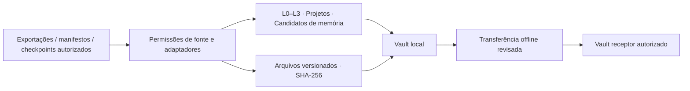

# AI Memory Hub — Memória de IA sob seu controle
**Languages:** [English](../../README.md) · [简体中文](README.zh-CN.md) · [日本語](README.ja.md) · [한국어](README.ko.md) · [Español](README.es.md) · [Français](README.fr.md) · [Deutsch](README.de.md) · [Português (Brasil)](README.pt-BR.md) · [Русский](README.ru.md)
> **Seu contexto. Seus arquivos. Seu controle.** Uma base local e independente de plataformas para memória de longo prazo, continuidade de projetos e transferência autorizada entre agentes de IA.
**Versão 2.3.0 · Python 3.11+ · Licença MIT · Interface de linha de comando (CLI)**
Um histórico de conversa não é necessariamente uma memória confiável. Decisões importantes se perdem em diálogos longos; anexos e arquivos gerados deixam de estar ligados ao contexto; mudar de assistente pode exigir repetir tudo. O **AI Memory Hub** mantém contexto autorizado, evidências, estado dos projetos e **bytes reais de arquivos** em um Vault local, sem depender da memória interna de um único serviço de IA.
## Por que usar?
- **Continuidade:** Preserve objetivos, restrições, decisões, resultados de testes, dúvidas e próximos passos.
- **Rastreabilidade:** Vincule fontes, revisões, evidências e hashes SHA-256 às informações.
- **Arquivos reais:** Guarde versões de arquivos enviados pelo usuário e resultados gerados por IA, não só links que podem expirar.
- **Portabilidade entre agentes:** Compartilhe contexto revisado e apenas as versões de arquivos escolhidas e autorizadas.
- **Privacidade definida pelo usuário:** Selecione fontes e níveis de sensibilidade; mensagens originais L3 precisam de consentimento adicional.
## O que a versão 2.3 implementa
| Recurso | Comportamento |
| --- | --- |
| Memória de longo prazo | Candidatos de fatos, preferências e decisões, com revisão; textos de chat não viram automaticamente fatos aceitos |
| Quatro camadas de conversa | L0 índice, L1 resumo, L2 checkpoint detalhado, L3 opcional com mensagens visíveis e origem verificável |
| Projetos | Histórico de estado, decisões, evidências, marcos e próximas tarefas para facilitar a continuidade |
| Arquivos | Bytes autorizados, deduplicação por SHA-256, versões imutáveis e recuperação com conferência |
| Importação | JSON local, manifestos explícitos de agentes de programação e exportações ChatGPT JSON/ZIP baixadas pelo usuário |
| Transferência entre agentes | Pacotes offline, concordância das duas pontas, versões `ID@REV` e validação no Vault receptor |
| Sincronização | Cinco opções independentes: semanal, completa, eventos, diária e transferência |
| Recuperação | Novas tentativas idempotentes, preservação de histórico, backup, restauração e teste de rollback |
**Limite importante:** o código foi validado com dados sintéticos no Windows e no Ubuntu. Ele **não** monitora automaticamente todos os chats, não instala agendamentos por conta própria e não oferece sincronização em nuvem em tempo real pronta para uso.
## V2.3: espaço pessoal completo e reutilizável
A V2.3 reúne o **mecanismo local testado** e um **espaço de memória inicializado por cada usuário**, não apenas uma biblioteca Python. Os modelos neutros correspondem aos 19 módulos de organização, entre eles `AGENTS.md`, `core/`, `memory/`, `candidates/`, `projects/`, `sessions/`, `assets/`, `life-archive/`, `integrations/` e `workflows/`, sem registros pessoais reais.
O arquivo de vida contém **12 categorias, 52 subáreas e 134 campos registrados**, com validação de fonte, validade temporal e sensibilidade. Tudo começa como `unknown`. Candidatos de memória passam por validação, sugestões de duplicidade e conflito, aprovação fundamentada e **ativação separada**, com histórico e revogação.
### Inicialize seu espaço pessoal
Com Python 3.11+, execute no diretório fonte V2.3. Serão criadas **duas pastas separadas** fora do Git: espaço pessoal e Vault. Copiar dados sintéticos não libera o acesso à fonte; o comando `source grant` o autoriza de modo explícito.
```sh
python -m pip install .
ai-memory-hub workspace init --path ../workspace-demo-v23 --demo
ai-memory-hub workspace check --path ../workspace-demo-v23
ai-memory-hub --root ../workspace-demo-v23-vault source grant sample normalized --path ../workspace-demo-v23/demo-inbox --consent
ai-memory-hub --root ../workspace-demo-v23-vault local run --source sample
ai-memory-hub --root ../workspace-demo-v23-vault memory review
ai-memory-hub --root ../workspace-demo-v23-vault project list
ai-memory-hub --root ../workspace-demo-v23-vault local status
```
Candidatos não viram fatos aceitos automaticamente. Consulte [inicialização](../workspace.md), [cobertura dos 19 módulos](../workspace-parity.md), [entrada dos agentes](../../AGENTS.md) e [registro de campos](../../life-archive/field-registry.json).
### Versões compartilhadas e gestão de candidatos
Memórias escolhidas e aprovadas podem ser exportadas em snapshot local. No Vault receptor, `version check` detecta mudanças, `version reload` devolve os escopos alterados com recibo único, e `version confirm` atualiza `synced_sha` **somente após confirmação explícita**. `detected_sha` não significa sincronizado; origem indisponível retorna `unknown`. O recibo não comprova que o Agent compreendeu o conteúdo, nem conecta todos os serviços de IA automaticamente. Veja [integração e versão](../../integrations/memory-bootstrap.md).
`candidate suggest`, `candidate advance` e `candidate history` oferecem revisão, decisão e histórico com autorização. Veja [ciclo da memória](../../workflows/memory-lifecycle.md). O módulo de saúde **apenas valida agregados desidentificados**, não sincroniza dados brutos. Software **2.3.0**, esquema Vault **2.1**, formato de espaço pessoal **1.0**.

## Como funciona

O **Vault** é uma pasta local controlada pelo proprietário e armazenada **fora do repositório Git**. Usa um índice SQLite e blocos de arquivos endereçados por conteúdo. Cada instância possui uma classe de sensibilidade; permissões do sistema operacional protegem o acesso. Pessoas ou públicos diferentes precisam de identidades ou limites de armazenamento separados.
L0 identifica a conversa, L1 resume, L2 registra objetivos, decisões, testes e próximas ações; L3 guarda mensagens visíveis originais **somente mediante autorização adicional**, com sua fonte e revisão. Atualizações em L2 não alteram nem inventam o histórico L3.
## Exemplos de uso
**Continuar um projeto em outra IA:** registre requisitos, alternativas descartadas, resultados validados e tarefas pendentes; depois entregue um pacote de contexto revisado, com arquivos de versões específicas quando necessário.
**Arquivar entregas de IA:** marque entradas como `user_upload` e resultados como `ai_generated`. Mesmo se o original sumir, a versão preservada pode ser conferida e recuperada.
**Importar seu histórico ChatGPT:** solicite e baixe a exportação pelo procedimento oficial, autorize o caminho local JSON/ZIP e execute a importação. Texto original L3 e anexos exigem permissões separadas.
## Comece em cinco minutos com dados sintéticos
Você precisa do **Python 3.11 ou mais recente** e de armazenamento local confiável. Após clonar o repositório, opcionalmente instale o pacote com `python -m pip install .`. Use PowerShell no Windows ou terminal no Linux/macOS. O Vault deve ficar **fora da pasta Git**.
```sh
python -m ai_memory_hub --root ../hub-demo init --preset ordinary
python -m ai_memory_hub --root ../hub-demo source grant demo normalized --path examples --consent
python -m ai_memory_hub --root ../hub-demo local run --source demo
python -m ai_memory_hub --root ../hub-demo local status
python -m ai_memory_hub --root ../hub-demo session show calibration-session --layer L2
python -m ai_memory_hub --root ../hub-demo asset check calibration-notes
python -m ai_memory_hub --root ../hub-demo asset copy calibration-notes --consent
```
O exemplo `examples/memory-hub.json` seleciona quatro itens fictícios, incluindo um arquivo real. Repetir a importação marca dados inalterados, sem duplicá-los. `asset copy` cria uma cópia local verificada dentro do Vault.
### Importar fontes autorizadas
Inicialize um Vault e autorize uma pasta com `memory-hub.json` usando `source grant ID normalized --path PATH --consent`. Depois execute `local run --source ID` e consulte `local status`. Para ChatGPT, escolha `chatgpt_export` e um `.json` ou `.zip` compatível já baixado. Adicione `--allow-raw` somente com autorização expressa para preservar L3. Não existe um monitor global automático de conversas. Veja [adaptadores](../adapters.md) e [implantação](../deployment.md).
### Entregar um projeto a outro Vault
A opção `handoff` vem desativada. Ative-a no remetente e no destinatário; selecione cada versão de arquivo que deseja incluir.
```sh
python -m ai_memory_hub --root ../hub-demo config set handoff on
python -m ai_memory_hub --root ../hub-demo transfer pack --project greenhouse-demo --asset calibration-notes@1 --consent
python -m ai_memory_hub --root ../recipient init --preset ordinary
python -m ai_memory_hub --root ../recipient config set handoff on
python -m ai_memory_hub --root ../recipient transfer receive --input APPROVED_COPY.zip --consent
python -m ai_memory_hub --root ../recipient transfer inspect PACKAGE_ID --consent
python -m ai_memory_hub --root ../recipient transfer file PACKAGE_ID calibration-notes@1 --consent
```
`APPROVED_COPY.zip` representa o pacote previamente revisado, copiado por um canal confiável autorizado. `PACKAGE_ID` é o identificador retornado pelo recebimento. **O ZIP não é criptografado.** SHA-256 confere integridade, **não autentica quem enviou**. L3 e arquivos não selecionados não entram no pacote.
## Cinco opções independentes
| Opção | Padrão | Finalidade |
| --- | --- | --- |
| `weekly` | Ligada | Entrada semanal; não instala agendador |
| `full` | Ligada | Importação completa ou por fonte, sob demanda |
| `event` | Desligada | Evento explícito e autorizado |
| `daily` | Desligada | Complementação diária opcional |
| `handoff` | Desligada | Transferência explícita de projeto |
Altere com `config set FEATURE on|off`. `local run --source ID` usa `full` por padrão. A rotina local de arquivo semanal não é o mesmo executor da gestão de memórias na nuvem. Uma opção ligada não prova que o agendamento foi instalado ou executado.
## Privacidade, limites e compatibilidade
O aplicativo não criptografa o Vault internamente: configure permissões do sistema, criptografia de disco e backups. Revogar uma fonte interrompe leituras futuras, mas não elimina automaticamente revisões já armazenadas. Pacotes ZIP offline não são criptografados: escolha um destinatário e um canal aprovados. Um URL externo é apenas uma referência até os bytes estarem efetivamente armazenados.
O software é V2.3.0 e mantém compatibilidade com o esquema de registros `2.1`; o envelope de transferência offline é 2.2. Faça backup e teste atualizações em uma cópia restaurada antes da mudança definitiva.
## Documentação e contribuições
[Implantação, recuperação e transferência](../deployment.md) · [Guia completo](../guide.md) · [Adaptadores](../adapters.md) · [Protocolo](../protocol.md) · [Segurança](../../SECURITY.md) · [Licença MIT](../../LICENSE)
Use somente dados sintéticos em contribuições, nunca exportações privadas. Testes: `python -m pip install jsonschema`, `python -m unittest discover -s tests -v`, `python scripts/smoke_release.py` e `python scripts/smoke_v22.py`.
**Situação do lançamento:** o núcleo V2.3 já foi implementado e validado sinteticamente. Tornar o repositório público e criar uma Release oficial 2.3.0 são etapas separadas.
