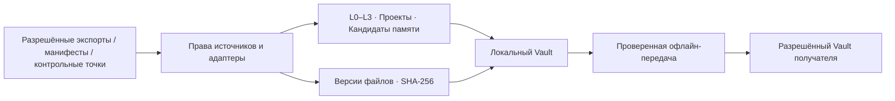

# AI Memory Hub — память ИИ под вашим контролем

**Languages:** [简体中文](../../README.md) · [English](README.en.md) · [日本語](README.ja.md) · [한국어](README.ko.md) · [Español](README.es.md) · [Français](README.fr.md) · [Deutsch](README.de.md) · [Português (Brasil)](README.pt-BR.md) · [Русский](README.ru.md)

---

> **Ваш контекст. Ваши файлы. Ваши правила.** Локальная и независимая от платформ основа для долговременной памяти, непрерывной работы над проектами и согласованной передачи материалов между ИИ-агентами.

**Версия 2.3.0 · Python 3.11+ · Лицензия MIT · Интерфейс командной строки (CLI)**

История переписки сама по себе не является надёжной долговременной памятью. Важные решения теряются в длинных диалогах, вложения отрываются от контекста, а при переходе к другому ассистенту приходится всё объяснять заново. **AI Memory Hub** сохраняет разрешённый контекст, подтверждения, состояние проектов и **настоящие байты файлов** в локальном Vault, независимом от поставщика ИИ.

## Зачем нужен проект

- **Продолжение работы:** сохраняйте цели, ограничения, решения, проверенные результаты, открытые вопросы и следующие шаги.
- **Проверяемость:** связывайте информацию с источником, ревизиями, доказательствами и SHA-256 файлов.
- **Настоящий архив:** храните версии пользовательских вложений и файлов, созданных ИИ, а не только ссылки.
- **Перенос между агентами:** передавайте проверенный контекст и только одобренные версии файлов.
- **Контроль пользователя:** выбирайте источники и уровни конфиденциальности; дословные сообщения L3 требуют отдельного разрешения.

## Возможности версии 2.3

| Возможность | Реализованное поведение |
| --- | --- |
| Кандидаты в долговременную память | Факты, предпочтения и решения проходят проверку; текст чата не становится подтверждённой памятью автоматически |
| Четыре слоя диалога | L0 индекс, L1 краткое содержание, L2 подробная контрольная точка, необязательный L3 с исходными видимыми сообщениями |
| Непрерывность проектов | Версии состояния, решения, доказательства, история и оставшиеся действия |
| Архив файлов | Сохранение разрешённых байтов, дедупликация SHA-256, неизменяемые версии и проверенное извлечение |
| Импорт | Локальные JSON/манифесты, явно выбранная рабочая папка агента, скачанные ChatGPT JSON или поддерживаемые ZIP |
| Передача между агентами | Офлайн-пакет, согласие обеих сторон, точные версии `ID@REV` и проверка файлов в принимающем Vault |
| Синхронизация | Пять независимых переключателей: еженедельно, полностью, по событию, ежедневно и передача |
| Восстановление | Повтор без дублирования, сохранение истории, резервное копирование, восстановление и проверка отката |

**Важно:** возможности проверены на синтетических данных в Windows и Ubuntu. Программа **не** отслеживает автоматически все чаты ИИ, не создаёт системное расписание и не предоставляет готовую облачную синхронизацию в реальном времени.

## V2.3: полноценное повторно используемое рабочее пространство памяти

V2.3 объединяет **проверенное локальное ядро** и **личное рабочее пространство, создаваемое владельцем**, а не только библиотеку Python. Нейтральные шаблоны охватывают все 19 организационных модулей, включая `AGENTS.md`, `core/`, `memory/`, `candidates/`, `projects/`, `sessions/`, `assets/`, `life-archive/`, `integrations/` и `workflows/`. Чужих личных данных в них нет.
Архив жизни включает **12 категорий, 52 подкатегории и 134 зарегистрированных поля** с проверкой источника, срока действия и конфиденциальности. Изначально все поля имеют состояние `unknown`. Кандидаты в память проходят валидацию, поиск дублей и противоречий, обоснованное одобрение и **отдельную активацию**; поддерживаются отзыв и история версий.

### Создайте личное пространство

С Python 3.11+ выполните команды в каталоге исходников V2.3. Программа создаёт **два независимых каталога** вне Git: рабочее пространство и Vault. Копирование синтетического примера не предоставляет доступа к источнику — требуется явный `source grant`.

```sh
python -m pip install .
ai-memory-hub workspace init --path ../workspace-demo-v23 --demo
ai-memory-hub workspace check --path ../workspace-demo-v23
ai-memory-hub --root ../workspace-demo-v23-vault source grant sample normalized --path ../workspace-demo-v23/demo-inbox --consent
ai-memory-hub --root ../workspace-demo-v23-vault local run --source sample
ai-memory-hub --root ../workspace-demo-v23-vault memory review
ai-memory-hub --root ../workspace-demo-v23-vault project list
ai-memory-hub --root ../workspace-demo-v23-vault local status
```

Кандидаты не становятся подтверждёнными фактами автоматически. См. [установку](../workspace.md), [соответствие 19 модулей](../workspace-parity.md), [вход для Agent](../../AGENTS.md) и [реестр полей](../../life-archive/field-registry.json).

### Версии памяти между Agent и управление кандидатами

Разрешённые и выбранные воспоминания можно передать локальным снимком. На принимающей стороне `version check` обнаруживает изменения, `version reload` возвращает изменённые области и одноразовую квитанцию, а `version confirm` обновляет `synced_sha` **только после явного подтверждения**. `detected_sha` не равно синхронизированной версии; недоступный источник получает `unknown`. Квитанция не подтверждает понимание Agent и не создаёт подключение ко всем платформам ИИ. См. [подключение и проверку версий](../../integrations/memory-bootstrap.md).
Команды `candidate suggest`, `candidate advance` и `candidate history` обеспечивают проверку, решение и историю с разрешением пользователя. См. [жизненный цикл памяти](../../workflows/memory-lifecycle.md). Дополнение для здоровья **проверяет только обезличенные агрегаты**, не синхронизирует исходные записи. Программа **2.3.0**, существующая схема Vault **2.1**, формат нового рабочего пространства **1.0**.

### L0–L3: читать разговор на нужной глубине

| Уровень | Содержимое | Для чего использовать |
| --- | --- | --- |
| **L0 · Индекс** | Название, идентификатор, связанный проект и ревизия | Найти нужную беседу |
| **L1 · Сводка** | Индекс и предоставленное краткое содержание | Понять, стоит ли читать подробнее |
| **L2 · Контрольная точка** | Цели, ограничения, решения, отклонённые варианты и причины, проверки, дальнейшие действия и файлы | Возобновить проект без перечитывания всей переписки |
| **L3 · Необязательный оригинал** | Реально сохранённые видимые сообщения, их источники и версии | Уточнить дословный текст с отдельным разрешением |

Это **последовательные уровни детализации**, а не четыре автоматически созданных пересказа. Отсутствующие L1/L2/L3 не выдумываются. Для L3 нужен Vault `private` либо `restricted` и отдельное согласие. Обновление L2 не переписывает старые сообщения L3.

**Важные детали:** утверждение кандидата не означает его активацию как факта. Внешняя ссылка не равна сохранённым байтам. Каждый агент ведёт `detected_sha` отдельно от `synced_sha`; повторный импорт проверяет записи по отдельности, чтобы не создавать лишних копий.

## Архитектура



**Vault** — локальная папка под контролем владельца, расположенная **вне Git-репозитория**. Используются индекс SQLite и файлы с адресацией по хешу содержимого. Каждый Vault соответствует одному уровню конфиденциальности. Доступ защищён правами ОС; для разных получателей требуются отдельные учётные записи или изолированное хранилище.

L0 отвечает на вопрос «какой диалог?», L1 содержит краткое содержание, L2 — цели, решения, проверки и дальнейшие действия. L3 хранит реальные видимые сообщения **только с дополнительным согласием**, сохраняя источник и ревизию. Позднейшее изменение L2 не переписывает и не выдумывает сообщения L3.

## Примеры применения

**Передать проект другому ИИ:** зафиксировать требования, отвергнутые подходы, результаты проверок и незавершённые задачи; отправить проверенный пакет контекста с точно выбранными версиями файлов.

**Сохранить результаты работы ИИ:** входные вложения обозначить как `user_upload`, созданные документы — как `ai_generated`. Даже после исчезновения оригинала сохранённую версию можно проверить и извлечь.

**Импортировать переписки ChatGPT:** самостоятельно скачать экспорт через официальный механизм, разрешить локальный JSON/ZIP и выполнить импорт. Для L3 и вложений нужны отдельные разрешения.

## Быстрый старт на тестовых данных

Требуется **Python 3.11 или новее** и доверенная локальная файловая система. После клонирования репозитория при необходимости установите пакет командой `python -m pip install .`. В Windows используйте PowerShell, в Linux/macOS — терминал. Vault должен находиться **вне рабочего каталога Git**.

```sh
python -m ai_memory_hub --root ../hub-demo init --preset ordinary
python -m ai_memory_hub --root ../hub-demo source grant demo normalized --path examples --consent
python -m ai_memory_hub --root ../hub-demo local run --source demo
python -m ai_memory_hub --root ../hub-demo local status
python -m ai_memory_hub --root ../hub-demo session show calibration-session --layer L2
python -m ai_memory_hub --root ../hub-demo asset check calibration-notes
python -m ai_memory_hub --root ../hub-demo asset copy calibration-notes --consent
```

Манифест `examples/memory-hub.json` выбирает четыре тестовые записи, включая файл. Повторный импорт помечает неизменённые данные и не создаёт дублей. `asset copy` создаёт проверенную локальную копию внутри Vault.

### Импорт разрешённого источника

Сначала создайте Vault. Укажите каталог с `memory-hub.json` через `source grant ID normalized --path PATH --consent`, затем выполните `local run --source ID` и `local status`. Для ChatGPT нужен адаптер `chatgpt_export` с предварительно скачанным совместимым `.json` или `.zip`. Дополнительный `--allow-raw` разрешайте только для явно одобренного хранения L3. Фоновое наблюдение за всеми чатами отсутствует. Подробнее: [адаптеры](../adapters.md) и [развёртывание](../deployment.md).

### Передача проекта в отдельный Vault

Переключатель `handoff` по умолчанию выключен. Включите его у отправителя и получателя, выберите разрешённые версии файлов.

```sh
python -m ai_memory_hub --root ../hub-demo config set handoff on
python -m ai_memory_hub --root ../hub-demo transfer pack --project greenhouse-demo --asset calibration-notes@1 --consent
python -m ai_memory_hub --root ../recipient init --preset ordinary
python -m ai_memory_hub --root ../recipient config set handoff on
python -m ai_memory_hub --root ../recipient transfer receive --input APPROVED_COPY.zip --consent
python -m ai_memory_hub --root ../recipient transfer inspect PACKAGE_ID --consent
python -m ai_memory_hub --root ../recipient transfer file PACKAGE_ID calibration-notes@1 --consent
```

`APPROVED_COPY.zip` — проверенный архив отправителя, скопированный по отдельно согласованному безопасному каналу. `PACKAGE_ID` возвращает команда приёма. **ZIP не шифруется.** SHA-256 подтверждает целостность, **но не личность отправителя**. Сообщения L3 и невыбранные файлы не передаются.

## Пять независимых переключателей

| Переключатель | По умолчанию | Назначение |
| --- | --- | --- |
| `weekly` | Включён | Еженедельная точка входа; не устанавливает планировщик |
| `full` | Включён | Полный импорт или импорт выбранного источника по запросу |
| `event` | Выключен | Явный разрешённый вызов события |
| `daily` | Выключен | Дополнительное ежедневное пополнение |
| `handoff` | Выключен | Явная передача проекта |

Управление: `config set FEATURE on|off`. Команда `local run --source ID` по умолчанию использует `full`. Локальное еженедельное архивирование и облачное управление долговременной памятью — разные исполнители. Включённый переключатель не означает, что задача действительно запланирована или выполнена.

## Безопасность, ограничения и совместимость

Приложение не шифрует Vault самостоятельно: нужны права ОС, шифрование диска и резервные копии. Отзыв доступа к источнику прекращает будущие чтения, но не удаляет сохранённые ревизии автоматически. ZIP-пакеты передачи не зашифрованы — нужен утверждённый получатель и защищённый канал. Внешняя ссылка остаётся ссылкой, пока реальные байты не сохранены.
Версия программы — 2.3.0; схема существующих записей остаётся `2.1` для совместимости, а формат передачи имеет номер 2.2. Перед обновлением сохраните резервную копию и проверьте обновление на восстановленном экземпляре.

## Документация и участие

[Развёртывание, резервные копии и передача](../deployment.md) · [Руководство](../guide.md) · [Адаптеры](../adapters.md) · [Протокол](../protocol.md) · [Безопасность](../../SECURITY.md) · [Лицензия MIT](../../LICENSE)
Для разработки используйте только синтетические данные, не загружайте личные экспорты. Проверки: `python -m pip install jsonschema`, `python -m unittest discover -s tests -v`, `python scripts/smoke_release.py` и `python scripts/smoke_v22.py`.

**Статус публикации:** ядро V2.3 реализовано и проверено на тестовых данных. Открытие GitHub-репозитория и официальный Release 2.3.0 — отдельные шаги.
